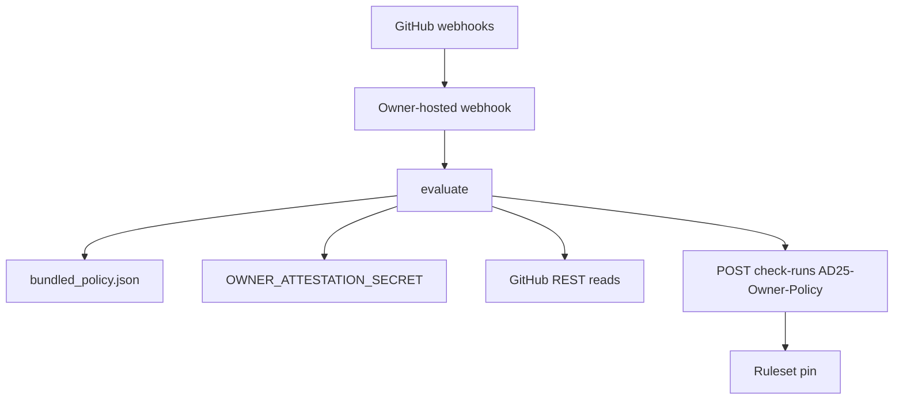

# Independent App architecture and deployable prototype plan

Prototype (reference only): `_bmad-output/implementation-artifacts/cohestra-owner-policy-app/`  
Runtime must be copied to a private repo. This Cohestra tree is not the authorization root.

## Components

| Piece | Location | Privilege |
| --- | --- | --- |
| Webhook + evaluator | Owner host | App private key, webhook secret, HMAC secret |
| Bundled policy | App image | Read-only JSON |
| Cohestra repo | Data | Contents read via IAT |
| Ruleset | GitHub | Owner-applied later |

## Check identity

- Name: `AD25-Owner-Policy`
- Posted only with the Owner-Policy installation token
- `head_sha` = exact PR HEAD
- `status=completed`, `conclusion` ∈ {`success`,`failure`}
- GitHub Apps (not users, not OAuth apps) can create check runs — this is why the sidecar must be an App

`statuses: write` is requested so the ruleset UI/API can pin the App as expected source. The prototype posts **check runs**, not legacy statuses.

## Evaluation inputs (reads only)

The prototype does not call GitHub. `GitHubSnapshot` is the host contract. A hand-built `EvaluationRequest` returns `failure` / `unverified evidence`. Filling the snapshot in a unit test does **not** prove a live ruleset pin or a live check-run.

| Field | How the hosted App obtains it | Fail when |
| --- | --- | --- |
| `head_sha` | `GET /repos/{repo}/pulls/{n}` `head.sha`, equal to the signed webhook | missing, not 40-hex lowercase, or differs from `event_head_sha` |
| `base_ref` | pulls `base.ref` | not `main` or `release/uat` |
| `files` | pulls `files` pages until `Link` rel=next is absent | `files_complete` is false |
| `comments` | issues comments pages, including `created_at` and `updated_at` | `comments_complete` is false; edited or deleted owner attestation |
| `pulls_api_base_sha` | pulls `base.sha` | not 40-hex on dest_sync |
| `compare_merge_base_sha` | `GET /repos/{repo}/compare/{base.sha}...{head.sha}` `merge_base_commit.sha` | not equal to pulls `base.sha`. Do not copy one variable into both fields |
| `source_commit_sha` | `GET /repos/{repo}/commits/main` | missing on dest_sync |
| `source_blobs` / `head_blobs` | `GET /repos/{repo}/git/trees/{sha}?recursive=1` | `truncated=true` or a required path has no blob |
| `app_integration_id` | App config / JWT `iss`, never the PR | 15368, 1210556, or 46505 |
| `ruleset_checks` | `GET /repos/{repo}/rulesets/{id}` | `AD25-Owner-Policy` missing, null, duplicated, or a different integration |
| `active_hmac_secrets` | host env only | empty, or echoed in check text |
| published app id | `GET /repos/{repo}/check-runs/{id}` `app.id` after POST | `github_check_body` refuses success without a matching read-back |

`posting_integration_id`, `expected_integration_id`, `merge_base_sha`, `source_ref`, `dest_ref`, `dest_parent_sha`, and the blob maps are derived inside `seal_request`. Callers do not get to assert them.

Never: Environments, Actions secrets, `git show` piped to `exec`, or treating a valid HMAC as human presence.

## Verdicts

| `base.ref` | Changed paths | Attestation | Tree | Result |
| --- | --- | --- | --- | --- |
| `main` or `release/uat` | ordinary product paths, including `src/` and `web/` | not required | n/a | `feature` success |
| any | `.env`, nested `.env*`, private keys, `*.pem`, `credentials.json`, traversal, ambiguous encoding | n/a | n/a | failure |
| `main` | ⊆ sync ∪ expansion, no product paths | HMAC v2 | not required | `policy_expansion` |
| `release/uat` | ⊆ sync ∪ expansion, no product paths | HMAC v2 | exact blobs and compare merge-base equals pulls base SHA | `dest_sync` |
| any | mixed control-plane and application paths | n/a | n/a | failure |
| any | Production workflow, ADCP, unknown `deploy/` or `.github/` | n/a | n/a | failure |

## Hosting (owner later; not this task)

Minimum: HTTPS endpoint with signed webhooks (`X-Hub-Signature-256`), GitHub App JWT → installation token, 10s fail-closed timeout.

Suggested events: `pull_request` (opened, synchronize, reopened, ready_for_review), `issue_comment`, `check_run` (rerequested), `check_suite` (rerequested).

On any handler exception: post `failure` if `head_sha` is known; if SHA is unknown, still fail closed (no success).

## Permissions recap

contents read · pull_requests read · metadata read · checks write · statuses write · else none.

## Not PR-E

This App cannot merge. A future feature auto-merge App is a different registration, different `integration_id`, different check name, and must refuse control-plane paths.
