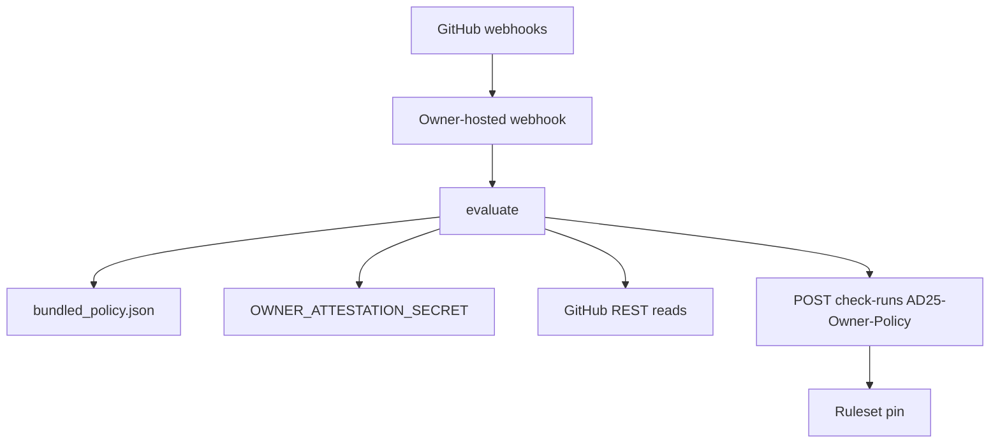

# Independent App architecture and deployable prototype plan

Prototype (reference only): `_bmad-output/implementation-artifacts/cohestra-owner-policy-app/`  
Runtime must be copied to a private repo. This Cohestra tree is not the authorization root.

## Components

| Piece | Location | Privilege |
| --- | --- | --- |
| Webhook + evaluator | Owner host | App private key, webhook secret, HMAC secret |
| Bundled policy | App image | Read-only JSON |
| Cohestra repo | Data | Contents read via IAT |
| Ruleset | GitHub | Owner-applied later |

## Check identity

- Name: `AD25-Owner-Policy`
- Posted only with the Owner-Policy installation token
- `head_sha` = exact PR HEAD
- `status=completed`, `conclusion` ∈ {`success`,`failure`}
- GitHub Apps (not users, not OAuth apps) can create check runs — this is why the sidecar must be an App

`statuses: write` is requested so the ruleset UI/API can pin the App as expected source. The prototype posts **check runs**, not legacy statuses.

## Evaluation inputs (reads only)

From GitHub API, never from executing PR scripts:

- PR number, `head.sha`, `base.ref`
- Changed files list
- Blob SHAs via `GET /repos/{owner}/{repo}/git/trees/{sha}?recursive=1` or `GET .../contents/{path}?ref=`
- Issue comments
- For dest_sync: GitHub compare/commits merge-base of dest_parent vs PR HEAD. The host MUST set `merge_base_sha` from that API result, `source_ref` to the claimed `main` SHA, `dest_ref` to PR HEAD, `source_blobs` from the main tree, `dest_blobs` from the PR tree. The evaluator refuses dest_sync if `merge_base_sha != dest_parent_sha` or `dest_ref != head_sha`.

Never: Environments, Actions secrets, `git show` piped to `exec`.

## Verdicts

| `base.ref` | Changed paths | Attestation | Tree | Result |
| --- | --- | --- | --- | --- |
| `main` or `release/uat` | no `.github/` or `deploy/` (includes `src/`/`web/` product PRs) | not required | n/a | `feature` success |
| `main` | ⊆ sync ∪ expansion | HMAC required | not required | `policy_expansion` |
| `release/uat` | ⊆ sync ∪ expansion | HMAC required | exact blobs + ancestor dest_parent | `dest_sync` |
| any | mixed control-plane + `src/`/`web/`/`secret` | n/a | n/a | failure |
| any | Production workflow, ADCP, unknown `deploy/` | n/a | n/a | failure |

## Hosting (owner later; not this task)

Minimum: HTTPS endpoint with signed webhooks (`X-Hub-Signature-256`), GitHub App JWT → installation token, 10s fail-closed timeout.

Suggested events: `pull_request` (opened, synchronize, reopened, ready_for_review), `issue_comment`, `check_run` (rerequested), `check_suite` (rerequested).

On any handler exception: post `failure` if `head_sha` is known; if SHA is unknown, still fail closed (no success).

## Permissions recap

contents read · pull_requests read · metadata read · checks write · statuses write · else none.

## Not PR-E

This App cannot merge. A future feature auto-merge App is a different registration, different `integration_id`, different check name, and must refuse control-plane paths.
