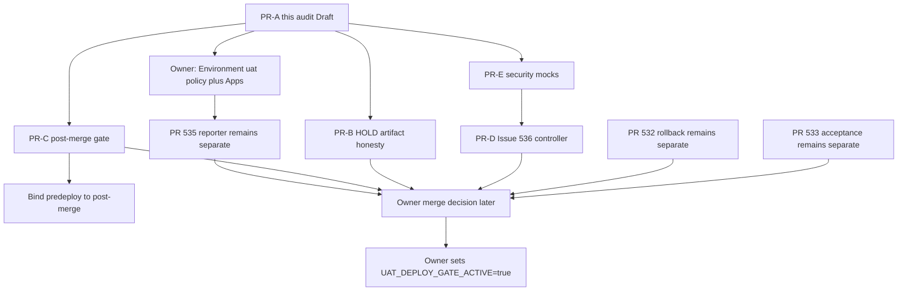

# UAT Automation Readiness Audit

**Date:** 2026-11-01, Asia/Singapore  
**Auditor:** Cursor Cloud Agent (read-only)  
**Repository:** fad16papa/Cohestra  
**Decision:** NOT READY for UAT activation. Architecture Draft only. No privileged operations performed.

## Revalidated references

| Reference | Claimed | Revalidated 2026-11-01 23:30 SGT | Verdict |
| --- | --- | --- | --- |
| `origin/main` | `22ffe6350f5198a1b5f67536e243f8a644df13e6` | Same SHA. Subject `Merge pull request #530`. | MATCH |
| Deploy UAT | run `41321497962`, #451 | `workflow_dispatch` on `main` @ `22ffe635`, conclusion `failure`, 15:29:43Z–15:30:12Z | MATCH |
| PR #535 | Draft, HEAD `73c31457` | OPEN, DRAFT, MERGEABLE, HEAD `73c314571ef8b417cc2c981af0e3d0a7a525872b` | MATCH |
| Issue #536 | Open controller | OPEN, updated 2026-11-01T14:46:29Z | MATCH |
| `UAT_DEPLOY_GATE_ACTIVE` | `false` | Job env in #451: `UAT_DEPLOY_GATE_ACTIVE: false`. Variables API 403. | MATCH in run; live var UNVERIFIED via API |
| Production | NO-GO | `deploy-production.yml` dispatch-only; no Production run started | MATCH |

Companion files:

- `_bmad-output/planning-artifacts/architecture/architecture-uat-automation-readiness-2026-11-01/ARCHITECTURE-SPINE.md`
- `_bmad-output/planning-artifacts/architecture/architecture-uat-automation-readiness-2026-11-01/CAT-SEC-THREAT-MODEL.md`

---

## 1. Current workflow architecture

What is on `main` today:

```
CURSOR DEV BRANCH
  → PR to main
  → CI (dotnet, integration, Next.js+npm test, Exact-SHA scan,
        UAT isolation, Docker smoke; native GitGuardian on PR)
  → owner merge
  → CI push-main (same jobs + GitGuardian exact-SHA API)
  → Deploy UAT workflow_run OR workflow_dispatch
       → predeploy-gate (no Environment, no DROPLET_*)
            HOLD-first if UAT_DEPLOY_GATE_ACTIVE != true
            else tip-pin + Layer A + Exact-SHA + GG API + duplicate-deploy
       → deploy job (environment: uat) ONLY if eligible==true
       → browser / lifecycle / summary
       → delivery-outcome (always)
```

What is **not** on `main`:

- `uat-readiness.yml` (PR #535 only)
- `deploy-uat-rollback.yml` (PR #532 only)
- Issue #536 controller
- Dedicated post-merge workflow distinct from CI
- Dedicated UAT integration branch (proposed, not accepted)

Target model after accepted implementation and owner activation:

```
CURSOR → TDD/PRE-MERGE CI → INDEPENDENT BMAD+CAT-SEC
  → MACHINE READINESS (#535)
  → OWNER MERGE (not auto-merge)
  → FRESH POST-MERGE TESTS (new gate)
  → DEPLOYMENT SECURITY GATE + suppressor
  → AUTOMATIC UAT SSH
  → LIVE ACCEPTANCE
```

**Topology reconciliation:** keep `main` as the only deployable SHA (spine AD-1). A dedicated UAT integration branch would break tip-pin (`candidate_sha == origin/main` tip) and is a separate architecture decision. Do not change branch topology in the correction PRs.

---

## 2. Security and deployment configuration matrix

| Name | Where referenced | Presence | Isolation / restriction | Verdict |
| --- | --- | --- | --- | --- |
| `DROPLET_HOST` | `deploy.yml` `secrets.DROPLET_HOST`; docs say Environment `uat` | UNVERIFIED (secrets API 403) | Env `uat` has no branch policy | UNVERIFIED |
| `DROPLET_USER` | `deploy.yml` | UNVERIFIED | same | UNVERIFIED |
| `DROPLET_SSH_KEY` | `deploy.yml` appleboy `key` | UNVERIFIED | same; never printed | UNVERIFIED |
| `DROPLET_DEPLOY_PATH` | `deploy.yml` | UNVERIFIED | default `/home/deploy/cohestra` in script | UNVERIFIED |
| `GITGUARDIAN_API_KEY` | `ci.yml` push-main only | UNVERIFIED via API. Job `GitGuardian exact-SHA API scan` SUCCESS on `22ffe635` implies a usable key for that run | repo secret per docs | UNVERIFIED value; implied configured |
| `UAT_DEPLOY_GATE_ACTIVE` | `vars.` in `deploy.yml` | `false` in run #451 job env. Variables API 403 | first-merge suppressor | VERIFIED false in #451 |
| Environment `uat` | deploy/browser/lifecycle/evidence jobs | EXISTS id `24393995130`, created 2026-10-15 | `protection_rules=[]`, `deployment_branch_policy=null`, `can_admins_bypass=true` | FAIL restriction |
| Environment `production` | `deploy-production.yml` | EXISTS | `main` branch policy, required reviewer `fad16papa`, `can_admins_bypass=false` | VERIFIED policy |
| `PROD_DROPLET_*` | production workflow only | UNVERIFIED values | name-isolated from UAT | VERIFIED naming |
| Branch protection `main` | protection API | 403 | rulesets `[]` | UNVERIFIED |
| Actions permissions | permissions API | 403 | OIDC `use_default=true` | UNVERIFIED |
| SSH connectivity | none this run | not tested | authorization withheld | UNVERIFIED |
| Deploy user lockdown | docs only | not probed | `deploy` user recommended | UNVERIFIED |
| Droplet `.env` / Docker | docs `digitalocean-uat.md` | not probed | compose `cohestra-uat` | UNVERIFIED live |
| Firewall | docs inbound 22/80/443 | not probed | | UNVERIFIED |

Do not treat Environment existence as proof that secrets exist. Fail-closed UAT secret check runs only after `eligible=true`, so #451 never exercised `MISSING_SECRET`.

---

## 3. Analysis of Deploy UAT #451

**Run:** https://github.com/fad16papa/Cohestra/actions/runs/41321497962  
**When:** 2026-11-01 23:29:43–23:30:12 Asia/Singapore (`15:29:43Z`–`15:30:12Z`)  
**Event:** `workflow_dispatch` on `main` @ `22ffe6350f5198a1b5f67536e243f8a644df13e6`

| Check | Result | Evidence |
| --- | --- | --- |
| `RESULT=HOLD` | YES | predeploy log + `uat-predeploy-gate.json` + `uat-final-outcome.json` |
| `HOLD_REASON=UAT_DEPLOY_GATE_ACTIVE is not true` | YES | gate step stdout and JSON `reason` |
| `UAT_DEPLOYED=false` | YES | delivery-status + final-outcome |
| SSH job skipped | YES | job `Deploy accepted SHA to UAT` conclusion `skipped`; `ssh_executed=false`; `ssh_attempted=false` |
| Browser / lifecycle skipped | YES | both jobs `skipped`; summary job `skipped` |
| Final outcome persisted | YES | artifact `uat-final-outcome` digest `93f1b094…`; `result=HOLD` |
| Host mutation from this workflow | NO | SSH step never started; `deployment_phase=NOT_STARTED` |
| Gate job env | `UAT_DEPLOY_GATE_ACTIVE: false` | setup log |

Jobs:

| Job | Conclusion |
| --- | --- |
| Pre-UAT eligibility gate | failure (HOLD exit 1, fail-closed) |
| Deploy accepted SHA to UAT | skipped |
| UAT browser acceptance | skipped |
| UAT Story 19.5 lifecycle acceptance | skipped |
| UAT acceptance summary | skipped |
| UAT final delivery outcome | success |

### Missing-artifact annotations

`delivery-outcome` always downloads five artifacts with `continue-on-error: true`. Predeploy evidence downloaded (SHA256 `111ae702…` matched upload). These four logged `##[error] Artifact not found`:

- `uat-deploy-evidence`
- `uat-playwright-evidence`
- `uat-19-5-lifecycle-evidence`
- `uat-acceptance-summary`

That is **expected** because SSH never ran. The aggregator still wrote HOLD. The annotation is misleading, not a fail-open.

### Required artifact design (do not weaken fail-closed)

1. Read predeploy evidence first (mandatory; missing predeploy is FAIL).
2. If `eligibility=HOLD` and `ssh_executed=false` and deploy job `skipped`: **do not download** the four post-deploy artifacts. Record `expected_absent=true`.
3. If deploy job ran or `ssh_attempted=true`: those artifacts are **mandatory**. Missing = FAIL. `continue-on-error` must be false.
4. HOLD / FAIL / REFUSE never coerce to READY or `UAT_DEPLOYED=true`.
5. Workflow conclusion may stay `failure` on HOLD. Do not flip HOLD to exit 0 just to paint the Actions UI green.

---

## 4. BMAD architecture review

Spine path: `architecture-uat-automation-readiness-2026-11-01/ARCHITECTURE-SPINE.md`.

**Paradigm:** fail-closed gated pipeline.

Accepted from current main (do not reopen):

- HOLD-first suppressor
- Tip-pin to `origin/main`
- Environment `uat` only after `eligible==true`
- Production owner dispatch and `PROD_*` names
- Reporter ≠ controller (#535 vs #536)
- No ADCP
- No PR #505 modification

Required changes (after this architecture is accepted, in separate Draft PRs):

1. Conditional HOLD artifact handling (`deploy.yml` `delivery-outcome`).
2. Dedicated post-merge validation workflow on the merge SHA; Deploy UAT must require it before SSH.
3. Owner configuration of Environment `uat` (branch policy `main`, `can_admins_bypass=false`).
4. Issue #536 controller Draft PR — not combined with #535.
5. Deterministic security tests for the abuse catalog.
6. Artifact digest/SHA provenance if host rebuild cannot be proven immutable.

**Merge authorization:** keep owner merge. A later ruleset that allows two review Apps to satisfy required reviews is a separate AD (open question Q4). Do not implement auto-merge in #536.

**Dedicated UAT branch:** Deferred. Implementing it now would conflict with Epic 45 tip-pin.

---

## 5. CAT-SEC threat model

See `CAT-SEC-THREAT-MODEL.md`. Highest residuals:

| ID | Finding | Severity |
| --- | --- | --- |
| T1/T8 | Environment `uat` unprotected | MAJOR |
| T3 | Dual-review producer missing; Apps not observed | BLOCKER for READY |
| T5/AD-6 | No dedicated post-merge gate | MAJOR |
| T7 | Unconditional `continue-on-error` downloads | MAJOR after first real deploy |
| T10 | #536 absent; privilege risk if built wide | FAIL today |
| T4 | One-App two-role tests not on main | MAJOR |

---

## 6. Readiness trust-gap assessment

### PR #535 (consumer)

- Draft, unmerged, HEAD `73c31457`.
- Event-driven reporter. `persist-credentials: false`. Notify skipped on `pull_request` / `pull_request_review`.
- Dual-App **consumer** is implemented on that branch: allowlisted slugs, exact SHA, distinct identities, forbidden slugs, comments never authenticate.
- Live evaluations HOLD `REVIEW_EVIDENCE_MISSING` because `cursor[bot]` / author comments are inauthentic. That HOLD is correct.
- Apps `cohestra-bmad` / `cohestra-cat-sec` produced no check-runs on `main` `22ffe635`.
- Do not merge #535 as the correction loop. Do not treat its CI green as #536 done.

### Issue #536 (controller)

| Requirement | Status |
| --- | --- |
| Separate Draft PR | FAIL — none |
| Owner-approved task manifest | FAIL — none |
| Bounded Cursor attempts | FAIL — none |
| Fresh exact-HEAD tests after correction | FAIL — none |
| Re-review after every new commit | FAIL — none |
| Retry / cost limits | FAIL — none |
| Safe state + no duplicate execution | FAIL — none |
| No untrusted privileged credentials | N/A (unimplemented) |
| Fail-closed missing reviewers | Specified, not built |

Do not claim `LIVE_SCOPED_LOOP_VERIFIED` or even `SIMULATED_PASS`.

---

## 7. Mandatory post-merge testing design

**New workflow** (proposed name `Post-merge UAT validation`), trigger `push` to `main` plus `workflow_dispatch` pinned to `github.sha`. Concurrency per SHA. Permissions read-only. No `environment: uat`. No SSH.

Required jobs, all on the **merge SHA** (`git rev-parse HEAD` must equal `github.sha`):

| # | Coverage | Current home | Gap |
| --- | --- | --- | --- |
| 1 | Fresh .NET build + unit | CI `dotnet` | Re-run in the new workflow; do not reuse PR HEAD |
| 2 | API integration | CI `integration` | same |
| 3 | Next.js build + frontend tests | CI `web` (`npm test` + `npm run build`) | Name frontend tests as a required job so skip is visible |
| 4 | Application regression | partial (unit + integration + docker smoke) | Enumerate required filters; skip = HOLD |
| 5 | AuthN / AuthZ | not a named required job | Add explicit test filter or job |
| 6 | Billing / entitlement | not a named required job | Add explicit test filter or job |
| 7 | Docker build + Compose | CI `smoke-docker` + isolation | Keep; require SUCCESS |
| 8 | Exact-SHA scan + GG API | CI jobs | Already required by predeploy when gate is true |
| 9 | UAT / Production isolation | CI `uat-isolation` | Keep |
| 10 | Artifact provenance | SSH script pins SHA; no digest attestation | Add build-id / compose config digest check |

**Binding to Deploy UAT:** extend `uat-predeploy-gate.py` so that when the suppressor is true it requires a completed SUCCESS run of the post-merge workflow on the candidate SHA. Missing/failed/canceled/skipped mandatory jobs HOLD. `workflow_run` of CI alone is not enough once this gate exists.

**Race / bypass / stale release:**

- Keep `concurrency: deploy-uat` / `cancel-in-progress: false`.
- Keep duplicate in-progress or successful deploy HOLD.
- Candidate must remain `origin/main` tip at pre-SSH revalidation.
- No SSH job without `eligible==true`.
- Environment `uat` branch policy = `main` (owner).

---

## 8. Automated deployment and rollback design

| Safeguard | Implemented on main? | Mocked? | Live-tested? |
| --- | --- | --- | --- |
| Suppressor HOLD | YES | YES (unit) | YES (#451) |
| Tip-pin / Layer A | YES (skipped while HOLD-first) | YES | NOT this run (gate false) |
| Fail-closed missing UAT secrets | YES (after eligible) | YES | NOT this run |
| Pre-deploy backup | NO on main | #532 docs/checklist | NO |
| Migration safety | host `remote-deploy.sh` applies EF on deploy; no expand/contract gate | partial | NO this run |
| Image immutability | SHA pin on checkout; rebuild on host | script tests | NO |
| Health checks | public smoke + Playwright after SSH | #533 expands required scenarios | NO (jobs skipped) |
| Last known-good | #532 previous-SHA rollback, unmerged | YES on #532 | NO |
| Automatic rollback | NO | NO | NO — do not claim |
| Controlled rollback | #532 dispatch, confirm phrase, default `execute=false` | YES | NO |
| Partial-deploy recovery | evidence + owner rollback | #532 lock | NO |
| Failure diagnostics | final-outcome JSON | YES | YES for HOLD path |

Automatic rollback is **unavailable**. PR #532 stays a separate Ready-for-review PR. Do not fold it into #535 or #536.

---

## 9. Dependency graph and parallel plan



Parallel after architecture acceptance:

- PR-B and PR-C and PR-E can start together (different files).
- PR-D starts after the threat model for the controller is accepted; mocks first.
- Owner Environment/App setup is off the git critical path and is the READY blocker for dual-review.
- #532 / #533 / #535 stay independent. Do not merge any of them from this audit.

---

## 10. Proposed separate implementation stories and Draft PR boundaries

**This PR (PR-A):** documentation only. Spine, CAT-SEC, this audit. No workflow YAML change on the execution path.

After independent architecture acceptance, open these Draft PRs from `main`. Do not start them in this run.

| ID | Story | Exclusive files | Must not touch |
| --- | --- | --- | --- |
| PR-B | Conditional artifact handling for expected HOLD skips | `deploy.yml` `delivery-outcome`, `deploy/uat-final-outcome.sh` + tests, `deploy/validate-deploy-uat-workflow.sh` | #535, #536, #505, Production |
| PR-C | Mandatory post-merge validation workflow + predeploy bind | new `.github/workflows/post-merge-uat.yml`, new `deploy/validate-post-merge-uat.sh`, `deploy/lib/uat-predeploy-gate.py`, `ci.yml` only if a job must be renamed | #536 controller, Environment settings, suppressor default |
| PR-D | Issue #536 bounded correction controller | new workflow + `deploy/lib/uat-correction*.py` + mocks | #535 consumer (may *read* its states), #505, secrets |
| PR-E | Deterministic security abuse tests | `deploy/*.test.sh` fixtures for N1–N13 | live gate, SSH |
| Owner | Environment `uat` branch policy, `can_admins_bypass=false`, App install, vars `UAT_READINESS_*` | GitHub UI | git |

Keep existing PRs:

| PR | Role | Action now |
| --- | --- | --- |
| #535 | Readiness reporter | Keep DRAFT. Do not merge. |
| #536 | Controller issue | Keep OPEN. New PR later. |
| #532 | Rollback | Keep separate. Not automatic. |
| #533 | Auth acceptance | Keep separate. |
| #505 | Epic 46 | Do not modify. |

---

## 11. Owner-only setup (names, no values)

Do these in GitHub / DigitalOcean UI. This agent must not.

1. Keep `UAT_DEPLOY_GATE_ACTIVE` unset or `false`.
2. Environment `uat`: add deployment branch policy `main`; set `can_admins_bypass=false`; optional required reviewer for the first live SSH window.
3. Confirm Environment `uat` secrets exist by **name**: `DROPLET_HOST`, `DROPLET_USER`, `DROPLET_SSH_KEY`, `DROPLET_DEPLOY_PATH`, plus later acceptance names from `epic-45-uat-secret-bootstrap-matrix.md`.
4. Confirm they are **not** also repo-level Production-shaped copies.
5. Confirm `GITGUARDIAN_API_KEY` is a scan-only repo secret (implied by main CI SUCCESS; still owner-confirm).
6. Install two GitHub Apps: `Cohestra BMAD` (slug `cohestra-bmad`) and `Cohestra CAT-SEC` (slug `cohestra-cat-sec`). Distinct App IDs. Checks: write. Contents: read. No `uat` environment secret access.
7. Set repository variables `UAT_READINESS_BMAD_APP_SLUG` / `ID` and `UAT_READINESS_CATSEC_APP_SLUG` / `ID`.
8. Confirm `main` branch protection: required PR, required CI jobs, no admin bypass if that is the policy. This integration cannot read it (403).
9. Do **not** authorize SSH or a live transport pilot until PR-B/C/E are merged and #536 is at least `SIMULATED_PASS`.
10. Production remains NO-GO. Do not dispatch `Deploy Production`.

---

## 12. Exact evidence required for final acceptance

Activation is allowed only when **all** of the following are true on the **same** `main` HEAD:

1. Deploy UAT on that HEAD with gate still false: `RESULT=HOLD`, `UAT_DEPLOYED=false`, SSH skipped, **no** `##[error]` for expected-absent post-deploy artifacts.
2. Owner attestation (names only) that Environment `uat` is branch-restricted and secrets exist.
3. Two installed Apps post exact-HEAD check-runs; a spoof comment and a one-App dual-role fixture both HOLD.
4. #536 Draft PR: mocked loop `SIMULATED_PASS` with listed negatives. No live dispatcher until a later owner note.
5. Post-merge workflow SUCCESS on that HEAD; a fixture with one skipped required job blocks predeploy.
6. Artifact provenance test: wrong SHA/digest REFUSE.
7. Isolation contract still forbids `PROD_*` in `deploy.yml`.
8. Rollback still not claimed automatic unless a later live test says so.
9. Independent BMAD + CAT-SEC on that HEAD with no BLOCKER/MAJOR.
10. Owner explicitly sets `UAT_DEPLOY_GATE_ACTIVE=true` **after** 1–9.

Until then: `UAT_ACTIVATION_HOLD`.

---

## Decision table

| Control | Status | Evidence | Required Action |
| --- | --- | --- | --- |
| UAT disabled gate | PASS | Run 41321497962 / #451: `RESULT=HOLD`, reason `UAT_DEPLOY_GATE_ACTIVE is not true`, `UAT_DEPLOYED=false`, SSH skipped | Keep `false`. Do not dispatch again for proof. |
| GitHub secrets | UNVERIFIED | Secrets API 403. GG API job SUCCESS on `22ffe635` implies `GITGUARDIAN_API_KEY` worked once. `DROPLET_*` never resolved in #451 | Owner confirms names in Environment `uat`. Agent must not read values. |
| SSH connectivity | UNVERIFIED | No authorized connectivity test. #451 did not start appleboy | Do not SSH. Optional later owner-authorized non-mutating probe. |
| Branch protection | UNVERIFIED | `/branches/main/protection` 403; `/rulesets` `[]` | Owner screenshots or PAT audit of required checks and review policy. |
| BMAD/CAT-SEC trust | FAIL | #535 consumer unmerged; no App check-runs on `22ffe635`; comments are inauthentic | Keep #535 Draft. Install Apps. Implement producer in #536, not in #535. |
| Auto-correction controller | FAIL | Issue #536 OPEN; zero implementation PR | Separate Draft PR after architecture acceptance. |
| Post-merge testing | FAIL | Deploy UAT trusts the same CI `workflow_run`; Layer A omits named auth/billing/provenance jobs | PR-C dedicated workflow + bind. |
| Deployment artifact integrity | FAIL | Host checkout pinned in script; no digest attestation; not exercised in #451 | PR-C provenance job. REFUSE on SHA mismatch. |
| Rollback safety | FAIL | Automatic rollback not on main. #532 unmerged, default dry-run, not live-tested | Keep #532 separate. Do not claim automatic rollback. |
| Production isolation | PASS (workflow) / UNVERIFIED (host) | `PROD_*` only in production workflow; Environment `production` restricted to `main` + reviewer. Live droplet not probed | Keep isolated. No Production dispatch. Owner confirms host/firewall. |

**Overall:** `UAT_ACTIVATION_HOLD`. Production: **NO-GO**.
