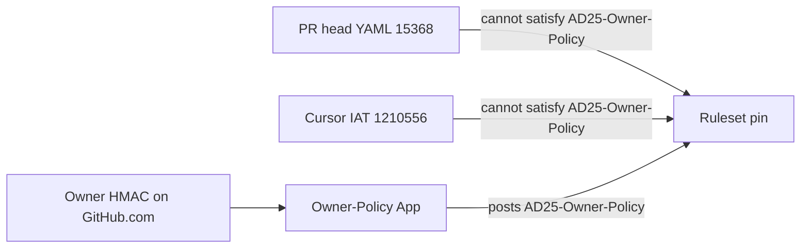

# Architecture Spine — AD-25 Owner-Policy App

## Design Paradigm

**Source-bound policy sidecar.** Authorization is a GitHub App the PR cannot author. Cohestra is data. The sidecar posts check-run `AD25-Owner-Policy` under its own `integration_id`. Merge is a GitHub ruleset decision, not an App merge.



## Invariants & Rules

### AD-1 — Sidecar identity [ADOPTED]

- **Binds:** check `AD25-Owner-Policy`
- **Prevents:** PR-head or Cursor check-name spoof
- **Rule:** Live ruleset JSON `integration_id` equals the Owner-Policy App. Not 15368, not 1210556, not 46505, not null.

### AD-2 — No installer downgrade of Cursor [ADOPTED]

- **Binds:** Layer A
- **Prevents:** false “contents: read” checklists
- **Rule:** Do not instruct the owner to set Cursor contents to read. Installer levers are repo restriction, suspend, uninstall, revoke UAT. Default path keeps Cursor installed and blocks merge with AD-1.

### AD-3 — No merge permission on the sidecar [ADOPTED]

- **Binds:** App registration
- **Prevents:** policy App becoming a merger
- **Rule:** `contents: read` only. No `deployments`, `actions`, `secrets`. Check+status write only to post this check.

### AD-4 — App-bundled policy, blobs as data [ADOPTED]

- **Binds:** evaluator
- **Prevents:** `exec` of git blobs / PR-head Python
- **Rule:** Policy JSON ships in the App image. GitHub contents API supplies path lists and blob SHAs as data.

### AD-5 — Two verdicts [ADOPTED]

- **Binds:** PR classification
- **Prevents:** dest-sync exact-tree blocking policy expansion, and expansion attestation skipping dest-tree checks
- **Rule:** `base=main` + control-plane → `policy_expansion`. `base=release/uat` + control-plane → `dest_sync`. Feature PRs have no control-plane paths and no secret-like paths. A secret-like path is failure even when the PR has zero control-plane files.

### AD-6 — HMAC attestation, not comment-only [ADOPTED]

- **Binds:** owner approval
- **Prevents:** user-token `OWNER_APPROVE_CONTROL_PLANE sha=` minting success
- **Rule:** Required comment is `OWNER_APPROVE_CONTROL_PLANE sha=<40-hex> ts=<unix> mac=<64-hex>`. HMAC-SHA256 covers repo, PR, base, exact HEAD, and ts (canonical version 2). Max age 86400s, future skew 120s. Edited, deleted, expired, conflicting, or comment-only attestations are FAILURE. A valid MAC is account binding, not human presence. The secret is not in Cohestra, Cursor, PR comments, or CI logs.

### AD-7 — Fail closed [ADOPTED]

- **Binds:** check conclusions
- **Prevents:** NEUTRAL/SKIPPED merge windows
- **Rule:** Evaluator returns only `success` or `failure`. Timeouts, missing SHA, missing secret, App errors → `failure`.

### AD-8 — Not PR-E [ADOPTED]

- **Binds:** future auto-merge App
- **Prevents:** one App both authorizing and merging
- **Rule:** Owner-Policy App never merges. PR-E is a later, different `integration_id`, refused on control-plane paths.

### AD-9 — Canonical paths, fail closed [ADOPTED]

- **Binds:** path classification
- **Prevents:** `.env`, nested dotenv, private keys, traversal, and encoded paths classifying as feature success
- **Rule:** Every changed path, including a rename's previous name, is canonicalized before classification. Reject NUL, backslash, non-ASCII, double percent-decoding, absolute paths, empty or dot segments, and `..`. Secret filenames include `.env*`, `*.env`, private keys, `credentials`, `secrets.json`, and certificate extensions. `CODEOWNERS` and `action.yml` are control-plane names. The substring `secret` is not a marker. Ordinary `src/` and `web/` code, including `src/SecretRotation.cs`, stays `feature`.

### AD-10 — Snapshot evidence, not caller authority [ADOPTED]

- **Binds:** host inputs
- **Prevents:** a hand-built `EvaluationRequest` or a caller-supplied merge-base boolean authorizing a merge
- **Rule:** Only `evaluate_snapshot` can mint a seal, and the seal is a digest of the request fields. Changing a field after sealing is `failure`. Ancestry is `compare.merge_base_commit.sha == pulls.base.sha`, both 40-hex, from two API reads. Ruleset `integration_id` must equal the installation and must not be 15368, 1210556, or 46505. A success check body uses the evaluated HEAD and requires a read-back of the posted check-run `app.id`. Unit tests that build a `GitHubSnapshot` are simulated. They do not prove a live pin.

## Consistency Conventions

| Concern | Convention |
| --- | --- |
| Check name | `AD25-Owner-Policy` exactly |
| HMAC envelope | `OWNER_APPROVE_CONTROL_PLANE sha=<40 lowercase hex> ts=<unix> mac=<64 lowercase hex>` |
| Policy file | `policy/bundled_policy.json` in the App image |
| Hosting | Private repo `fad16papa/cohestra-owner-policy` (proposal), not this tree as runtime |
| Errors | Map every exception to check `failure` |

## Stack

| Name | Version |
| --- | --- |
| Python | 3.11+ (prototype; 3.12 on this VM) |
| GitHub Apps Checks API | REST `POST /repos/{owner}/{repo}/check-runs` |
| HMAC | SHA-256, stdlib `hmac` |

## Structural Seed

```text
fad16papa/cohestra-owner-policy/   # owner-controlled, not this PR's runtime
  policy/bundled_policy.json
  owner_policy/evaluate.py
  owner_policy/attestation.py
  host/webhook.py                  # not implemented here
```

Reference snapshot in this repo: `_bmad-output/implementation-artifacts/cohestra-owner-policy-app/`.

## Deferred

- Concrete host (Fly.io vs Cloud Run vs VM) — owner picks at install time.
- Second GitHub account as attestor — optional stronger identity; HMAC is the default.
- Cursor-offered contents:read App — not available.
- PR-E — out of scope.
