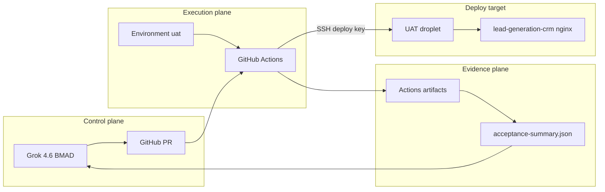
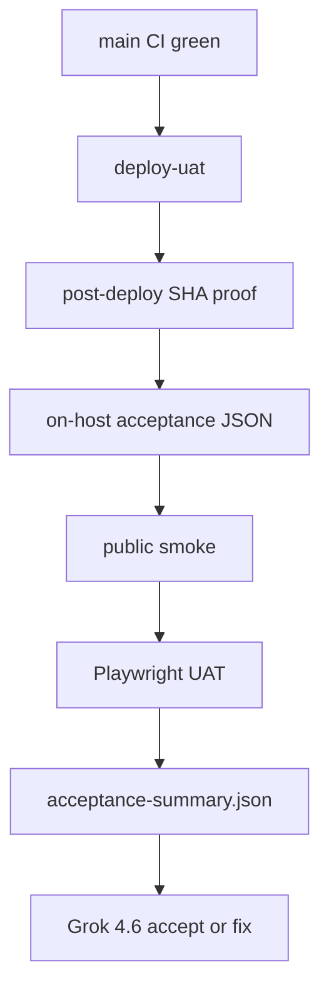

# Architecture Spine — Epic 45 Autonomous Delivery & UAT Acceptance

## Design Paradigm

**Control plane / execution plane / evidence plane.** Cursor + BMAD + Grok 4.6 plan, review, and decide. GitHub Actions executes deploy and acceptance. The UAT droplet is a deploy target, not a chat terminal. Playwright and host probes produce artifacts. Humans enter only at real owner gates.



## Inherited Invariants

| Inherited | From parent | Binds here |
| --- | --- | --- |
| Tenant-scoped data plane / EF filters | enterprise AD-1 / AD-10 | UAT automation must not bypass tenant isolation |
| Platform Admin is a claim, not membership | enterprise AD-7 | Automation tenants are tenant operators, not impersonation |
| No live Paddle on UAT | Epic 19 / Paddle credential guards | Deploy and probes refuse `live_` / non-`sdbx` keys |
| Shared-host UAT isolation | `cohestra-uat-guards.sh` | Preserve CRM host, loopback binds, compose project `cohestra-uat` |
| Production cutover is owner-only | Epic 19 NO-GO | This epic never automates production |

## Invariants & Rules

### AD-1 — Cursor is not an SSH client

- **Binds:** Cloud Agent, BMAD loop, all 45.x stories
- **Prevents:** Standing owner copy/paste of droplet commands as the acceptance path
- **Rule:** Control-plane agents inspect GitHub workflow logs and artifacts. They must not require a droplet private key in Cursor. GitHub Actions may hold a dedicated Environment `uat` deploy key.

### AD-2 — GitHub Environment `uat` owns UAT secrets

- **Binds:** Deploy workflow, bootstrap matrix
- **Prevents:** Repo-level production-shaped secrets and mixed UAT/prod credentials
- **Rule:** UAT deploy and UAT acceptance secrets are Environment-scoped to `uat`. Workflow concurrency group is `deploy-uat`. The group name `deploy-production` is forbidden on this path.

### AD-3 — Fail closed on missing protected secrets

- **Binds:** Deploy and UAT acceptance jobs
- **Prevents:** Late opaque `missing server host` failures and secret-value requests in chat
- **Rule:** Before SSH or mailbox/browser login, required secret *names* are checked. Missing names emit `MISSING_SECRET=<NAME>` and fail. Chat may show names only. Values are never requested or printed.

### AD-4 — Evidence never contains secrets

- **Binds:** `uat-acceptance.json`, Playwright artifacts, acceptance-summary
- **Prevents:** Passwords, API keys, private keys, webhook secrets, tokens, and full sensitive provider identifiers in logs/artifacts
- **Rule:** Artifacts expose booleans, classifications, SHA values, safe suffixes (at most last 4 where a suffix is required), and HTTP codes. No `.env` dumps.

### AD-5 — Deploy only an accepted main SHA

- **Binds:** Deploy UAT workflow
- **Prevents:** Deploying an untested SHA or a `workflow_run` default-branch mismatch
- **Rule:** Automatic deploy runs only after CI success on `main`. For `workflow_run`, the triggering SHA is `github.event.workflow_run.head_sha`. `remote-deploy.sh` remains the on-host deploy entrypoint.

### AD-6 — Shared-host UAT and CRM stay isolated

- **Binds:** `remote-deploy.sh`, acceptance probe
- **Prevents:** Binding Cohestra to :80/:443, compose project `cohestra-infra-uat`, or taking down `thesocialcollectivesg.com`
- **Rule:** Existing guards stay mandatory. Probe must verify shared CRM health and public diagnostic-port isolation. Lead-generation-crm remains the public edge.

### AD-7 — Dual-layer recaptcha; never defeat a real challenge

- **Binds:** Stories 45.6 and 19.3
- **Prevents:** CAPTCHA-solving services, UAT recaptcha disablement, and test keys on real UAT/production
- **Rule:** Layer A uses real UAT domain keys and proves config, widget render, CSP, and negative rejects. Layer B uses official Google reCAPTCHA v2 test keys only on an isolated CI/automation stack. Layer B must not substitute into `docker-compose.uat.yml` defaults or the live UAT `.env`.

### AD-8 — Artifacts are the only execution evidence

- **Binds:** Story close, 45.7
- **Prevents:** Fake PASS and “owner pasted stdout” as authoritative proof
- **Rule:** A story that requires UAT proof is not done without `acceptance-summary.json` (or the then-current schema) plus the detailed artifacts it references. Missing evidence is FAIL.

### AD-9 — Stop only at real owner gates

- **Binds:** 45.8 autonomous loop
- **Prevents:** Treating test failures, container health, or review MAJOR findings as owner gates
- **Rule:** Fixable in-repo failures are repaired and re-run. Owner gates are: initial external credentials, legal/business policy, irreversible production, live money, production credential activation, live DNS/cert ownership, destructive customer data, and ambiguous material product decisions.

### AD-10 — Dedicated automation identities

- **Binds:** 45.4, 45.5
- **Prevents:** Using the owner’s personal login or personal mailbox as the service account
- **Rule:** Authenticated UAT flows use purpose-built automation tenants and a dedicated mailbox credential stored on Environment `uat`. Dev/UAT seed shortcuts stay off on real UAT.

### AD-11 — Autonomous merge is not assumed

- **Binds:** PR merge, 45.8
- **Prevents:** Per-PR merge habit without policy, and silent production merges
- **Rule:** The merge policy document is a proposal until the owner approves it. Production/live cutover remains owner-authorized after approval.

### AD-12 — Grok 4.6 owns control-plane decisions

- **Binds:** Model routing for this epic
- **Prevents:** Composer 2.5 owning architecture, security, CI/CD, secrets, billing, authz, recaptcha, OTP, review signoff, or merge
- **Rule:** Primary model is Grok 4.6. Composer 2.5 may execute only explicitly delegated light tasks. Auto is disabled.



## Consistency Conventions

| Concern | Convention |
| --- | --- |
| Naming | Workflow concurrency `deploy-uat`; Environment `uat`; artifacts `uat-acceptance.json`, `acceptance-summary.json` |
| Data & formats | JSON objects with `result` ∈ `pass` \| `fail` \| `owner_gate`; secret gaps use `MISSING_SECRET` |
| State & cross-cutting | Fail closed; SHA recorded; no secret print; no live Paddle; no production deploy job in this epic |
| Model routing | Grok 4.6 primary; Composer 2.5 light only; Auto disabled |

## Stack

| Name | Version |
| --- | --- |
| GitHub Actions | ubuntu-latest runner + `actions/checkout@v4` + `actions/upload-artifact@v4` |
| appleboy/ssh-action | v1.2.2 |
| Docker Compose UAT | `docker-compose.uat.yml` project `cohestra-uat` |
| Playwright | @playwright/test ^1.55.0 |
| reCAPTCHA | Google v2 checkbox (real UAT keys + official v2 test keys on isolated stack) |
| ASP.NET Core API | 9.0.x |
| Next.js web | 16 (repo lockfile) |

## Structural Seed

```text
.github/workflows/deploy.yml          # deploy-uat + environment uat
deploy/remote-deploy.sh               # on-host entry (existing)
deploy/fail-closed-uat-secrets.sh     # names only
deploy/uat-acceptance.sh              # sanitized JSON probe
web/e2e/                              # add UAT project; keep local suite
_bmad-output/planning-artifacts/epics-autonomous-delivery.md
```

## Capability → Architecture Map

| Capability / Area | Lives in | Governed by |
| --- | --- | --- |
| UAT deploy control | `.github/workflows/deploy.yml` | AD-1, AD-2, AD-3, AD-5 |
| On-host proof | `deploy/uat-acceptance.sh` | AD-4, AD-6 |
| Browser acceptance | `web/e2e` UAT project | AD-8, AD-10 |
| OTP mailbox | isolated helper + Environment secrets | AD-3, AD-4, AD-10 |
| reCAPTCHA contract | 19.3 + 45.6 | AD-7 |
| Evidence schema | `acceptance-summary.json` | AD-8 |
| Delivery loop | 45.8 + merge policy | AD-9, AD-11, AD-12 |

## Deferred

- Exact mailbox vendor (45.5 owner external-service gate after a minimal secure proposal).
- Whether Layer B runs as CI ephemeral compose or a separately named automation deployment — both allowed if they never overwrite live UAT keys.
- Owner approval of `autonomous-merge-policy.md`.
- Production CD workflow — out of this epic.
