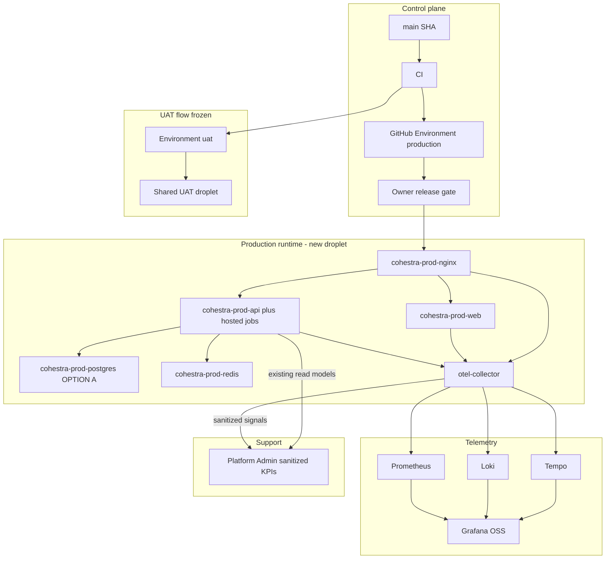
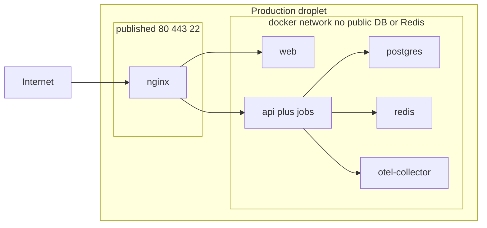

# Architecture Spine — Epic 46 Production Launch

## Design Paradigm

**Two-plane production.** GitHub Actions plus Environment `production` is the control plane. A dedicated droplet running a Production compose project is the runtime plane. Telemetry is a sidecar plane (OTLP), not Platform Admin. Platform Admin is a sanitized consumer on the existing web/api modular monolith.

Jobs stay inside the API process. No new worker, no Hangfire, no second frontend, no production-on-UAT host.



## Inherited Invariants

| Inherited | From parent | Binds here |
| --- | --- | --- |
| Layered modular monolith; brownfield extend `Cohestra.sln` + `web/` | enterprise / project-context | No new microservice |
| AD-2 apex marketing; tenant hosts | enterprise | Production apex `cohestra.app`; tenants `*.cohestra.app` |
| AD-3 never trust `X-Tenant-Id` | enterprise | Unchanged |
| AD-7 Platform Admin is claim `platform_admin` | enterprise / Epic 44 AD-12 | Production support identity |
| AD-10 TenantIsolation CI gate | enterprise | Required on Production-bound PRs |
| AD-13 KPI provenance envelope | Epic 44 | Sanitized support signals |
| AD-14 `/ready` contract frozen | Epic 44 | postgres + redis + default-tenant only |
| AD-15 Safe diagnostic DTOs | Epic 44 | No payloads/secrets/stacks in Platform Admin |
| AD-18 No payment/outbox mutation from Platform Admin | Epic 44 | No replay/requeue in 46.8 |
| AD-19 Version SHA is staff-only | Epic 44 | Runtime SHA via `GIT_SHA` |
| Cursor is not an SSH client | Epic 45 AD-1 | Production deploy via Actions |
| Fail closed on missing secrets | Epic 45 AD-3 | Environment `production` |
| Evidence never contains secrets | Epic 45 AD-4 | Production artifacts too |
| No live Paddle on UAT | `PaddleCredentialGuard` | Unchanged |
| Production cutover is owner-only | Epic 19 / 45 | Strengthened to the cutover phrase |

## Invariants & Rules

### AD-1 — Production is a dedicated droplet [ADOPTED]

- **Binds:** FR-1, FR-2, 46.1, 46.2
- **Prevents:** Installing Production compose on the UAT/CRM host
- **Rule:** Production deploy target is a new DigitalOcean droplet that hosts Cohestra Production only. The existing shared droplet remains UAT + `lead-generation-crm`. `COHESTRA_SHARED_HOST_UAT` must not be true on Production.

### AD-2 — Production DNS names [ADOPTED]

- **Binds:** FR-28, FR-29, 46.13
- **Prevents:** Pointing `cohestra.app` at UAT
- **Rule:** Production serves `cohestra.app` and `*.cohestra.app`. UAT remains `uat.cohestra.app` and `*.uat.cohestra.app`. DNS mutation is an owner gate. Planning and implementation must not change Production DNS until that gate.

### AD-3 — Dedicated Production compose project [ADOPTED]

- **Binds:** FR-3, 46.1, 46.4
- **Prevents:** Reusing `docker-compose.prod.yml` overlay or project `cohestra-uat`
- **Rule:** Production topology is a new compose file `docker-compose.production.yml` with project name `cohestra-production`. Services: `cohestra-prod-web`, `cohestra-prod-api`, `cohestra-prod-postgres` (OPTION A), `cohestra-prod-redis`, `cohestra-prod-nginx`, `cohestra-prod-otelcol`. Postgres and Redis have no public host ports.

### AD-4 — Jobs stay in the API process [ADOPTED]

- **Binds:** FR-3, FR-35
- **Prevents:** Inventing a worker service for launch
- **Rule:** `OutboxDispatcherHostedService`, `BillingJobsHostedService`, `ActivityExpirationHostedService`, and `FollowUpDigestHostedService` remain hosted in `cohestra-prod-api`. Do not add Hangfire or a second process unless a later spine update records evidence they cannot share the API.

### AD-5 — PostgreSQL default is OPTION A [ADOPTED]

- **Binds:** FR-4, FR-10, 46.5
- **Prevents:** Quietly purchasing managed Postgres or forking two incompatible backup designs
- **Rule:** Planning default is self-hosted Postgres 16 on the Production droplet. OPTION B (DigitalOcean managed PostgreSQL) is an owner purchase gate. Backup/restore stories implement OPTION A first; OPTION B only after the owner selects it. Database is never publicly exposed.

### AD-6 — GitHub Environment `production` is the only Production CD environment [ADOPTED]

- **Binds:** FR-6, FR-7, FR-8, 46.3
- **Prevents:** Mixing UAT secrets or auto-deploying Production from `main`
- **Rule:** Production deploy workflows use `environment: production` and concurrency group `deploy-production`. Environment `uat` and `deploy-uat` stay UAT-only. Required reviewer on Environment `production` is the owner release gate. CI success never deploys Production by itself.

### AD-7 — SHA chain is mandatory [ADOPTED]

- **Binds:** FR-8, FR-9, FR-42
- **Prevents:** Deploying a SHA that is not the reviewed CI SHA
- **Rule:** REVIEWED SHA = CI SHA = DEPLOY TARGET SHA = RUNTIME SHA = ACCEPTANCE SHA. Runtime SHA is `GIT_SHA` already consumed by `PlatformOpsVersionService`. Mismatch aborts or pages CRITICAL. Rollback targets a previous accepted SHA, not `latest`.
- **Merge-commit provenance (does not shorten the chain):** GitHub merge commits create two SHAs. REVIEWED is the PR HEAD that passed review and `GitGuardian Security Checks`. CI / DEPLOY TARGET / RUNTIME / ACCEPTANCE are the merged main SHA. Production must prove `merge_commit_sha == deploy_sha` and GitGuardian SUCCESS on the immutable merge-time PR HEAD (`deploy_sha^2`). Do not require GitGuardian on the merge SHA. Do not treat `ancestor of main` as reviewed. Direct-to-main fails closed. Branch protection Settings are a later hardening concern, not the 46.3 trust boundary.

### AD-8 — OpenTelemetry is the telemetry contract [ADOPTED]

- **Binds:** FR-13, FR-14, FR-15, FR-16, FR-17, 46.6, 46.7
- **Prevents:** Vendor SDK lock-in; Platform Admin owning collection
- **Rule:** Instrument the API with OpenTelemetry .NET (OTLP). Export to an OpenTelemetry Collector. Default backends are Grafana OSS + Prometheus + Loki + Tempo on the Production host (or a private docker network). Paid vendors require owner approval and must still speak OTLP. Do not widen `/ready`.

### AD-9 — Telemetry redaction is a hard deny-list [ADOPTED]

- **Binds:** FR-13, NFR-7, 46.6
- **Prevents:** Secrets and unnecessary PII in logs/traces/metrics labels
- **Rule:** Telemetry must not contain passwords, JWTs, refresh tokens, API keys, Paddle secrets, SendGrid secrets, reCAPTCHA secrets, database credentials, SSH keys, or unnecessary customer PII (emails, phones, form answers as default fields). Prefer IDs. Reuse/extend `PlatformHealthDescriptionSanitizer` patterns at the log pipeline, not only on Platform DTOs.

### AD-10 — Platform Admin consumes; it does not collect [ADOPTED]

- **Binds:** FR-21, FR-22, 46.8
- **Prevents:** Turning Platform Admin into Grafana, SSH, SQL, or a deploy console
- **Rule:** New Production-support UI reads sanitized signals through existing Platform APIs and the KPI envelope. No SSH, raw secrets, arbitrary SQL, database consoles, production credentials, unrestricted Paddle controls, or infra shell. New privileged actions need a separate security review and are out of 46.8 default scope.

### AD-11 — Backup readiness equals isolated restore proof [ADOPTED]

- **Binds:** FR-10, FR-11, FR-12, 46.5
- **Prevents:** Claiming DR because `pg_dump` is documented
- **Rule:** Encrypted off-host backups are required. Do not mark backup/DR ready until an isolated restore test passes. Planning defaults: RPO 24 hours until WAL archive is proven, then RPO 1 hour; RTO 4 hours. Backup failure and restore-verification failure are CRITICAL.

### AD-12 — Live Paddle and Production SendGrid are independent of UAT [ADOPTED]

- **Binds:** FR-30, FR-31, FR-32, FR-33, FR-34, 46.10, 46.11
- **Prevents:** Reusing sandbox credentials or UAT SendGrid identity
- **Rule:** Production Paddle uses live keys only after owner gates, with `Paddle:AllowLive=true` and non-UAT `PUBLIC_BASE_URL`. `PaddleCredentialGuard` must not be weakened. Production SendGrid uses a distinct key and authenticated sender domain. Story 19.4 remains frozen sandbox history. No real charges in planning or in stories before the financial owner gate.

### AD-13 — Production remains NO-GO without the cutover phrase [ADOPTED]

- **Binds:** FR-48, FR-49, FR-50, 46.14, 46.15
- **Prevents:** Inferring public launch from Epic 46 completion, CI green, or a dark-host deploy
- **Rule:** The only owner phrase that authorizes public cutover is `PRODUCTION CUTOVER: AUTHORIZED`. Until then Production is NO-GO. Story 46.15 implements cutover mechanics but must refuse to execute public DNS/data migration without that phrase.

### AD-14 — Security headers stay nginx-owned on Production [ADOPTED]

- **Binds:** FR-24, FR-29, 46.9, 46.13
- **Prevents:** Duplicate CSP from Next.js in Production
- **Rule:** nginx owns Production security headers including CSP enforce. Next.js must not emit Production security headers (existing `web/security-headers.ts` pattern). Production CSP must allow live Paddle origins; sandbox Paddle hosts may be omitted on Production.

### AD-15 — Production Redis requires authentication [ADOPTED]

- **Binds:** FR-5, 46.4, 46.9
- **Prevents:** Shipping Production Redis as an unauthenticated internal cache because UAT did
- **Rule:** Production Redis uses a password or ACL from the Production `.env`. The password is a secret (AD-6). UAT Redis may remain passwordless. Fail-closed rate limiters stay 503 on Redis outage; do not fail open to skip auth.

## Consistency Conventions

| Concern | Convention |
| --- | --- |
| Naming | Compose project `cohestra-production`; GitHub Environment `production`; concurrency `deploy-production`; workflow name distinct from `Deploy UAT` |
| Secret names | Fail closed by name; never print values; app secrets on host `.env`; deploy secrets in Environment `production` |
| KPI JSON | Epic 44 `PlatformKpi<T>` envelope for any new Platform Admin figure |
| Config | `ASPNETCORE_ENVIRONMENT=Production`; seeds off; `DEV_TENANT_SLUG` unset |
| Errors | ProblemDetails; `traceId` continues; OTel trace id should align when instrumentation lands |
| Evidence | Missing evidence is FAIL; no fictional health |

## Stack

| Name | Version |
| --- | --- |
| .NET / ASP.NET Core | 9.0 (existing) |
| Next.js | 16.2.x (existing) |
| PostgreSQL | 16 (`postgres:16-alpine` existing) |
| Redis | 7 (`redis:7-alpine` existing) |
| nginx | 1.27-alpine (existing) |
| OpenTelemetry.Extensions.Hosting | 1.20.0 (NuGet, 2026-10-15) |
| OpenTelemetry OTLP exporter | 1.20.x matching Hosting |
| otel/opentelemetry-collector-contrib | 0.136.x or current stable at implement time, pinned in compose |
| Grafana OSS | 12.x current stable at implement time, pinned in compose |
| DigitalOcean Basic droplet (recommended) | 8 GiB RAM / 4 vCPU / 160 GiB SSD — $48/mo list 2026-10-19 |
| DigitalOcean Managed PostgreSQL (OPTION B, not selected) | Standard 2 GiB $30.45/mo or 4 GiB $60.90/mo list 2026-10-19 |

## Structural Seed

```text
docker-compose.production.yml          # new - Production topology
.env.production.example                # names only
.github/workflows/deploy-production.yml
deploy/production-*.sh                 # deploy, smoke, backup, restore, rollback
deploy/nginx/production-*.conf
docs/deploy/production-launch-program.md
```

Do not modify UAT workflow behavior in Epic 46 except to keep it isolated.



## Capability → Architecture Map

| Capability / Area | Lives in | Governed by |
| --- | --- | --- |
| Dedicated host | DigitalOcean droplet + 46.2 | AD-1 |
| Compose topology | `docker-compose.production.yml` | AD-3, AD-4, AD-5, AD-15 |
| Owner-gated CD | `deploy-production.yml` + Environment `production` | AD-6, AD-7 |
| Observability | OTel SDK + collector + Grafana OSS | AD-8, AD-9 |
| Platform support | Existing `(platform)` + 46.8 read models | AD-10, inherited AD-13..18 |
| Backups | `deploy/production-backup*.sh` + off-host storage | AD-11 |
| Live Paddle / SendGrid | Production `.env` after owner gates | AD-12 |
| Cutover | 46.15 runbook | AD-13 |
| Edge TLS/CSP | Production nginx | AD-2, AD-14 |

## Deferred

- OPTION B managed PostgreSQL — owner purchase
- Paid observability / Sentry / paid status page — owner purchase
- Outbox requeue from Platform Admin — product + security review (Epic 44 open item)
- Separate worker process — no evidence
- Multi-droplet HA / Kubernetes — out of launch altitude
- Public cutover execution — blocked on `PRODUCTION CUTOVER: AUTHORIZED`
- Exact Grafana image digest — pin at implement time
- Production sender domain confirmation if not `cohestra.app`
