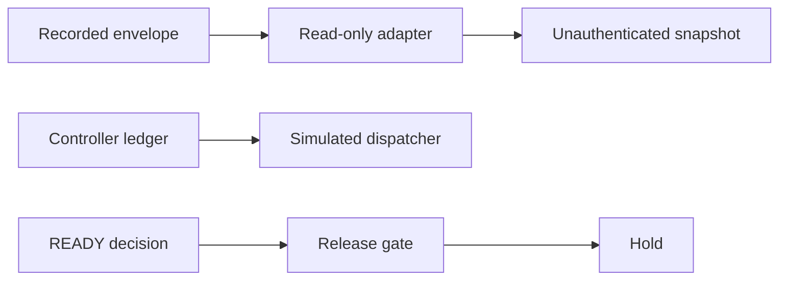

# Architecture Spine — Issue 536 autonomous workflow

## Design Paradigm

The story-acceptance ledger remains the durable controller. Three new units sit beside it. The read-only adapter parses recorded GitHub envelopes. The dispatch boundary records simulated receipts. The release gate refuses merge and deployment. None of them opens a live privileged path.



## Inherited Invariants

| Inherited | From parent | Binds here |
| --- | --- | --- |
| parent AD-3 Simulation is not live verification | Issue 536 story acceptance | A snapshot or receipt cannot set a live flag |
| parent AD-12 This feature does not ship or merge | Issue 536 controller | merge_feature and deploy_uat raise |

Epic 45 AD-12 still pins Grok 4.6 for that epic. This feature requires grok-4.7-high-fast for dispatch and does not amend Epic 45.

## Invariants & Rules

### AD-1 — A recorded envelope is not a webhook

- **Binds:** issue-536
- **Prevents:** A pull-request comment or webhook field becoming reviewer authentication
- **Rule:** `parse_recorded` accepts only delivery `github-api-recorded`. Webhook delivery raises. Review identities keep `authenticated` false and an empty authentication source. The snapshot review tuple is empty. Blocker counts, roles, requirement results, usage, and manifest ids are not read from GitHub text. Check-runs need an app slug. A GitGuardian-named check is kept only when the slug is `gitguardian`. Other checks are kept only from `github-actions` and only on the pull head. Incomplete pages and identity mismatches raise. `live_transport_verified` is false.

### AD-2 — Live clients stay closed

- **Binds:** issue-536
- **Prevents:** A caller-built grant object opening HTTP or Cursor
- **Rule:** `LiveReadOnlyClient.fetch` and `LiveCursorDispatcher.dispatch` raise. A complete grant still raises the pilot-not-enabled hold. Neither module contains a network call. `live_scoped_loop_verified` is false. The simulated dispatcher returns one receipt per assignment id, reloads saved receipts without sending them again, and rejects `live_dispatch` true.

### AD-3 — Callbacks do not authenticate

- **Binds:** issue-536
- **Prevents:** Provider JSON marking a same-SHA rerun as a correction or a review as trusted
- **Rule:** `classify_callback` never sets `authenticated` true. The assigned SHA is rejected. A new SHA from an unauthenticated callback is not accepted. The controller still requires its own new commit before re-evaluation.

### AD-4 — The release gate cannot be switched on by arguments

- **Binds:** issue-536
- **Prevents:** A simulated READY decision, a true policy flag, or an authorized manifest boolean merging or deploying
- **Rule:** `assess` always returns eligible, automerge, UAT, production, and owner-control false. `OWNER_POLICY_ENFORCED`, `UAT_DEPLOY_GATE_ACTIVE`, and `PRODUCTION_AUTHORIZED` are false. `UAT_MAIN_DEPLOY_SUPPRESSED` is true. `merge_feature`, `deploy_uat`, and `deploy_production` raise. Paths under `.github/`, `deploy/`, `correction/`, or `_bmad/`, and any path containing `secret`, are named as control-plane holds. Those reasons do not open the gate.

### AD-5 — Resume is the ledger and the receipt log

- **Binds:** issue-536
- **Prevents:** A new agent session duplicating a correction or treating a prompt as persistent automation
- **Rule:** The controller ledger remains the execution record. Reloading it replays an applied event and does not assign again. The simulated dispatcher reloads receipts and treats the same assignment id as a duplicate. A prompt file is not that record.

## Consistency Conventions

| Concern | Convention |
| --- | --- |
| Naming | Hold reasons are fixed strings. Capability flags stay independent. |
| Data and formats | Recorded envelopes are JSON objects. SHAs are 40 lowercase hex characters. |
| State and auth | GitHub text is not reviewer trust. A grant dataclass is not an owner signature. |

## Stack

| Name | Version |
| --- | --- |
| Python | 3.12 |
| cryptography | 50.0.2 |

The dispatch and release units use the standard library. The story-acceptance verifier still uses cryptography 50.0.2, the PyPI stable release checked on 2026-11-03. These units do not add a network client.

## Structural Seed

```text
correction/github_readonly.py
correction/cursor_dispatch.py
correction/release_gate.py
tests/test_github_readonly.py
tests/test_cursor_dispatch.py
tests/test_release_gate.py
```

The three implementation PRs are separate. A validation PR may combine them without merging.

## Capability to Architecture Map

| Capability | Lives in | Governed by |
| --- | --- | --- |
| Recorded GitHub snapshot | correction/github_readonly.py | AD-1, AD-2 |
| Simulated and refused dispatch | correction/cursor_dispatch.py | AD-2, AD-3, AD-5 |
| Closed merge and UAT | correction/release_gate.py | AD-4 |
| Operating contract | permanent-autonomous-engineering-workflow.md | AD-1 through AD-5 |

## Deferred

- Live read-only GitHub HTTP, after a grant recorded outside Cursor.
- Live Cursor dispatch, after a separate grant and the read-only pilot.
- Owner-policy enforcement that could make a feature PR eligible. This gate does not implement it.
- UAT activation and production deployment. Production remains NO-GO.
- The GitHub App slug for GitGuardian is the string `gitguardian` in this parser. A live check was not verified here.
