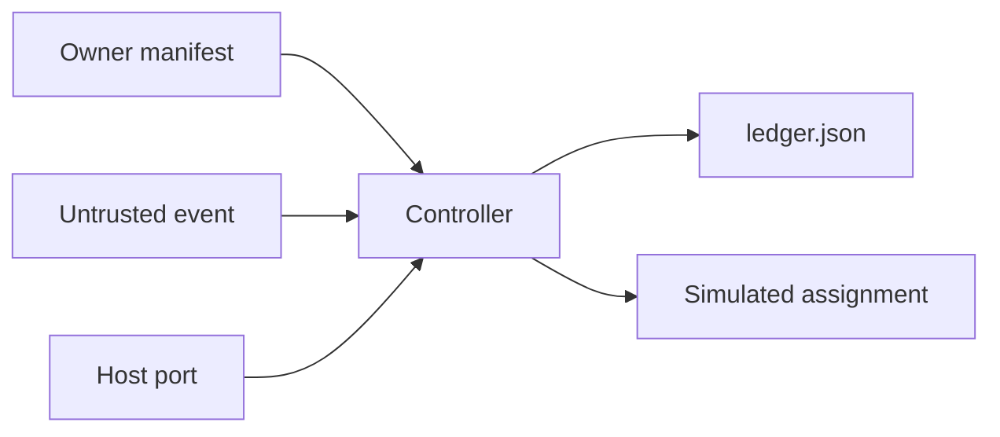

# Architecture Spine — Issue 536 correction controller

## Design Paradigm

Manifest-gated ledger. An immutable owner manifest is the only permission. A durable JSON ledger is the only memory. A host-supplied port is the only evidence input. The dispatcher records a simulated assignment and does not call Cursor.



## Inherited Invariants

| Inherited | From parent | Binds here |
| --- | --- | --- |
| AD-3 Fail closed on missing protected evidence | Epic 45 | Missing, skipped, canceled, stale, or failed checks cannot become READY |
| AD-4 Evidence never contains secrets | Epic 45 | Secret-shaped strings are not written to the ledger or the assignment |
| AD-11 Autonomous merge is not assumed | Epic 45 | READY_FOR_OWNER_MERGE_DECISION does not merge |

Epic 45 AD-12 pins Grok 4.6 for that epic's control plane. This feature does not inherit that pin. Issue 536's activating instruction requires grok-4.7-high-fast for this controller only. Epic 45 is unchanged.

## Invariants & Rules

### AD-1 — The manifest is the only permission

- **Binds:** issue-536
- **Prevents:** A pull request, comment, or hand-edited dataclass granting itself scope
- **Rule:** `Manifest.from_dict` accepts only pull numbers outside the forbidden set containing 505, a 40-character lowercase base SHA, safe relative allowed paths, the five mandatory acceptance criteria, required check names, a correction budget from 1 to 5, and model `grok-4.7-high-fast`. The digest is SHA-256 of that canonical JSON. `Controller` recomputes it and refuses a mismatch before creating a store. One store binds one manifest id and one digest. The digest is not an owner signature. `owner_manifest_authorized` is literal false on every decision.

### AD-2 — Event text is untrusted

- **Binds:** issue-536
- **Prevents:** Comment text becoming an assignment prompt
- **Rule:** The controller never writes `untrusted_text` into the ledger. Injection phrases and values longer than 300 characters are stored as the fixed word redacted. An event id that matches a secret or an instruction is stored as `redacted:` plus SHA-256, not as the raw id. A structured in-scope failure may still assign. Finding fields are kind, name, path, check, role, and counts. The fingerprint mixes a hash of redacted source text so two different redacted strings do not collide. The raw text is not stored.

### AD-3 — Simulation is not live verification

- **Binds:** issue-536
- **Prevents:** A mocked READY being reported as a live Cursor loop
- **Rule:** `verification_plane` is `SIMULATED_PASS` only for `READY_FOR_OWNER_MERGE_DECISION`. `live_scoped_loop_verified` and `live_read_only_transport_verified` are literal false. A port with `is_live` true is a sticky hold and `pull` is not called.

### AD-4 — A correction requires a new commit before re-evaluation

- **Binds:** issue-536
- **Prevents:** Re-grading or re-assigning the same SHA after an assignment
- **Rule:** The assigned head is stored. A later event whose port head is in that list cannot become READY and cannot create another assignment.

### AD-5 — One event produces one decision

- **Binds:** issue-536
- **Prevents:** Duplicate delivery or overlapping processes creating two assignments
- **Rule:** The store path must be a real directory. A symlink is refused before the ledger is written. The lock is an exclusive `flock` held for the critical section. The lease body is rewritten in place on that descriptor. The lease is 30 seconds and is refreshed before the port call and before the ledger write. An unexpired token that belongs to someone else returns BUSY and is not removed. Release unlinks the lock while the flock is still held, then unlocks. A holder that no longer owns the lock discards the decision and does not write. The holder reloads the ledger after acquiring the lock. An applied event id returns the stored decision and does not call the port again. A foreign pull number is rejected before comment text is inspected, so it cannot set the sticky hold. The ledger file is fsynced, and the store directory is fsynced after the replace. Every locked handle reapplies the manifest id and digest binding, including a controller that could not take the lock during construction. `Ledger.from_json` requires every stored key. `corrections`, assignment records, assigned heads, and fingerprints must have equal length. A trace or assignment entry that is not an object makes the ledger unreadable and is not rewritten.

### AD-6 — A stale claim is not an evaluation

- **Binds:** issue-536
- **Prevents:** An old event applying the port's newer head
- **Rule:** When `claimed_head` is set and differs from the port head, the decision is IGNORED, no assignment is written, and ledger status is left unchanged.

### AD-7 — Required checks are exact-head and fail closed

- **Binds:** issue-536
- **Prevents:** A skipped, canceled, missing, stale, or differently cased success satisfying the gate
- **Rule:** A required check counts as success only when every row with that name on the current head has conclusion `success`. `failure` and `timed_out` are retryable findings and still cannot become READY. Conclusions `pending`, `queued`, and `in_progress`, or a null conclusion, wait. Every other conclusion, including `neutral` and an empty string, refuses the gate. A missing name or a row bound to another SHA refuses READY. Retryable findings outrank a still-running check.

### AD-8 — Independent review is two authenticated roles

- **Binds:** issue-536
- **Prevents:** Author, bot, forged, or wrong-model approval
- **Rule:** READY needs two distinct reviewer ids, one policy role `bmad` and one `catsec`, both with `authenticated` true and `authentication_source` exactly `host-verified`, both using the manifest model, both bound to the current head, both with integer blocker 0 and major 0 at or below 1000000, and each naming at least one in-scope path. Forbidden logins are compared case-insensitively: `cursor`, `cursor[bot]`, `github-actions[bot]`, `copilot`, `copilot[bot]`, and `copilot-swe-agent[bot]`. The author login is also case-insensitive and cannot satisfy the gate. Claimed role text is ignored. Event text cannot set authentication. A future live adapter must not copy `authenticated` or `authentication_source` from webhook, comment, or pull-request JSON. A trusted in-scope blocker or major is a retryable finding. An untrusted review is not a correction source. Test evidence must carry the same head SHA as the pull.

### AD-9 — Secret-shaped material is dropped

- **Binds:** issue-536
- **Prevents:** Tokens in comments, test details, or API errors reaching the ledger
- **Rule:** Matches for `ghp_`, `gho_`, `ghu_`, `ghs_`, `ghr_`, `github_pat_`, `AKIA`, `ASIA`, private-key banners, Slack tokens, and `sk_live_` produce a sticky hold. Private-key banners match case-insensitively, including EC. The reason is a fixed string. The matched text is not stored. A head that is not 40 lowercase hex characters is not stored. GitHub error text is not copied; only the status class is. Any other port exception becomes the same API-failure hold.

### AD-10 — The budget bounds assignments only

- **Binds:** issue-536
- **Prevents:** An endless correction loop, and a budget hold blocking a later clean head
- **Rule:** Each assignment increments a counter up to `max_corrections`. That counter is an assignment count only. Elapsed time, token consumption, and cost are not accepted budget keys and are not enforced. The same finding fingerprint on a later head holds for no progress and does not assign. A head that meets every gate can still become READY after the assignment cap. That READY does not mean a time, token, or cost budget was met.

### AD-11 — Scope, base, secret, live, and digest failures stick

- **Binds:** issue-536
- **Prevents:** A later clean snapshot erasing an escalation
- **Rule:** Path escape, a changed or test path outside the manifest, a base SHA or base ref mismatch, a repository mismatch, secret material, a live port, a foreign manifest id, and a digest mismatch set `hold`. A directory allow entry must end with a slash; a file allow entry matches only that path. Secret material is scanned before the event-size and evidence-size refusals, and a padded secret still sticks. An empty changed-path list refuses READY without sticking. Later events return a sticky hold and do not assign. Unknown manifest keys are rejected before a digest is computed.

### AD-12 — This feature does not ship or merge

- **Binds:** issue-536
- **Prevents:** The controller becoming a deploy or merge actuator
- **Rule:** The package has no merge client, no deploy client, no UAT flag writer, and no production path. `READY_FOR_OWNER_MERGE_DECISION` is a decision string for the owner.

## Consistency Conventions

| Concern | Convention |
| --- | --- |
| Naming | Status strings are fixed: READY_FOR_OWNER_MERGE_DECISION, HOLD_OWNER_ACTION_REQUIRED, RETRYABLE_SCOPED, WAITING_EXTERNAL, IGNORED, BUSY |
| Data and formats | Ledger JSON is UTF-8, sorted keys, mode 0600. SHAs are 40 lowercase hex characters. Findings are string dictionaries. |
| State and auth | The manifest digest is SHA-256 of the canonical field JSON and is not owner authorization. Reviewer trust comes from the host policy. `authentication_source` must be `host-verified`. Event text is not an identity. The lock is an exclusive flock with a 30-second lease. |

## Stack

| Name | Version |
| --- | --- |
| Python | 3.12 |
| actions/checkout | 11d5960a326750d5838078e36cf38b85af677262 |
| actions/setup-python | a26af69be951a213d495a4c3e4e4022e16d87065 |

The controller imports the Python standard library only. The checkout pin is the commit named by the GitHub tag v4.4.0. The setup-python pin is the commit named by the GitHub tag v5.6.0. Both refs were read from the GitHub git API on 2026-11-02. The workflow selects Python 3.12. The local interpreter used for the unit tests was Python 3.12.3.

## Structural Seed

```text
_bmad-output/implementation-artifacts/cohestra-correction-controller/
  correction/controller.py
  correction/manifest.py
  correction/models.py
  tests/test_demo_loop.py
  tests/test_negatives.py
.github/workflows/correction-controller-tests.yml
```

The unit workflow requests `contents: read` and sets `persist-credentials: false`. It does not add a ruleset.

## Capability to Architecture Map

| Capability | Lives in | Governed by |
| --- | --- | --- |
| Immutable manifest | correction/manifest.py | AD-1 |
| Ledger, lock, and transitions | correction/controller.py | AD-2, AD-4, AD-5, AD-6, AD-10, AD-11 |
| Evidence classification | correction/controller.py | AD-7, AD-8, AD-9 |
| Simulated loop | tests/test_demo_loop.py | AD-3, AD-12 |
| Fail-closed cases | tests/test_negatives.py | AD-1 through AD-12 |

## Deferred

- Live read-only GitHub transport. The port in this build is a test double. A passing mock is not a live read.
- Live scoped Cursor dispatch. `is_live` is a hold, not an adapter.
- Owner-controlled manifest trust root. A signature over the canonical body, verified against an owner key this controller does not mint. The content digest stays an integrity check. See `issue-536-follow-on-requirements.md`.
- Live adapter reviewer authentication. The adapter must verify GitHub identity before setting `host-verified`. It must not copy authentication from webhook, comment, or pull-request JSON.
- Execution budgets for elapsed time, token consumption, and cost. `max_corrections` does not implement those budgets.
- GitHub App installation, ruleset changes, and required-check registration.
- UAT activation, production deploy, and ADCP restoration.
- Provisioning the two non-author reviewer identities that a real pull would need.
- Epic 45 AD-12 remains the model pin for that epic. This feature does not retarget it.
