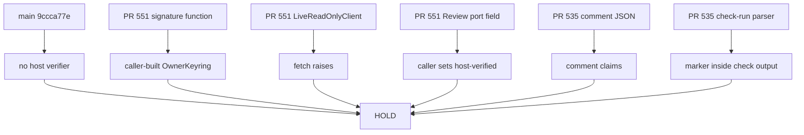
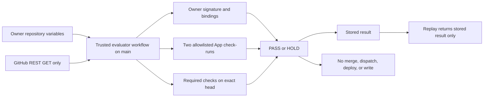

# Architecture Spine — Issue 536 host trust boundary

## Design Paradigm

Fail-closed location gate. A host is a process that loads an owner public key from outside the repository and verifies GitHub identities from authenticated GitHub data. A library that accepts a caller-built key, a unit-test workflow, a comment parser, and a check-run parser are not that process. This spine does not create one.



Revision 2. The owner named the host (AD-7). It is a dedicated GitHub Actions workflow defined on the protected default branch. It reads PR metadata as data and never runs PR code. It decides PASS or HOLD from an owner-signed manifest (AD-10), two allowlisted GitHub App check-runs (AD-8), and exact-head required checks. It returns a stored result on replay (AD-9) and has no write path (AD-11).



## Inherited Invariants

These rules were read from unmerged draft commits. They are not files on `main`. This spine does not edit those commits and does not weaken the rules.

| Inherited | From parent | Binds here |
| --- | --- | --- |
| story AD-1 signature is the only version-2 authorization | PR 551 story-acceptance spine at bb16fa24 | The canonical payload is that rule's exact JSON shape. A content digest is not owner authorization. On replay the controller returns the stored decision and does not assign again. AD-9 here adds that a stored flag is never a new authorization. |
| story AD-6 this feature does not operate the live loop | PR 551 story-acceptance spine at bb16fa24 | A test key and a true verify result are not production owner control and cannot authorize a live action. |
| controller AD-8 independent review is two authenticated roles | PR 551 controller spine at bb16fa24 | Roles are exactly `bmad` and `catsec`. `host-verified` is not copied from webhook, comment, or pull-request JSON. |
| controller AD-9 secret-shaped material is dropped | PR 551 controller spine at bb16fa24 | This decision stores no token, key, or secret value. |
| workflow AD-2 live clients stay closed | PR 551 autonomous-workflow spine at bb16fa24 | `LiveReadOnlyClient.fetch` raises. A grant object is not a network client. |
| controller AD-12 this feature does not ship or merge | PR 551 controller spine at bb16fa24 | No merge client and no deploy client are added. `deploy.yml` on main does not read the correction ledger. |

## Invariants & Rules

### AD-1 — Main has no host verifier

- **Binds:** issue-536
- **Prevents:** Treating a missing directory, a product API, or a deploy workflow as the trust host
- **Rule:** On `9ccca77e7297dc28b0a843d3435e9603dc803da7`, `_bmad-output/implementation-artifacts/cohestra-correction-controller/` is absent. No file on that commit defines `verify_owner_authorization`. `.github/workflows/deploy.yml` and `.github/workflows/deploy-production.yml` are release workflows. They do not verify a manifest signature. No substitute host is added by this decision.

### AD-2 — The unmerged signature function is not the host

- **Binds:** issue-536
- **Prevents:** A caller-built key or a true verify result being reported as out-of-band host verification
- **Rule:** The file `_bmad-output/implementation-artifacts/cohestra-correction-controller/correction/authorization.py` is absent on `main` and on PR 545. Blob `0ceeaaa5370813cb92ffac65e7bb357b479347a4` is the file at heads `379ec80a107f6730fd7d674391830e7d755f73c9` (PRs 546 and 547), `63e08eaa4ac0ebeaa7d6a93d927050bb2fd1938b` (PR 548), `79076ea2be5dfda97660d0edf0b6627563794c88` (PR 549), `e2ee0de347987f2145d6fc8a9715ceb1ff7979c2` (PR 550), and `bb16fa2406dd1882be5a57b5cb48c10655cf4a11` (PR 551). `OwnerKeyring` stores bytes the caller passed. `verify_owner_authorization` returns false when the keyring is missing, the fingerprint differs, or Ed25519 verify fails. A true return means that caller-supplied key matched. It does not mean an out-of-band host loaded a production key. The stored `owner_manifest_authorized` bit, including a true value returned on replay, is not live authorization. The package has no trust-store path and no environment loader for a public key. Compared with `main`, the PR 551 tree adds `.github/workflows/correction-controller-tests.yml` and no other workflow. That file runs unit tests with `contents: read`. Commit `bb16fa24` did not add it. The file was added in `892c0089` and the `cryptography==50.0.2` pin landed in `61f74ca6`. The workflow is not a host.

### AD-3 — No draft path authenticates a GitHub identity for this boundary

- **Binds:** issue-536
- **Prevents:** A recorded envelope, a port flag, a comment body, a check-run marker, or a caller flag becoming the host's reviewer authentication
- **Rule:** On PR 551, `ReviewIdentity.authenticated` defaults to false and `parse_recorded` keeps it false. `LiveReadOnlyClient.fetch` raises for a missing grant and raises again for a complete grant. `github_readonly.py` blob `60c5cca4937ae7e584a9aec844d097409c84bd2c` is the PR 551 file. Blob `b568f31a22c194f16e91c15eabe633028d446247` is the different file on PR 548. The file is absent on PRs 545, 546, 547, 549, and 550. The PR 551 controller can still reach READY when the caller supplies `Review`, requirement, and usage rows whose `authentication_source` is `host-verified`, including two distinct ids and roles `bmad` and `catsec` (`controller.py` returns READY when both roles are present and the identity count is at least 2). This decision does not change that predicate. A fixture that meets it is not a host check. On PR 535 at `73c314571ef8b417cc2c981af0e3d0a7a525872b`, `parse_review_blob` only extracts a JSON object. `authentic_review` then checks `role`, `independent`, and `head_sha` on that object. `collect_reviews` can store `authentic` true with source `collaborator_comment`. `collect_app_reviews` lists check-runs and can store `authentic` true with source `github_app_check_run` only after the same marker fields pass inside that function. `merge_review_sources` can prefer that check-run row. Role tokens there are `BMAD` and `CAT-SEC`, which are not the controller tokens `bmad` and `catsec`. Neither function is on `main`. Neither is the host for this boundary. This decision does not call `paginate` and performs no live GitHub read. An epic must not adopt either PR 535 function as the identity proof for the correction controller.

### AD-4 — A stacked draft needs a named host and an explicit base

- **Binds:** issue-536
- **Prevents:** A draft stacked on PR 551 that invents a trust store, an identity provider, or a runtime the repository does not contain
- **Revision 2:** Revision 1 blocked implementation because no host was named. AD-7 to AD-10 now name the host, the reviewer identities, and the key delivery path, so that block is lifted for the evaluator only. A stacked draft is allowed when its base is the PR 551 head branch `cursor/issue-536-program-ci-c2e5` and it states that dependency. It must not push to, retarget, merge, close, or edit PR 551 or PRs 545 to 550. The rest of this rule is the revision 1 record.
- **Rule:** The signature file is absent on `main`. The open draft heads named in AD-2 contain blob `0ceeaaa5`. The same blob is also at ancestor `61f74ca62dbeb3e68e0bc1d520000a207f8a06ac`. The PR 551 head blob of `github_readonly.py` is `60c5cca4`. Ancestor `c4ccd6713e23593d09ceff0411222f6bd4799758` has a different blob `53c7240301e8cd9f455c74070535acace06ad049`. The host process, the out-of-band public-key path, and the authenticated identity source are not in those trees and not on `main`. A stacked pull request cannot represent the missing host without adding it. PR 551 is not merged and is not edited. The revision 2 pull request opens no implementation. Revision 1 stated that no implementation pull request is opened; that sentence is superseded by the revision 2 bullet above, which allows only a later stacked draft on the PR 551 head.

### AD-5 — Release controls stay untouched

- **Binds:** issue-536
- **Prevents:** This location check changing deploy gates, secrets, rulesets, or environments, or a simulated flag opening a gate
- **Rule:** No workflow, variable, secret, ruleset, or environment is edited. `deploy.yml` on `main` still reads `vars.UAT_DEPLOY_GATE_ACTIVE` and `vars.UAT_MAIN_DEPLOY_SUPPRESSED` and holds unless the first is the string true and the second is the string true. The same inline gate holds when `GITHUB_REF` is not `refs/heads/release/uat`, with reason `CUTOVER_INCOMPLETE_MAIN_SOURCE`. Those live variable values were not read. Production workflow dispatch was not run. `docs/deploy/tailscale-production-overlay.md` and `_bmad-output/planning-artifacts/autonomous-delivery-loop.md` still state Production NO-GO. Live deployment status was not queried. `deploy.yml` does not read `owner_manifest_authorized` or the correction ledger. A simulated pass cannot open UAT or Production.

### AD-6 — A future host waits on the owner, then uses one existing contract

- **Binds:** issue-536
- **Prevents:** Two later units choosing different payloads, role tokens, replay results, identity proofs, or a write-capable client
- **Revision 2:** The owner has named the host, the identity source, the key path, and the replay rule. They are AD-7 to AD-10. The sentence in the rule below that blocks implementation until those names exist is satisfied for the evaluator slice only. Reviewer identity is a GitHub App numeric id, not a login (AD-8). Replay is AD-9. Nothing else in this rule is relaxed.
- **Rule:** No implementation starts until the owner names the host process, the out-of-band public-key delivery path, and the authenticated GitHub read source, and resolves the replay conflict recorded below. The only canonical payload is story AD-1 at `bb16fa24`: UTF-8 JSON, sorted keys, separators comma and colon, no whitespace, signature bytes outside the payload, and object keys exactly `acceptance_criteria`, `allowed_paths`, `author_id`, `authorization`, `base_ref`, `base_sha`, `budget`, `manifest_id`, `manifest_version`, `model`, `pull_number`, `repo`, `required_checks`, `requirements`, and `task_id`, with `authorization` exactly `key_id` and `public_key_sha256`. Nested requirement and budget shapes are those accepted by `Manifest.from_dict` in `manifest.py` blob `ab0cd40d48145fe13b047f6b4cfe5425d034b891` at `bb16fa24`. The signed bytes are the return value of `signing_payload` in authorization blob `0ceeaaa5`, which is `json.dumps` with `sort_keys=True` and separators comma and colon, then UTF-8. A different encoder, including a different slash or non-ASCII escape, is not canonical. `public_key_sha256` must equal `hashlib.sha256(public_key).hexdigest()`, which is lowercase hex. Required scope is `allowed_paths` inside that object. It is not a token grant. The moving head SHA is not a signature field. Exact-head evidence stays story AD-2 and controller AD-4. Controller role tokens are exactly `bmad` and `catsec`. `BMAD` and `CAT-SEC` are different strings and are not accepted as those roles. READY on that controller also requires two distinct reviewer id strings, and the author id cannot be one of them. Reviewer identity is the numeric GitHub App id of an allowlisted App, per AD-8. The App ids are owner-supplied variables that do not exist yet, because the Apps are not created. Until they are set, no allow-list is the host and the gate is HOLD. Replay is defined by AD-9, which refines story AD-1 and does not contradict it. No diff in an implementation of this slice, including an edit to an existing file, adds a merge, deploy, Cursor dispatch, or repository-write call. A write-capable token is HOLD. Missing or invalid trust material returns HOLD. A mock, a recorded envelope, `SIMULATED_PASS`, a fixture that satisfies the current READY predicate, and a test key cannot authorize a live action.

### AD-7 — The host is a trusted evaluator workflow on the protected branch

- **Binds:** issue-536
- **Prevents:** Executing or building PR-controlled code in the trust evaluator, a PR editing its own evaluator, and a write-capable token reaching a fork
- **Rule:** The host is one dedicated GitHub Actions workflow, `.github/workflows/cohestra-trust-evaluator.yml`, and the Python it runs from `_bmad-output/implementation-artifacts/cohestra-correction-controller/`. Both are read from a commit on the default branch `main`. `main` reports `protected: true` through the branches API (VERIFIED in this run; the branch-protection body itself returned HTTP 403 and was not read). The trigger is `pull_request_target` with `branches: [main]` and types `opened`, `synchronize`, `reopened`, and `ready_for_review`. The evaluator also returns HOLD when the API `base.ref` is not `main`. GitHub documents that this event runs in the default-branch context with `GITHUB_SHA` set to the last default-branch commit and `GITHUB_REF` set to the default branch, so a PR cannot change the workflow that judges it. `pull_request` is not used because it runs the PR's own workflow file. `workflow_run` is not used because it needs a second workflow and gives no PR number without extra reads. The workflow declares `permissions` of exactly `contents: read`, `checks: read`, and `pull-requests: read`. It uses no third-party action. After checkout it installs only the hash-pinned wheels listed in `requirements-trust.txt` (`--require-hashes`, `--only-binary=:all:`, `--no-deps`, fixed index) into a throwaway virtual environment. Its only `uses` is the already pinned `actions/checkout` commit `11d5960a326750d5838078e36cf38b85af677262`, with `ref: ${{ github.sha }}` and `persist-credentials: false`. It never checks out `github.event.pull_request.head`. It never runs a PR script, a PR package manager step, or a PR build. PR title, body, branch names, and labels are never interpolated into a `run` line. The only event values passed to the evaluator are the numeric PR number and the head SHA, as environment variables, and the evaluator validates both by pattern. The head SHA from the event is a stale hint only. The authoritative head is the `head.sha` of the GET pull-request response for that PR number. The PR's manifest file is fetched through the contents API as bytes at that head SHA, size-limited, and parsed as JSON data. It is never executed. Fork PRs (`head.repo` not equal to `base.repo`) are HOLD. The job runs only when `vars.COHESTRA_TRUST_EVALUATOR_ENABLED` is exactly the string `true`, and the evaluator checks the same value again. Absent or any other value is a skipped job and a HOLD. A skipped job is not a pass. The repository Actions settings (allowed actions, default token permission, fork approval policy, and whether `pull_request_target` runs are restricted) were not readable: the REST endpoints under `actions/permissions` returned HTTP 403 for the integration token. They are NOT VERIFIED. This design does not depend on a permissive default, and no setting is changed. The owner verifies those settings before setting the enable variable. The `branches: [main]` filter means a pull request whose base is not `main` does not start this workflow. A stacked draft therefore does not execute it.

### AD-8 — Reviewers are two allowlisted GitHub Apps, by numeric id

- **Binds:** issue-536
- **Prevents:** A comment, a Cursor bot message, a login, an author-controlled App, or a same-name check from another App satisfying review
- **Rule:** The two reviewer identities are the Apps Cohestra BMAD (role `bmad`) and Cohestra CAT-SEC (role `catsec`). They are allowlisted by GitHub App numeric id from owner variables. They are NOT created and NOT installed. No claim is made that they exist. A gate passes only when the commit check-runs list for the exact head SHA, requested with `filter=all` and `per_page=100` and followed through every page until the collected count equals `total_count` (a short page, a missing page, or a count mismatch is HOLD), contains, for each role, at least one run whose `app.id` equals that role's allowlisted id, whose `name` equals that role's configured check name exactly, whose `head_sha` equals the head, whose `status` is `completed`, and whose `conclusion` is `success`, and no run with the same name and App id has any other state. A same-name run from another App id is ignored as evidence and cannot hide a failing allowlisted run. The two ids must be positive integers and distinct. The two check names must be distinct. The id `15368` (`github-actions`) is never accepted as a reviewer id. A reviewer App is an author App when its `app.slug` followed by the literal suffix `[bot]` equals the pull author's login. An author App never satisfies a reviewer role, and the gate is HOLD. A reviewer run with a missing or non-string `app.slug` is not accepted as evidence. Comments, review bodies, check-run output text, labels, and Cursor messages are not read as review evidence. The evaluator does not parse a verdict from check output. Integer ids come from the check-runs API response and are not copied from the PR. Required checks other than the reviewers are resolved through an owner-pinned map. Each manifest `required_checks` entry must be a key of `COHESTRA_REQUIRED_CHECKS_MAP` (AD-10), which pins the exact check-run name and the producer App id for that entry. Every run of that name on the exact head, from the full list above, must be `completed` with conclusion `success`, and every such run must carry the pinned App id. An entry with no map key is HOLD. A run of the same name from another App id makes the entry HOLD, because it is not the pinned producer. Because a same-repository head can mint a `github-actions` run under any job name by editing a workflow file, the evaluator returns HOLD when any changed file lies under `.github/`. Observed on the `bb16fa24` check-runs: `github-actions` has App id `15368` and `GitGuardian Security Checks` is produced by App id `46505`. The map is still owner-supplied. The manifest baseline names (`gitguardian`, `integration`, `regression`, `security`, `tdd`) do not equal the current CI job names, so until the owner supplies the map the required-check gate is HOLD. `skipped`, `neutral`, `cancelled`, `timed_out`, `failure`, `action_required`, `stale`, pending, and missing are not success.

### AD-9 — Replay returns the stored result and authorizes nothing

- **Binds:** issue-536
- **Prevents:** A repeated or replayed event producing a second evaluation, a second side effect, or a stored success being reused as fresh authorization
- **Rule:** The replay key is the event id the workflow supplies. The stored record binds the event id to a fingerprint of repository, pull number, and claimed head SHA. The same event id with the same fingerprint returns the stored result, marked `replayed: true`, without a network read, a signature verify, or a store write. The same event id with a different fingerprint is HOLD and the stored result is not changed. A replayed result carries no side-effect authorization. The evaluator's own output has none either, because AD-11 keeps every live flag false. Any later consumer asks the side-effect gate, which returns HOLD for a replayed result, for a result whose head differs from the current exact head, and for every request in this build. Each new dispatch, merge, or deployment needs fresh owner authorization and a fresh evaluation of current exact-head evidence. This resolves the conflict recorded in revision 1: story AD-1's "return the stored result and do not verify again" is kept, and the stored `owner_manifest_authorized` value is evidence about that event only. The task wording "reject replay" is superseded by owner decision 3. Replay is idempotent read-only reuse, not a rejection and not a re-authorization. A signature or evidence copied onto a different repository, task, pull number, or base reference is a binding mismatch and is HOLD (AD-10). That is not the replay rule. Durable cross-run storage is not provided by an Actions runner. This build keeps the store as a local file with atomic write, so replay is durable inside one workflow run only. A durable store is an owner-named deployment dependency and is NOT IMPLEMENTED here. The side-effect gate does not depend on the store.

### AD-10 — The owner public key arrives through owner-managed repository variables

- **Binds:** issue-536
- **Prevents:** A key, key id, or fingerprint taken from the PR, from the manifest alone, or generated by the evaluator
- **Rule:** The evaluator reads these variable names from the environment, populated by the workflow from `vars.*`. Format only is defined here. No value is created, read, or stored in this task. `COHESTRA_OWNER_KEY_ID` matches `^[A-Za-z0-9._-]{1,64}$`. `COHESTRA_OWNER_PUBLIC_KEY` is standard base64 of exactly 32 raw Ed25519 public-key bytes. `COHESTRA_OWNER_PUBLIC_KEY_SHA256` is 64 lowercase hex characters and must equal `hashlib.sha256(public_key_bytes).hexdigest()`. `COHESTRA_APPROVED_TASK_ID` is the owner-approved task id for the story. `COHESTRA_REVIEW_APP_BMAD_ID` and `COHESTRA_REVIEW_APP_CATSEC_ID` are positive decimal integers. `COHESTRA_REVIEW_BMAD_CHECK_NAME` and `COHESTRA_REVIEW_CATSEC_CHECK_NAME` are exact check-run names of 1 to 100 characters with no line break. `COHESTRA_REQUIRED_CHECKS_MAP` is a JSON object of at most 20 entries, each key a manifest required-check entry and each value an object with exactly `name` (1 to 100 characters, no line break) and `app_id` (positive integer). `COHESTRA_TRUST_EVALUATOR_ENABLED` is the exact string `true` to enable. The manifest path is the constant `.cohestra/story-manifest.json`. Verification requires all of the following, and any miss is HOLD: the configured key decodes to 32 bytes and is a valid Ed25519 public key; its SHA-256 equals the configured fingerprint; the manifest `authorization.key_id` equals the configured key id; the manifest `authorization.public_key_sha256` equals the configured fingerprint; `verify_owner_authorization` from authorization blob `0ceeaaa5` accepts the signature over `signing_payload`; manifest `repo` equals the event repository and the API `base.repo.full_name`; manifest `task_id` equals `COHESTRA_APPROVED_TASK_ID`; manifest `pull_number` equals the PR number; manifest `base_ref` equals the API `base.ref`; manifest `base_sha` equals the API `base.sha`; manifest `author_id` equals the API PR author login, case-insensitively; every changed file, read from the compare endpoint between the exact API base SHA and the exact head SHA (never from the moving pull files list), lies inside manifest `allowed_paths` by `path_allowed` in `manifest.py`, the rows read equal the pull `changed_files` count, a renamed or copied file carries its previous name, and the base SHA, head SHA, and author are unchanged at a closing read that re-applies the fork, open, base repository, and base ref gates; and the manifest parses with `Manifest.from_dict`, version 2, with duplicate JSON keys, non-finite numbers, and oversize input rejected. The private signing key stays outside Cursor, GitHub Actions, and the repository. The evaluator has no sign or key-generation function. Test keys exist only inside the test process. A variable is editable by a repository administrator, so the variable path is only as strong as repository admin control (INFERRED from GitHub's permission model, not tested here). The signature stops anyone else from producing a manifest the configured key accepts. An administrator who swaps the key and the fingerprint together is an owner-level risk and is residual.

### AD-11 — The evaluator has no side effect and every live flag is false

- **Binds:** issue-536
- **Prevents:** The evaluator becoming a merge, dispatch, deploy, or write actuator, and a mock or a PASS being reported as live verification
- **Rule:** The only network call is `GET` to `https://api.github.com` for the repository, the pull request, its files, the commit check-runs, and one file's contents. The transport accepts no method other than `GET`, no request body, and no other host. The evaluator output is `PASS` or `HOLD` with a reason and the exact head. `live_read_only_transport_verified`, `live_identity_verified`, `live_scoped_loop_verified`, `owner_control_ready`, `automerge_ready`, `uat_deploy_ready`, and `production_ready` are false in every output, including PASS. A PASS means the offered evidence matched the rules above. It is not an authorization. The workflow writes only the job summary file on the runner. It does not comment, label, create a check-run, dispatch, merge, deploy, or call a write API. It reads no secret other than the workflow's own read-scoped `GITHUB_TOKEN`. `UAT_DEPLOY_GATE_ACTIVE` stays false, `UAT_MAIN_DEPLOY_SUPPRESSED` stays true, and Production stays NO-GO. No unit test performs a live read. A test that passes against a fake transport does not count as live verification of the transport, the identities, or the Apps.

## Resolved Conflicts

Story AD-1 at `bb16fa24` returns the stored decision on replay and does not verify again. The revision 1 task text said reject replay. Owner decision 3 replaces that with idempotent read-only reuse that cannot authorize a new side effect. AD-9 is the single rule. No other replay wording applies. The revision 1 text that named a conflict is superseded by this section.

## Consistency Conventions

| Concern | Convention |
| --- | --- |
| Naming | Evaluator status is `PASS` or `HOLD`. `SIMULATED_PASS` is not a live flag. Role tokens are case-sensitive `bmad` and `catsec`. Variable names start with `COHESTRA_`. |
| Data and formats | SHAs are 40 lowercase hex characters. The earlier prompt string ending in da5 is not a commit. The signature payload is story AD-1 and no second envelope. App ids are positive integers. The manifest path is `.cohestra/story-manifest.json`. |
| State and auth | Caller-supplied `authentication_source` is not host verification. Comment JSON and check-run output markers are not an identity. Reviewer identity is `app.id` from the commit check-runs API. Replay never authorizes. |

## Stack

| Name | Version |
| --- | --- |
| Python interpreter that linted this spine | 3.12.3 |
| Host verifier package on main | not present; planned in a stacked draft on the #551 head |
| Python cryptography package on main | not adopted; the #551 workflow pins 50.0.2 |

The PR 551 tree's test workflow contains the pin `cryptography==50.0.2`. This spine does not add that pin to `main`. Python 3.12.3 is the interpreter observed for this lint. It is not a selected host runtime.

## Structural Seed

```text
_bmad-output/planning-artifacts/architecture/architecture-issue-536-host-trust-boundary-2026-11-03/
  ARCHITECTURE-SPINE.md
  .memlog.md
```

This revision changes only the spine and its memlog. The evaluator is a separate stacked draft that adds, on top of the PR 551 head:

```text
.github/workflows/cohestra-trust-evaluator.yml
_bmad-output/implementation-artifacts/cohestra-correction-controller/
  correction/trust_evidence.py
  correction/trust_evaluator.py
  tests/test_trust_evaluator.py
  tests/test_trust_evidence.py
  tests/test_trust_workflow.py
_bmad-output/implementation-artifacts/spec-issue-536-trust-evaluator.md
```

Deployment topology, repository environments, and provider credentials stay as they are. No GitHub App is created or installed. No variable is created. The unmerged PR 535 check-run parser is not selected as a provider.

## Capability to Architecture Map

| Capability | Lives in | Governed by |
| --- | --- | --- |
| Owner-signature host verify | revision 1: absent. Revision 2: named in AD-7, built in the stacked draft | AD-1, AD-2, AD-6, AD-7, AD-10 |
| Authenticated read-only GitHub evidence | revision 1: absent. Revision 2: named in AD-7 and AD-8, built in the stacked draft | AD-3, AD-6, AD-8, AD-11 |
| Replay and idempotency | stacked draft only | AD-9 |
| Recorded-envelope parser | PR 548 head blob b568f31a and PR 551 head blob 60c5cca4 | AD-3 |
| Comment and check-run parsers | PR 535 `deploy/lib/uat-readiness.py` only | AD-3 |
| Release gates | existing deploy workflows, unchanged | AD-5 |

## Deferred

- Creating and installing the Cohestra BMAD and Cohestra CAT-SEC Apps, and recording their numeric ids. Not done. Until then the reviewer gate is HOLD.
- Creating the owner signing key pair outside Cursor, GitHub Actions, and the repository, and setting the three key variables. Test keys are not that key.
- Verifying the repository Actions settings that the integration token could not read, before the enable variable is set.
- A durable cross-run replay store. Not implemented. The side-effect gate does not need it.
- Whether the evaluator becomes a required status check. No ruleset or branch protection is changed here.
- A live pilot of the transport, the identities, and the Apps. Until a separate authorized pilot verifies them, `live_*` stays false, and no mock or fixture counts.
- Live Cursor dispatch, merge, UAT activation, and Production deployment stay closed. This spine adds no client for them.
- Merging the stacked draft requires PR 551 to land first, because the evaluator imports its package. That is an owner decision. This revision does not merge or alter PR 551.

## Owner prerequisites before any live use

1. Create the two Apps and set their numeric ids and check names as repository variables (AD-10 names and formats).
2. Generate the signing key pair offline. Set only the public key, key id, and fingerprint variables. Sign a story manifest offline.
3. Read and confirm the Actions settings listed in AD-7.
4. Set `COHESTRA_TRUST_EVALUATOR_ENABLED` to `true` only after a separate authorized pilot.
