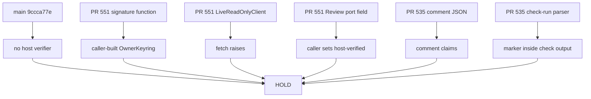

# Architecture Spine — Issue 536 host trust boundary

## Design Paradigm

Fail-closed location gate. A host is a process that loads an owner public key from outside the repository and verifies GitHub identities from authenticated GitHub data. A library that accepts a caller-built key, a unit-test workflow, a comment parser, and a check-run parser are not that process. This spine does not create one.



## Inherited Invariants

These rules were read from unmerged draft commits. They are not files on `main`. This spine does not edit those commits and does not weaken the rules.

| Inherited | From parent | Binds here |
| --- | --- | --- |
| story AD-1 signature is the only version-2 authorization | PR 551 story-acceptance spine at bb16fa24 | The canonical payload is that rule's exact JSON shape. A content digest is not owner authorization. Replay returns the stored flag and does not verify again. |
| story AD-6 this feature does not operate the live loop | PR 551 story-acceptance spine at bb16fa24 | A test key and a true verify result are not production owner control and cannot authorize a live action. |
| controller AD-8 independent review is two authenticated roles | PR 551 controller spine at bb16fa24 | Roles are exactly `bmad` and `catsec`. `host-verified` is not copied from webhook, comment, or pull-request JSON. |
| controller AD-9 secret-shaped material is dropped | PR 551 controller spine at bb16fa24 | This decision stores no token, key, or secret value. |
| workflow AD-2 live clients stay closed | PR 551 autonomous-workflow spine at bb16fa24 | `LiveReadOnlyClient.fetch` raises. A grant object is not a network client. |
| controller AD-12 this feature does not ship or merge | PR 551 controller spine at bb16fa24 | No merge client and no deploy client are added. `deploy.yml` on main does not read the correction ledger. |

## Invariants & Rules

### AD-1 — Main has no host verifier

- **Binds:** issue-536
- **Prevents:** Treating a missing directory, a product API, or a deploy workflow as the trust host
- **Rule:** On `9ccca77e7297dc28b0a843d3435e9603dc803da7`, `_bmad-output/implementation-artifacts/cohestra-correction-controller/` is absent. No file on that commit defines `verify_owner_authorization`. `.github/workflows/deploy.yml` and `.github/workflows/deploy-production.yml` are release workflows. They do not verify a manifest signature. No substitute host is added by this decision.

### AD-2 — The unmerged signature function is not the host

- **Binds:** issue-536
- **Prevents:** A caller-built key or a true verify result being reported as out-of-band host verification
- **Rule:** The file `_bmad-output/implementation-artifacts/cohestra-correction-controller/correction/authorization.py` is absent on `main` and on PR 545. Blob `0ceeaaa5370813cb92ffac65e7bb357b479347a4` is the file at heads `379ec80a107f6730fd7d674391830e7d755f73c9` (PRs 546 and 547), `63e08eaa4ac0ebeaa7d6a93d927050bb2fd1938b` (PR 548), `79076ea2be5dfda97660d0edf0b6627563794c88` (PR 549), `e2ee0de347987f2145d6fc8a9715ceb1ff7979c2` (PR 550), and `bb16fa2406dd1882be5a57b5cb48c10655cf4a11` (PR 551). `OwnerKeyring` stores bytes the caller passed. `verify_owner_authorization` returns false when the keyring is missing, the fingerprint differs, or Ed25519 verify fails. A true return means that caller-supplied key matched. It does not mean an out-of-band host loaded a production key. The stored `owner_manifest_authorized` bit, including a true value returned on replay, is not live authorization. The package has no trust-store path and no environment loader for a public key. Compared with `main`, the PR 551 tree adds `.github/workflows/correction-controller-tests.yml` and no other workflow. That file runs unit tests with `contents: read`. Commit `bb16fa24` did not add it. The file was added in `892c0089` and the `cryptography==50.0.2` pin landed in `61f74ca6`. The workflow is not a host.

### AD-3 — No draft path authenticates a GitHub identity for this boundary

- **Binds:** issue-536
- **Prevents:** A recorded envelope, a port flag, a comment body, a check-run marker, or a caller flag becoming the host's reviewer authentication
- **Rule:** On PR 551, `ReviewIdentity.authenticated` defaults to false and `parse_recorded` keeps it false. `LiveReadOnlyClient.fetch` raises for a missing grant and raises again for a complete grant. `github_readonly.py` blob `60c5cca4937ae7e584a9aec844d097409c84bd2c` is the PR 551 file. Blob `b568f31a22c194f16e91c15eabe633028d446247` is the different file on PR 548. The file is absent on PRs 545, 546, 547, 549, and 550. The PR 551 controller can still reach READY when the caller supplies `Review`, requirement, and usage rows whose `authentication_source` is `host-verified`, including two distinct ids and roles `bmad` and `catsec` (`controller.py` returns READY when both roles are present and the identity count is at least 2). This decision does not change that predicate. A fixture that meets it is not a host check. On PR 535 at `73c314571ef8b417cc2c981af0e3d0a7a525872b`, `parse_review_blob` only extracts a JSON object. `authentic_review` then checks `role`, `independent`, and `head_sha` on that object. `collect_reviews` can store `authentic` true with source `collaborator_comment`. `collect_app_reviews` lists check-runs and can store `authentic` true with source `github_app_check_run` only after the same marker fields pass inside that function. `merge_review_sources` can prefer that check-run row. Role tokens there are `BMAD` and `CAT-SEC`, which are not the controller tokens `bmad` and `catsec`. Neither function is on `main`. Neither is the host for this boundary. This decision does not call `paginate` and performs no live GitHub read. An epic must not adopt either PR 535 function as the identity proof for the correction controller.

### AD-4 — The dependency cannot be stacked safely

- **Binds:** issue-536
- **Prevents:** A draft stacked on PR 551 that invents a trust store, an identity provider, or a runtime the repository does not contain
- **Rule:** The signature file is absent on `main`. The open draft heads named in AD-2 contain blob `0ceeaaa5`. The same blob is also at ancestor `61f74ca62dbeb3e68e0bc1d520000a207f8a06ac`. The PR 551 head blob of `github_readonly.py` is `60c5cca4`. Ancestor `c4ccd6713e23593d09ceff0411222f6bd4799758` has a different blob `53c7240301e8cd9f455c74070535acace06ad049`. The host process, the out-of-band public-key path, and the authenticated identity source are not in those trees and not on `main`. A stacked pull request cannot represent the missing host without adding it. PR 551 is not merged and is not edited. No implementation pull request is opened for this slice.

### AD-5 — Release controls stay untouched

- **Binds:** issue-536
- **Prevents:** This location check changing deploy gates, secrets, rulesets, or environments, or a simulated flag opening a gate
- **Rule:** No workflow, variable, secret, ruleset, or environment is edited. `deploy.yml` on `main` still reads `vars.UAT_DEPLOY_GATE_ACTIVE` and `vars.UAT_MAIN_DEPLOY_SUPPRESSED` and holds unless the first is the string true and the second is the string true. The same inline gate holds when `GITHUB_REF` is not `refs/heads/release/uat`, with reason `CUTOVER_INCOMPLETE_MAIN_SOURCE`. Those live variable values were not read. Production workflow dispatch was not run. `docs/deploy/tailscale-production-overlay.md` and `_bmad-output/planning-artifacts/autonomous-delivery-loop.md` still state Production NO-GO. Live deployment status was not queried. `deploy.yml` does not read `owner_manifest_authorized` or the correction ledger. A simulated pass cannot open UAT or Production.

### AD-6 — A future host waits on the owner, then uses one existing contract

- **Binds:** issue-536
- **Prevents:** Two later units choosing different payloads, role tokens, replay results, identity proofs, or a write-capable client
- **Rule:** No implementation starts until the owner names the host process, the out-of-band public-key delivery path, and the authenticated GitHub read source, and resolves the replay conflict recorded below. The only canonical payload is story AD-1 at `bb16fa24`: UTF-8 JSON, sorted keys, separators comma and colon, no whitespace, signature bytes outside the payload, and object keys exactly `acceptance_criteria`, `allowed_paths`, `author_id`, `authorization`, `base_ref`, `base_sha`, `budget`, `manifest_id`, `manifest_version`, `model`, `pull_number`, `repo`, `required_checks`, `requirements`, and `task_id`, with `authorization` exactly `key_id` and `public_key_sha256`. Nested requirement and budget shapes are those accepted by `Manifest.from_dict` in `manifest.py` blob `ab0cd40d48145fe13b047f6b4cfe5425d034b891` at `bb16fa24`. The signed bytes are the return value of `signing_payload` in authorization blob `0ceeaaa5`, which is `json.dumps` with `sort_keys=True` and separators comma and colon, then UTF-8. A different encoder, including a different slash or non-ASCII escape, is not canonical. `public_key_sha256` must equal `hashlib.sha256(public_key).hexdigest()`, which is lowercase hex. Required scope is `allowed_paths` inside that object. It is not a token grant. The moving head SHA is not a signature field. Exact-head evidence stays story AD-2 and controller AD-4. Controller role tokens are exactly `bmad` and `catsec`. `BMAD` and `CAT-SEC` are different strings and are not accepted as those roles. READY on that controller also requires two distinct reviewer id strings, and the author id cannot be one of them. Whether a reviewer id string is a GitHub login or a numeric account id, and which distinct non-author identities map to `bmad` and to `catsec`, is part of the owner-named identity source. Until those identities are named, no allow-list is the host. Replay follows story AD-1 unless the owner explicitly replaces that rule: return the stored flag and do not verify again. No diff in an implementation of this slice, including an edit to an existing file, adds a merge, deploy, Cursor dispatch, or repository-write call. A write-capable token is HOLD. Missing or invalid trust material returns HOLD. A mock, a recorded envelope, `SIMULATED_PASS`, a fixture that satisfies the current READY predicate, and a test key cannot authorize a live action.

## Conflicts

Story AD-1 at `bb16fa24` says replay returns the stored flag and does not verify again. The task text for this run says reject replay. This spine does not override story AD-1. Implementation stays blocked until the owner picks one replay rule. That conflict is not a permission to build either rule now.

## Consistency Conventions

| Concern | Convention |
| --- | --- |
| Naming | Status for this slice is HOLD. `SIMULATED_PASS` is not a live flag. Role tokens are case-sensitive. |
| Data and formats | SHAs are 40 lowercase hex characters. The prompt string ending in da5 is not a commit. The signature payload is story AD-1 and no second envelope. |
| State and auth | Caller-supplied `authentication_source` is not host verification. Comment JSON and check-run output markers are not an identity. |

## Stack

| Name | Version |
| --- | --- |
| Python interpreter that linted this spine | 3.12.3 |
| Host verifier package on main | not present |
| Python cryptography package on main | not adopted |

The PR 551 tree's test workflow contains the pin `cryptography==50.0.2`. This spine does not add that pin to `main`. Python 3.12.3 is the interpreter observed for this lint. It is not a selected host runtime.

## Structural Seed

```text
_bmad-output/planning-artifacts/architecture/architecture-issue-536-host-trust-boundary-2026-11-03/
  ARCHITECTURE-SPINE.md
  .memlog.md
```

No file under `correction/`, `.github/workflows/`, or `deploy/` changes. Deployment topology, repository environments, and provider credentials stay as they are. No GitHub App and no Actions permission is added. The unmerged PR 535 check-run parser is not selected as a provider.

## Capability to Architecture Map

| Capability | Lives in | Governed by |
| --- | --- | --- |
| Owner-signature host verify | absent | AD-1, AD-2, AD-6 |
| Authenticated read-only GitHub evidence | absent | AD-3, AD-6 |
| Recorded-envelope parser | PR 548 head blob b568f31a and PR 551 head blob 60c5cca4 | AD-3 |
| Comment and check-run parsers | PR 535 `deploy/lib/uat-readiness.py` only | AD-3 |
| Release gates | existing deploy workflows, unchanged | AD-5 |

## Deferred

- The owner names the host process. Until that name, and until the replay conflict is resolved, no module is the verifier.
- Out-of-band delivery of the production public key. Test keys are not that key.
- The authenticated GitHub read. Comment association, check-run output markers, and `collect_app_reviews` are not that read. The owner must name a source. This spine does not.
- A stacked implementation pull request. It waits on those names and must not edit PR 551 in place.
- Live GitHub reads, Cursor dispatch, merge, UAT activation, and Production deployment stay closed. This spine adds no client for them. They do not become selectable work while the host is unnamed.
- ATDD scaffolds and an implementation review. They bind to a host module that is not in the tree.

## Owner decision required

Name the host process, the out-of-band public-key path, and the authenticated GitHub identity source, including whether reviewer ids are logins or numeric account ids and which distinct non-author identities map to `bmad` and `catsec`. Choose whether replay returns the stored flag or is rejected. This spine does not choose them.
