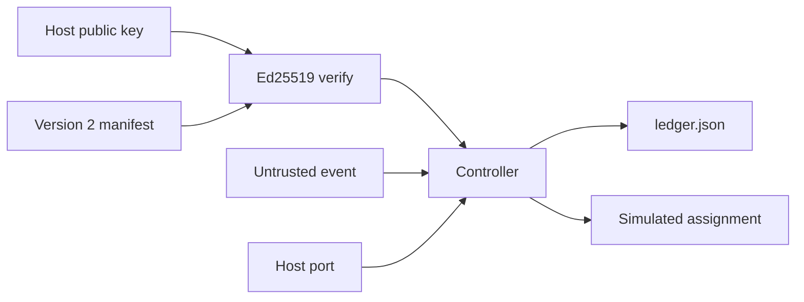

# Architecture Spine — Issue 536 story acceptance

## Design Paradigm

The parent ledger still classifies host evidence and records simulated assignments. Version 2 adds an owner signature, story requirements, a check floor, and usage budgets. Version 1 stays the parent contract. The controller verifies. It does not sign, merge, or call Cursor.



## Inherited Invariants

Citations of the parent spine use the prefix `parent`. Child headings below are this feature's own AD numbers.

| Inherited | From parent | Binds here |
| --- | --- | --- |
| parent AD-1 manifest permission | Issue 536 controller | Replaced for the flag sentence only, by this feature's AD-1 |
| parent AD-2 Event text is untrusted | Issue 536 controller | Event text cannot verify a requirement or set owner authorization |
| parent AD-3 Simulation is not live verification | Issue 536 controller | SIMULATED_PASS does not set either live flag or live_usage_verified |
| parent AD-4 A correction requires a new commit | Issue 536 controller | Evidence from an assigned head does not satisfy a later head |
| parent AD-5 One event, flock, exact ledger keys | Issue 536 controller | Same lock and the ledger key set in this feature's AD-4 |
| parent AD-6 A stale claim is IGNORED | Issue 536 controller | Unchanged |
| parent AD-7 Required checks fail closed | Issue 536 controller | Baseline names use the same exact-head conclusion rules |
| parent AD-8 Independent review is two authenticated roles | Issue 536 controller | bmad and catsec stay a separate gate from check names |
| parent AD-9 Secret-shaped material sticks | Issue 536 controller | Unchanged, and a secret hold does not read usage |
| parent AD-10 Assignment cap is not a usage budget | Issue 536 controller | A later clean head can still become READY after max_corrections |
| parent AD-11 Scope, base, secret, live, and digest failures stick | Issue 536 controller | A bad signature sticks. A different public key does not rewrite the store |
| parent AD-12 This feature does not ship or merge | Issue 536 controller | READY remains an owner decision string |

Parent AD-1 says `owner_manifest_authorized` is literal false on every decision. This feature replaces that one sentence. Version 2 sets the flag true if and only if verify succeeded against the bound public key. Version 1 keeps the flag false. A unit that leaves the flag false after a successful version-2 verify violates this feature. The parent file is not edited. The parent digest rule remains: a matching SHA-256 digest is not an owner signature.

Epic 45 AD-12 still pins Grok 4.6 for that epic. This feature requires `grok-4.7-high-fast` and does not amend Epic 45.

## Invariants & Rules

### AD-1 — An owner signature is the only version-2 authorization

- **Binds:** issue-536
- **Prevents:** The controller, a content digest, or a green check row minting owner approval
- **Rule:** The signing private key is outside Cursor, GitHub Actions, and this repository. `correction/` imports `Ed25519PublicKey` only and has no generate or sign function. `OwnerKeyring` accepts 32-byte public keys from the host. The signed payload is UTF-8 JSON with sorted keys and separators comma and colon, no whitespace. Its object keys are exactly `acceptance_criteria`, `allowed_paths`, `author_id`, `authorization`, `base_ref`, `base_sha`, `budget`, `manifest_id`, `manifest_version`, `model`, `pull_number`, `repo`, `required_checks`, `requirements`, and `task_id`. `authorization` in that payload is exactly `key_id` and `public_key_sha256`. The signature bytes are outside the payload. The store digest is SHA-256 of the same document with `authorization.signature` included, standard base64 of the 64 signature bytes. Version 1 documents keep the parent preimage and do not add those keys. `public_key_sha256` is the hex SHA-256 of the 32 public-key bytes. Verify succeeds only when the host key for that id hashes to that fingerprint and Ed25519 verify accepts the payload. For version 2, `owner_manifest_authorized` is true if and only if that verify succeeded. For version 1 it is false. A matching digest, a successful check, or event text cannot set the flag. The ledger stores `owner_public_key_sha256`. A later process whose key hashes differently returns a hold and does not write. Replay returns the stored flag and does not verify again. An invalid signature whose key fingerprint still matches is a sticky hold.

### AD-2 — Mandatory requirements are exact-head records

- **Binds:** issue-536
- **Prevents:** READY while a story requirement is missing, unverified, stale, mismatched, or failed
- **Rule:** A version-2 manifest carries 1 to 20 requirements and at least one mandatory requirement. Each requirement has a stable id, expected behavior, evidence kind `test` or `review`, and evidence name. The only channel that can satisfy a requirement is `RequirementEvidence`. A `Check`, a `TestResult`, and a `Review` cannot. A requirement row cannot satisfy a required check or the two-review gate. For each mandatory id, READY needs every row for that id to have result exactly `pass`, source exactly `bmad` or `catsec`, authentication source exactly `host-verified`, the current head, and the manifest evidence name. One trusted `fail` among those rows is a retryable finding and outranks a pass row. Any other row state holds without assignment. The stored result is `pass`, `fail`, or one of `requirement evidence is missing`, `requirement source is not independent`, `stale requirement evidence`, `requirement evidence does not match`, and `requirement is unverified`. Optional requirements are recorded and do not assign or block. Event text is not evidence. Engineering gates from the parent still apply.

### AD-3 — Baseline checks are a floor

- **Binds:** issue-536
- **Prevents:** A story manifest deleting a security or regression gate
- **Rule:** Version 2 `required_checks` must include `tdd`, `regression`, `integration`, `gitguardian`, and `security`. Extra names are allowed when they pass the existing check-name rules. Omitting one raises a manifest error before a store is created. Conclusion rules stay with the parent: only exact `success` on the current head counts. Pull-request workflow output is host evidence, not owner authorization.

### AD-4 — Unknown usage is not zero

- **Binds:** issue-536
- **Prevents:** A missing meter reading being treated as a free run, and a mocked number being reported as live usage
- **Rule:** Version 2 budgets are exactly `max_corrections` from 1 to 5, `max_elapsed_seconds` from 1 to 86400, `max_tokens` from 1 to 5000000, `max_cost_cents` from 1 to 100000, `max_no_progress` from 1 to 5, and `max_repeated_failures` from 1 to 5. Only elapsed seconds, tokens, and cost cents are `UsageEvidence` integers. They must be non-negative integers, with authentication source `host-verified` and the current head. Null, a boolean, a non-integer, a wrong head, or any other source holds as unknown or stale and does not stick. The controller does not coerce null to zero. A usage integer above its maximum sets `usage_gate` to `exceeded` and does not stick. No-progress and repeated-failure are ledger counts. They stick and they do not set `exceeded`. `max_corrections` stays the parent assignment cap. It does not set `usage_gate`, and a later clean head can still become READY. `usage_gate` is `host_supplied` only when those three integers were accepted for that decision, including RETRY and non-usage holds that happen after the usage check. It is `not_applicable` for version 1 and for any decision that did not accept usage, including a secret hold. `live_usage_verified` is stored on the trace as false beside `usage_gate`. Replay returns the stored owner flag, usage gate, and false usage flag, and does not derive them again. A future meter must attest the three integers for one SHA outside this repository. The host may set `host-verified` only after checking that attestation. This package does not call a meter.

### AD-5 — A correction invalidates exact-head evidence

- **Binds:** issue-536
- **Prevents:** Reusing a passing requirement row, check, review, or test from the assigned head
- **Rule:** The simulated cycle is a failing trusted requirement or test, one simulated assignment, a new commit, then fresh host evidence. Checks, tests, reviews, requirement rows, and usage must match the current head. An assigned head cannot become READY and cannot be assigned again. The same finding fingerprint holds for no progress. The controller stops on `READY_FOR_OWNER_MERGE_DECISION` or on a justified hold. `dispatcher` stays `simulated` and `live_dispatch` stays false.

### AD-6 — This feature does not operate the live loop

- **Binds:** issue-536
- **Prevents:** A unit-test key or a green mock being described as production owner control or a live agent
- **Rule:** The package has no merge client, no deploy client, no GitHub transport client, and no Cursor client. `UAT_DEPLOY_GATE_ACTIVE` stays false and `UAT_MAIN_DEPLOY_SUPPRESSED` stays true. Production remains NO-GO. A test-generated key pair is not the production owner key.

## Consistency Conventions

| Concern | Convention |
| --- | --- |
| Naming | Version 2 status strings stay the parent set. `usage_gate` is `not_applicable`, `unknown`, `exceeded`, or `host_supplied`. |
| Data and formats | Signature is standard base64 of 64 bytes. Requirement ids match `^[A-Z][A-Z0-9-]{1,32}$`. Ledger top-level keys add `owner_public_key_sha256` to the parent set. Version 2 trace rows include `requirement_results` plus the stored owner flag, usage gate, and `live_usage_verified`. |
| State and auth | Version 1 digest behavior is unchanged. Version 2 authorization is Ed25519 verify against the one public key named by `public_key_sha256`. Event text is not an identity and not a requirement result. |

## Stack

| Name | Version |
| --- | --- |
| Python | 3.12 |
| cryptography | 50.0.2 |
| actions/checkout | 11d5960a326750d5838078e36cf38b85af677262 |
| actions/setup-python | a26af69be951a213d495a4c3e4e4022e16d87065 |

PyPI listed cryptography 50.0.2 on 2026-09-30 as the current stable release when this spine was checked on 2026-11-03. The Ed25519 verify call is `Ed25519PublicKey.verify(signature, data)`, the same order documented for 41.0.7 and exercised here by the story tests on 50.0.2. The workflow installs that pin. It does not change permissions or the checkout pins. Local OpenSSL is not invoked.

The checkout and setup-python commits are the parent pins. Both actions still declare the Node 20 runtime. GitHub's changelog set 2026-09-23 as the Node 20 removal date, and current Node 24 releases are newer major versions. The parent workflow completed on these same pins on 2026-11-02. This feature does not retarget those action SHAs. A Node 24 bump is deferred until a run on this workflow fails or the owner asks for the bump.

## Structural Seed

```text
_bmad-output/implementation-artifacts/cohestra-correction-controller/
  correction/authorization.py
  correction/manifest.py
  correction/controller.py
  correction/models.py
  tests/test_story_acceptance.py
.github/workflows/correction-controller-tests.yml
```

## Capability to Architecture Map

| Capability | Lives in | Governed by |
| --- | --- | --- |
| Owner signature verify | correction/authorization.py | AD-1 |
| Story manifest and baseline floor | correction/manifest.py | AD-1, AD-2, AD-3 |
| Requirement, usage, and correction gates | correction/controller.py | AD-2, AD-4, AD-5 |
| Story demonstration and negatives | tests/test_story_acceptance.py | AD-1 through AD-6 |
| Architecture record | this spine | bmad-architecture |
| Red tests before the gate assertions | tests/test_story_acceptance.py | bmad-testarch-atdd |
| Implementation of the approved gates | correction/ | bmad-quick-dev |
| Risk that a digest or a mock meter is mistaken for trust | README and follow-on file | bmad-testarch-test-design |
| Independent review | bmad-code-review and Cursor security-review | AD-6 |

`bmad-code-review` runs Blind Hunter through `bmad-review-adversarial-general`, Edge Case Hunter through `bmad-review-edge-case-hunter`, and an Acceptance Auditor. CAT-SEC is the Cursor `security-review` subagent. Those reviews use `grok-4.7-high-fast`.

## Deferred

- Custody of the production Ed25519 private key, and out-of-band delivery of its public key. Test keys do not authorize a real story.
- Live read-only GitHub transport. The port remains a test double.
- Live scoped Cursor dispatch. `is_live` remains a hold.
- A live usage meter. The attestation steps in AD-4 are the contract. They are not implemented here, and `live_usage_verified` is not evidence of one.
- Live adapter reviewer authentication. The adapter must verify GitHub identity before setting `host-verified`.
- GitHub App installation, ruleset changes, and required-check registration.
- UAT activation, production deploy, and ADCP restoration.
- Upgrading Epic 45 off its Grok 4.6 pin. This feature does not do that.
- Moving the unit-test workflow from the parent Node 20 action pins to current Node 24 action releases.
