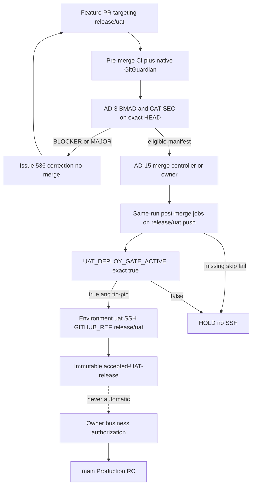
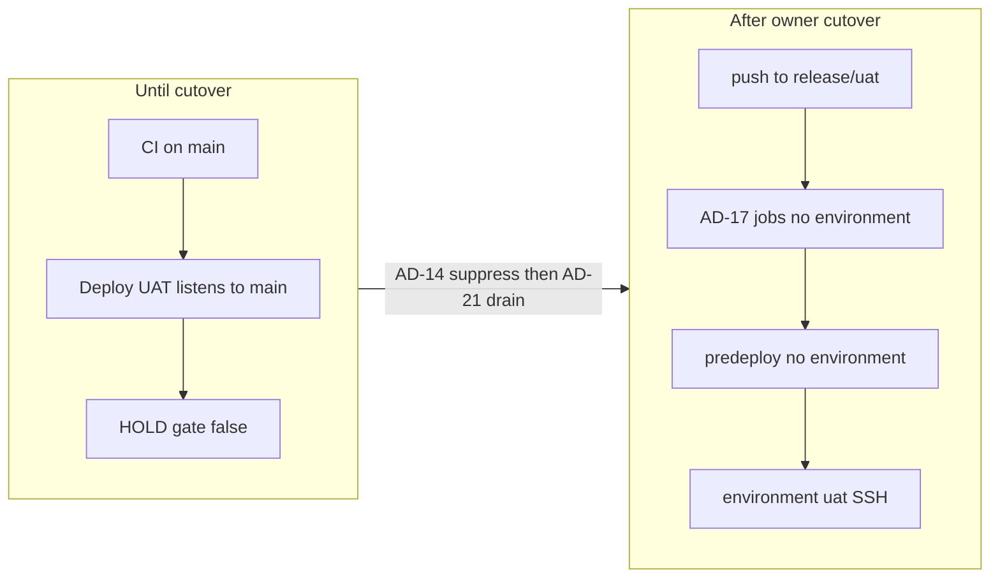

# Architecture Spine — Option B release/uat

## Design Paradigm

**Fail-closed gated pipeline** (unchanged). Option B moves the UAT integration and deploy source from `main` to protected `release/uat`. `main` becomes the Production release-candidate line. Missing evidence is HOLD. CI PASS is not deploy authorization.



## Inherited Invariants

Parent: `architecture-uat-automation-readiness-2026-11-01`. IDs are not renumbered.

| Inherited | From parent | Binds here |
| --- | --- | --- |
| AD-2 first-merge suppressor exact `true` | parent AD-2 | Still required after cutover. Not replaced by AD-14. |
| AD-3 dual-review identity | parent AD-3 | Check-runs `Cohestra BMAD` / `Cohestra CAT-SEC` or two human APPROVED reviews. |
| AD-4 reporter ≠ controller | parent AD-4 | #535 consumer. #536 correction. Neither is the merge controller. |
| AD-5 no auto-merge to main | parent AD-5 | Tightened: #536 still cannot merge. A separate AD-15 controller may merge only into `release/uat`. |
| AD-6 dedicated post-merge check-run | parent AD-6 | Superseded after PR-D by AD-17/AD-23 same-run jobs. Do not wait on a separate check-run. |
| Epic 45 AD-5 `workflow_run` + `remote-deploy.sh` | Epic 45 AD-5 | `remote-deploy.sh` remains. `workflow_run` is removed at PR-D (AD-22). |
| AD-7 `remote-deploy.sh` SHA checkout | parent AD-7 | Host entrypoint unchanged. SHA is the `release/uat` merge SHA. |
| AD-8 honest artifacts | parent AD-8 | Expected HOLD skips silent. Post-SSH missing evidence FAIL. |
| AD-10 correction budget and manifest | parent AD-10 | #536 stays `SIMULATED_PASS` first. No merge token. |
| AD-11 rollback not implied automatic | parent AD-11 | #532 remains separate. |
| Epic 45 AD-1 no Cursor SSH | Epic 45 | Agents read Actions artifacts. |
| Epic 45 AD-3 `MISSING_SECRET=<NAME>` | Epic 45 | After eligible, before SSH. |
| Epic 45 AD-4 no secrets in artifacts | Epic 45 | Scrub evidence. |
| Production owner-only | Epic 45 / 46 | `PROD_*`, Environment `production`, dispatch from `main`. |

### AD-1 — live in PHASE_MAIN_LISTEN and PHASE_SUPPRESS only

- **Binds:** Current `main` Deploy UAT tip-pin
- **Prevents:** Pretending Option B is already live
- **Rule:** One `deploy.yml` at a time. In PHASE_MAIN_LISTEN and PHASE_SUPPRESS the file still lists `workflow_run.branches: [main]` and tip-pins `origin/main`. PR-D replaces that file; AD-12 then applies. AD-1 does not authorize SSH. Do not delete this AD.

## Invariants & Rules

### AD-12 — `release/uat` is the only post-cutover UAT deploy source

- **Binds:** Deploy UAT, post-merge gate, rollback, Environment `uat`
- **Prevents:** Deploying `main`, a feature SHA, or a branch named `uat`
- **Rule:** In PHASE_RETARGET and PHASE_ARMED, `candidate_sha` must be a commit, an ancestor of `origin/release/uat`, and equal to the current `origin/release/uat` tip. Source ref is `github.ref` of the **deploy workflow run** (`refs/heads/release/uat`). Do not use `workflow_run.head_branch` as the Environment identity. A SHA that is also `origin/main` tip is still REFUSE if `github.ref` is `refs/heads/main`. Rollback pins ancestors of `origin/release/uat` via `ORIGIN_UAT_REF`.

### AD-13 — `main` is Production RC only after suppression

- **Binds:** CI on `main`, Deploy UAT, Deploy Production
- **Prevents:** A post-cutover push to `main` starting UAT SSH
- **Rule:** After PR-D, Deploy UAT has **no** `workflow_run` trigger. A `main` CI completion must not create a Deploy UAT run. Residual `workflow_run` listeners are a contract FAIL. Production remains `workflow_dispatch` from `refs/heads/main` with existing provenance. No automation opens or merges a `release/uat` → `main` PR.

### AD-14 — Dual suppressor; gate never implies source

- **Binds:** `deploy.yml` predeploy, owner cutover
- **Prevents:** Enabling `UAT_DEPLOY_GATE_ACTIVE` while `main` can still trigger Deploy UAT
- **Rule:** SSH `eligible=true` only when every conjunct is exact: `UAT_DEPLOY_GATE_ACTIVE==true` AND `UAT_MAIN_DEPLOY_SUPPRESSED==true` AND `github.ref==refs/heads/release/uat` AND AD-12 tip-pin AND every AD-17 job in **this run** is SUCCESS. Job order is a `needs` edge, not a Checks query: AD-17 jobs, then `predeploy` `needs` all of them, then `deploy` `needs` `predeploy`. Predeploy must not start until every required job has finished. Do not evaluate AD-17 names via the Checks API or `ci.yml` jobs. After PR-D under AD-23, `GITHUB_EVENT_NAME=push` is a legal event. After PR-D under AD-24, the only legal event is `workflow_dispatch`. Gate true with `github.ref==refs/heads/main` is HOLD `CUTOVER_INCOMPLETE_MAIN_SOURCE` (N14) — refuse on **ref**, not SHA uniqueness. After PR-D, `workflow_run` on `main` or `release/uat` is a contract FAIL of PR-D (N25), not an Environment-deny fallback. The SSH job must re-assert AD-12 and this conjunction immediately before `appleboy/ssh-action`; a newer `release/uat` tip HOLDs the older run. PR-C installs AD-27 inline suppression on `main` without changing `workflow_run.branches`. Phases: PHASE_MAIN_LISTEN → PHASE_SUPPRESS → AD-21 drain → PR-D on `main` → AD-25 sync PR into `release/uat` → PHASE_ARMED.

### AD-15 — Merge controller is not the correction controller

- **Binds:** Auto-merge into `release/uat`, Issue #536, PR #535
- **Prevents:** #536 or #535 gaining `contents: write` on `release/uat` or `main`
- **Rule:** The only automation that may merge into `release/uat` is GitHub App `cohestra-uat-merge` (slug `cohestra-uat-merge`, distinct numeric id from #535/#536 Apps). It uses the pull-request merge API with an **installation access token** only (AD-26). It must not force-push, must not write `main`, must not read Environment `uat` or `production` secrets, and must not edit repository variables. Owner installs a ruleset that encodes those denies. Humans with OWNER may merge (user token / UI). #535 evaluates. #536 assigns scoped Cursor repairs and must not be installed as `cohestra-uat-merge`. Neither review App nor the correction App may merge. `secrets.GITHUB_TOKEN` must not perform the merge.

### AD-16 — Auto-merge is manifest-eligible and non-control-plane

- **Binds:** Feature PRs into `release/uat`
- **Prevents:** Auto-merge of workflows, deploy controls, secrets, Production, billing/auth/migrations, or #505
- **Rule:** The authorization manifest is a file on `main` at `deploy/uat-task-manifests/<task_id>.json` merged by an owner (control-plane path). A `TASK.md` on the PR head is evidence only. Fields: `task_id`, `pr_number`, `allowed_path_prefixes`, `base_sha`, `max_attempts`, `reviewer_app_slugs` equal to AD-3 slugs. Merge-tree paths must be a subset of `allowed_path_prefixes`. Paths under `.github/workflows/**`, `deploy/**`, `docs/deploy/**`, billing/auth/migration trees, Production interfaces, or PR #505 require a separate owner merge and must not appear in an auto-merge manifest. The merge controller re-evaluates AD-3 itself; a #535 READY comment is not a permit. Exact-HEAD CI, native GitGuardian, AD-3 with no BLOCKER/MAJOR, mergeable clean, not draft, current SHA. Any new commit invalidates evidence. Branch policy requires the named check-runs.

### AD-17 — Post-merge gate runs on the `release/uat` merge SHA

- **Binds:** `deploy.yml` (AD-23). `post-merge-uat.yml` only under exclusive AD-24.
- **Prevents:** Using a feature HEAD, a `main` CI run, or a `ci.yml` check-run of a similar name as deploy eligibility
- **Rule:** Required Deploy UAT job names (distinct from `ci.yml` Checks): `UAT post-merge — .NET build and test`, `UAT post-merge — API integration tests`, `UAT post-merge — Next.js build`, `UAT post-merge — Frontend unit tests`, `UAT post-merge — AuthN AuthZ regression`, `UAT post-merge — Billing entitlement regression`, `UAT post-merge — Docker stack smoke`, `UAT post-merge — UAT isolation contract`, `UAT post-merge — Exact-SHA security scan`, `UAT post-merge — GitGuardian exact-SHA API scan`, `UAT post-merge — Deploy artifact provenance`. After PR-D under AD-23 they live in Deploy UAT. `predeploy` `needs` all of them (`needs` waits; it never observes pending). SSH `needs` `predeploy`. A needed job that is FAILURE, CANCELLED, or SKIPPED skips dependents. Do not poll check-runs of these names. Parent AD-6 check-run `Post-merge UAT validation` is not a gate after PR-D. `ci.yml` is not a deploy trigger. Under exclusive AD-24, `post-merge-uat.yml` holds the first copy (automatic start only). Deploy UAT still holds a second copy; AD-14 `needs` that copy. The dispatch App is not a substitute for in-run `needs`. The App fires only when every named job `conclusion==success` on that SHA (not workflow `conclusion`, not Actions `success()`).

### AD-18 — Environment `uat` allows only `release/uat`

- **Binds:** GitHub Environment `uat`
- **Prevents:** Feature-branch or `main` jobs reading `DROPLET_*`
- **Rule:** Owner configures deployment branch policy `release/uat` only and `can_admins_bypass=false` before PR-D merges and before the deploy gate is `true`. Jobs with `environment: uat` run only after `eligible=true`. `DROPLET_*` stay environment-scoped. `PROD_DROPLET_*` stay on Environment `production`. This agent does not apply the policy.

### AD-19 — Accepted UAT releases are immutable and not promotions

- **Binds:** Acceptance records, main promotion
- **Prevents:** Treating UAT PASS as a `main` merge right
- **Rule:** After live UAT acceptance, write `accepted-uat-release.json` with `release_sha`, `git_tree`, `compose_config_hash`, CI run ids, review identities, and `state=AWAIT_BUSINESS_RELEASE`. No `main` PR is opened from automation. Promotion requires an independently authenticated owner instruction that names that `release_sha`. Promotion verifies tree equivalence or re-runs UAT, then exact-`main`-SHA CI/security and existing Production provenance.

### AD-20 — Privileged Deploy UAT YAML is control-plane on protected `release/uat`

- **Binds:** Deploy UAT, post-merge jobs, Environment `uat`
- **Prevents:** A feature-branch `deploy.yml` using `DROPLET_*`
- **Rule:** After PR-D, GitHub executes the Deploy UAT YAML from the `release/uat` tip (`push` / dispatch-on-that-ref). `workflow_dispatch` also requires the workflow file on the default branch — PR-D must land on `main`, then AD-25 syncs the exclusive tree onto `release/uat`. That path is control-plane: AD-16 forbids auto-merge of `.github/workflows/**` and `deploy/**`. `pull_request` and `pull_request_target` never include `environment: uat` or `secrets.DROPLET_*`. Every other workflow (`ci.yml`, `uat-readiness.yml`, `uat-correction.yml`, `uat-merge.yml`, `post-merge-uat.yml`, `deploy-production.yml`) must also be free of `environment: uat` and `secrets.DROPLET_*`. Do not run PR-authored scripts with UAT secrets. Checkout uses `persist-credentials: false`. `GITGUARDIAN_API_KEY` stays a scan-only repository secret. Closed `on:` is AD-23 or exclusive AD-24 (AD-23). A leftover `workflow_run` listener is a contract FAIL of PR-D (N25). Feature-ref `workflow_dispatch` is REFUSE. After PR-D the evaluator must accept `GITHUB_EVENT_NAME=push` (AD-23) or `workflow_dispatch` (AD-24). `commission-uat-hold` must not require `workflow_run` after PR-D. GG / Layer A `head_branch==main` is Production-only.

### AD-21 — Cutover drains queued and in-progress Deploy UAT

- **Binds:** Owner cutover H, `deploy-uat` concurrency
- **Prevents:** A pre-retarget run completing SSH after the owner believes `main` is quiet
- **Rule:** Concurrency group stays `deploy-uat` with `cancel-in-progress: false`. Before merging PR-D, the owner sets `UAT_MAIN_DEPLOY_SUPPRESSED=true`, lists Deploy UAT runs in `queued`, `in_progress`, `waiting`, `pending`, or `requested`, waits until each is `completed` with `eligible=false` and `ssh_executed=false`, then merges PR-D to **`main`** (delete `workflow_run`, add `push` to `release/uat` under AD-23). `release/uat` is updated only by AD-25. After both copies exist, `deploy.yml` on `main` and on `release/uat` both have no `workflow_run`. A leftover listener on either copy is a contract FAIL of PR-D (N25), not a documented Environment-deny residual. Do not cancel in-flight jobs; wait for HOLD completion.

### AD-22 — Environment identity is `GITHUB_REF`, not checkout

- **Binds:** Environment `uat`, Deploy UAT triggers
- **Prevents:** Assuming `workflow_run.head_branch` or `actions/checkout` satisfies a `release/uat` Environment policy
- **Rule:** GitHub matches Environment selected-branch policy to the workflow run `GITHUB_REF`. Documented: `workflow_run` and `repository_dispatch` set `GITHUB_REF` to the default branch (`main`). Those triggers cannot deploy to Environment `uat` once it allows only `release/uat`. Documented: `workflow_call` sets `GITHUB_REF` to the **caller** ref — a `ci.yml` call from `release/uat` **would** match the policy; therefore `workflow_call` is name-forbidden on Deploy UAT (AD-23). Checkout, `workflow_run.head_branch`, and `ORIGIN_UAT_REF` do not change the Environment ref. A leftover `workflow_run` listener is a contract FAIL of PR-D (N25), not a licensed “safe deny.” Live canary of the denied pair is UNVERIFIED; `simulate-github-refs.py` is the required simulation.

### AD-23 — After cutover, Deploy UAT is a protected `push` with in-run `needs`

- **Binds:** `deploy.yml` after PR-D, AD-17 jobs, SSH job
- **Prevents:** CI-complete-before-post-merge HOLD with no retry; Environment ref mismatch
- **Rule:** Default after PR-D **unless exclusive AD-24**. `on:` may contain only `push: {branches: [release/uat]}` and optional `workflow_dispatch` (that dispatch still runs the same AD-17 jobs). Name-forbid `workflow_run`, `repository_dispatch`, `workflow_call`, `pull_request`, `pull_request_target`. Required AD-17 jobs run in this workflow without `environment: uat`. `predeploy` `needs` every AD-17 job. The SSH job `needs` `predeploy`, uses `environment: uat`, and runs only if each needed job is SUCCESS and AD-14 is PASS. A fully passing `release/uat` push reaches predeploy after tests finish, then SSH if AD-14 PASS. FAILURE, CANCELLED, or SKIPPED required jobs skip dependents. Evaluator must accept `GITHUB_EVENT_NAME=push`. `commission-uat-hold` must not require `workflow_run` after PR-D.

### AD-24 — Dispatch alternative is exclusive and authenticated

- **Binds:** Optional split of post-merge file vs deploy file
- **Prevents:** Running AD-23 `push` deploy together with a split-file or CI/`workflow_run`/`workflow_call` deploy
- **Rule:** Implement AD-23 **XOR** AD-24, never both. Under AD-24: Deploy UAT `on:` is **only** `workflow_dispatch` (no `push`, no `workflow_run`, no `repository_dispatch`, no `workflow_call`). Deploy UAT **still contains** the AD-17 jobs; `predeploy` `needs` them; SSH `needs` `predeploy`. AD-14 “this run SUCCESS” is that `needs` edge. Human / PAT / other-App `workflow_dispatch --ref release/uat` re-runs those jobs; it is not a skip-tests path. `post-merge-uat.yml` is the automatic start only (`push` to `release/uat`, no `environment: uat`). Dedicated App `cohestra-uat-dispatch` (not #535, #536, or `cohestra-uat-merge`) dispatches `--ref release/uat` only after every named AD-17 job `conclusion==success` on the **`post-merge-uat.yml` run for that SHA** — not any same-named job on another workflow, not workflow `conclusion`, not Actions `success()`. The App may dispatch **only** `.github/workflows/deploy.yml`. It must not dispatch `deploy-production.yml` or any other workflow, must not have Environment secrets, and must not have `contents: write`. `GITHUB_TOKEN` must not start Deploy UAT. Push + split file + no in-run AD-17 jobs is a contract FAIL. Default is AD-23.

### AD-25 — Protected `release/uat` sync is an owner PR, not a fast-forward of `main`

- **Binds:** PR-D cutover, protected `release/uat`
- **Prevents:** Force-push or admin-bypass fast-forward of the live `main` tip (and unintended Production-RC commits) into `release/uat`
- **Rule:** After PR-D merges to `main`, do **not** `git push --ff-only origin/main:release/uat`, force-push, or bypass branch protection. Owner opens a control-plane PR targeting `release/uat` whose merge-tree for exclusive PR-D paths equals the PR-D-on-`main` tree (`git ls-tree` of `.github/workflows/deploy.yml` and the PR-D exclusive scripts). Unintended `main` paths (app, Production workflows, #505) must not enter `release/uat` through this PR. If `main` moved after the Q2 SHA, the sync PR is a same-patch / cherry-pick of PR-D only. Merge is **human OWNER only** (UI or user token). AD-15 auto-merge must not land it (control-plane paths). Leftover `workflow_run` on either copy after both merges is N25.

### AD-26 — Merge into `release/uat` must create an authenticated `push` workflow

- **Binds:** AD-15, AD-23, `uat-merge.yml`
- **Prevents:** A merge performed with `GITHUB_TOKEN` that never starts Deploy UAT
- **Rule:** Documented: events triggered by `secrets.GITHUB_TOKEN` do not create new workflow runs except `workflow_dispatch` / `repository_dispatch`. A `GITHUB_TOKEN` merge or push into `release/uat` is a contract FAIL (N35) — AD-23 never starts. `cohestra-uat-merge` must use a GitHub App **installation access token** for the pull-request merge API so GitHub emits a normal `push` to `refs/heads/release/uat`. Human OWNER UI merge also emits `push`. Live App→`push`→Deploy UAT is UNVERIFIED until the App exists; `simulate-migration-contracts.py` is the required simulation. `GITHUB_TOKEN` must not be the merge credential.

### AD-27 — Trusted inline suppression on the default-branch workflow file

- **Binds:** PR-C `deploy.yml` on `main`
- **Prevents:** Candidate SHA checkout supplying a validator that omits `UAT_MAIN_DEPLOY_SUPPRESSED`
- **Rule:** PR-C adds a step in the default-branch `deploy.yml` **before** any `actions/checkout` of `TARGET_SHA` / `workflow_run.head_sha`. That step reads `vars.UAT_MAIN_DEPLOY_SUPPRESSED` and `vars.UAT_DEPLOY_GATE_ACTIVE` from the workflow env. Exact `UAT_MAIN_DEPLOY_SUPPRESSED==true` → HOLD `UAT_MAIN_DEPLOY_SUPPRESSED is true`, `eligible=false`, write both evidence files inline, skip candidate validation. Exact `UAT_DEPLOY_GATE_ACTIVE!=true` → HOLD `UAT_DEPLOY_GATE_ACTIVE is not true` (same as #451). Candidate-tree `validate-uat-predeploy-gate.sh` must not be the first suppressor. Do **not** change `on.workflow_run.branches` (still `[main]`). Defense-in-depth: the script also HOLDs when suppressed. Unset suppression + gate false = #451 behavior.

## Consistency Conventions

| Concern | Convention |
| --- | --- |
| Branch names | Git `release/uat`. Environment `uat`. Never a git branch `uat`. |
| Tip-pin after cutover | `ORIGIN_UAT_REF=origin/release/uat`. `ORIGIN_MAIN_REF` remains Production-only. |
| Triggers after cutover | Deploy UAT: `push` to `release/uat` (AD-23) or exclusive AD-24 dispatch `--ref release/uat`. Never `workflow_run`. Production unchanged. |
| CI | `ci.yml` runs on `push`/`pull_request`/`merge_group` for `main` and `release/uat`. GG API scan on push to either protected line. |
| Auto-merge | Only `release/uat`. Manifest path allowlist. Control-plane paths owner-merge only. |
| Verdicts | `SIMULATED_PASS`, `LIVE_READ_ONLY_VERIFIED`, `LIVE_UAT_DEPLOY_VERIFIED`, `NOT_RUN`. Missing ≠ PASS. |
| Concurrency | `deploy-uat` only for Deploy UAT. `post-merge-uat-${{ github.sha }}`. `uat-correction-${{ pr }}`. `uat-merge-${{ pr }}`. Never `deploy-production`. |
| Cutover phases | `PHASE_MAIN_LISTEN` → `PHASE_SUPPRESS` → `PHASE_RETARGET` → `PHASE_ARMED`. One `deploy.yml` per phase. PR-D retargets `main`; AD-25 syncs `release/uat`. |
| Merge token | App installation token or human OWNER. Never `GITHUB_TOKEN` for a merge that must start AD-23. |
| Tip-pin name | After PR-D, scripts read `ORIGIN_UAT_REF=origin/release/uat` only. No parallel `origin/main` UAT tip-pin. |

## Stack

| Name | Version |
| --- | --- |
| .NET | 9.0 |
| Next.js | 16.3.6 |
| Node | 22 |
| PostgreSQL | 16 |
| GitHub Actions checkout | 4.4.0 pin `11d5960a326750d5838078e36cf38b85af677262` |
| GitHub Actions upload-artifact | 4.6.2 pin `ea165f8d65b6e75b540449e92b4886f43607fa02` |
| GitHub Actions download-artifact | 4.3.0 pin `d3f86a106a0bac45b974a628896c90dbdf5c8093` |
| appleboy/ssh-action | 1.2.2 pin `2ead5e36573f08b82fbfce1504f1a4b05a647c6f` |
| ggshield | 1.56.1 |

## Structural Seed

```text
.github/workflows/
  ci.yml                 # add release/uat + merge_group; no secrets
  deploy.yml             # after PR-D: push release/uat; AD-17 jobs need SSH
  post-merge-uat.yml     # AD-24 only; omitted under AD-23
  deploy-production.yml  # unchanged
  uat-readiness.yml      # PR #535 only
  uat-correction.yml     # Issue #536 later
  uat-merge.yml          # AD-15 later; no DROPLET_*
```



## Capability → Architecture Map

| Capability | Lives in | Governed by |
| --- | --- | --- |
| Option B ADR | Issue #538, `ADR-OPTION-B.md` | this spine |
| Historical audit | PR #537 audit file | unchanged findings |
| Dual suppressor | PR-C inline `deploy.yml` + vars | AD-2, AD-14, AD-27 |
| Protected sync | owner PR into `release/uat` | AD-25 |
| Merge → `push` | App installation token | AD-15, AD-26 |
| Tip-pin `release/uat` | proposed `validate-uat-predeploy-gate.sh` | AD-12 |
| Merge controller | proposed `uat-merge.yml` | AD-15, AD-16 |
| Correction loop | Issue #536 | AD-10, AD-15 |
| Readiness consumer | PR #535 | AD-3, AD-4 |
| Post-merge tests | same `deploy.yml` run (AD-23) | AD-17, AD-23 |
| Environment `GITHUB_REF` | documented event table | AD-22 |
| Environment restriction | owner GitHub UI | AD-18 |
| Accepted release record | proposed acceptance writer | AD-19 |
| Production | `deploy-production.yml` | inherited, AD-13 |

## Deferred

| Item | Why it can wait |
| --- | --- |
| Creating and protecting `release/uat` | Owner GitHub UI. This agent must not set live protections. |
| Setting Environment `uat` branch policy | Owner. Required before gate `true`. |
| Installing `cohestra-bmad`, `cohestra-cat-sec`, `cohestra-uat-merge` | Owner. |
| Choosing merge queue vs auto-merge button | CI will include `merge_group` so either works. Owner enables one. |
| Live SSH rehearsal | Separate authorization. |
| `UAT_DEPLOY_GATE_ACTIVE=true` | Last owner step after verified positives and negatives. |
| Automatic rollback | Still AD-11. |
| Production activation | NO-GO. |

## Open questions

| ID | Question | Blocks |
| --- | --- | --- |
| Q1 | Owner will enable merge queue or classic required checks + auto-merge? | AD-16 wiring only; `merge_group` job is required either way |
| Q2 | Initial `release/uat` SHA: current `main` `22ffe635`? | Owner create-branch step |
| Q3 | Same DROPLET_* names move with Environment policy, or recreate? | Owner secret UI. Values unread. |

## Conflicts with prior decisions

| Conflict | Resolution |
| --- | --- |
| Parent AD-1 forbids a UAT integration branch | Issue #538 accepts Option B. AD-1 stays live until cutover; AD-12 applies after. |
| Parent AD-5 forbids auto-merge | Tightened, not dropped: still no auto-merge to `main` and no merge by #536. AD-15 is a new, narrower writer. |
| Parent AD-9 required Environment `uat` policy `main` | After cutover the allowed branch is `release/uat` (AD-18). Until cutover the environment remains FAIL-unrestricted as audited. |
| Issue #519 per-feature owner merge | Superseded only for manifest-eligible `release/uat` PRs after controls exist. Owner merge remains for control-plane and for `main`. |
| c6ec3370 used `workflow_run` after cutover | Superseded by AD-22/AD-23. `workflow_run` `GITHUB_REF` is `main` and cannot satisfy Environment `uat`=`release/uat`. |
| Parent AD-6 dedicated check-run `Post-merge UAT validation` | Superseded after PR-D by AD-17/AD-23 same-run `needs`. Until PR-D, AD-1 + current `main` `workflow_run` remain. |
| Epic 45 AD-5 `workflow_run` + `head_sha` entrypoint | `remote-deploy.sh` remains. The `workflow_run` trigger is removed at PR-D (AD-22). |
| Brownfield evaluator requires `GITHUB_EVENT_NAME` ∈ {`workflow_run`,`workflow_dispatch`} and GG `head_branch==main` | After PR-D under AD-23, `push` is eligible. GG / Layer A `head_branch==main` is Production-only. `commission-uat-hold` must not require `workflow_run`. |
| Prior letters assumed PR-D fast-forward into `release/uat` | Superseded by AD-25. Protected branch: owner PR, exclusive-tree match, no FF of live `main` tip. |
| `GITHUB_TOKEN` merge of `uat-merge.yml` | Superseded by AD-26. Documented: `GITHUB_TOKEN` `push` does not start Deploy UAT. |
