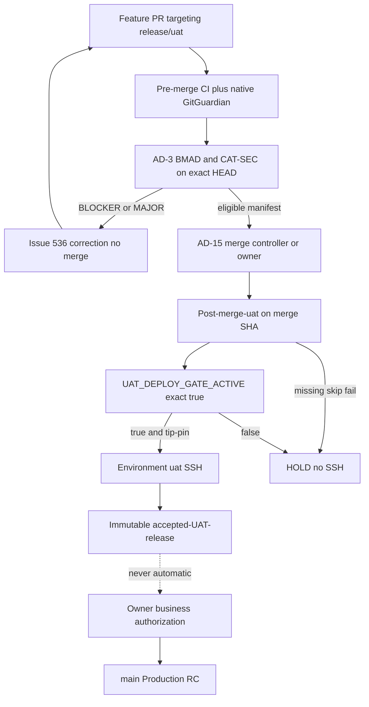
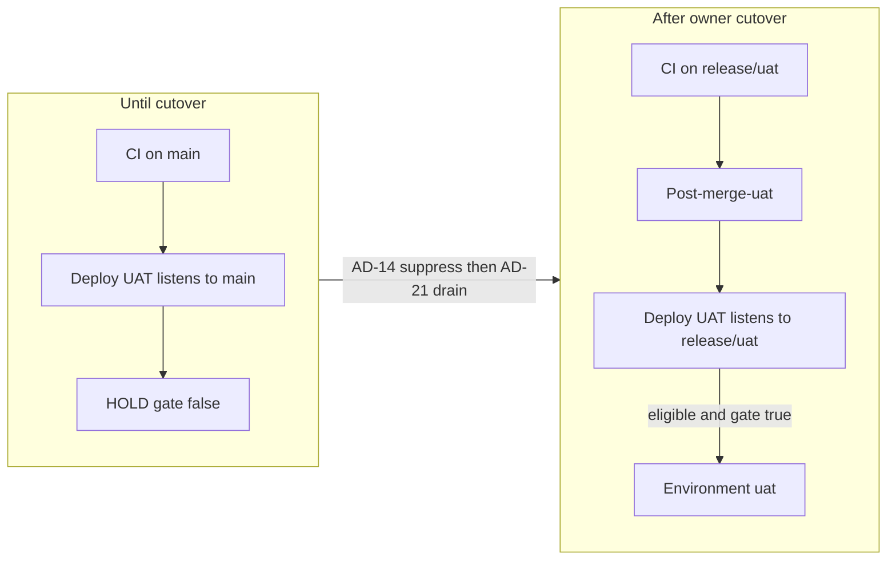

# Architecture Spine — Option B release/uat

## Design Paradigm

**Fail-closed gated pipeline** (unchanged). Option B moves the UAT integration and deploy source from `main` to protected `release/uat`. `main` becomes the Production release-candidate line. Missing evidence is HOLD. CI PASS is not deploy authorization.



## Inherited Invariants

Parent: `architecture-uat-automation-readiness-2026-11-01`. IDs are not renumbered.

| Inherited | From parent | Binds here |
| --- | --- | --- |
| AD-2 first-merge suppressor exact `true` | parent AD-2 | Still required after cutover. Not replaced by AD-14. |
| AD-3 dual-review identity | parent AD-3 | Check-runs `Cohestra BMAD` / `Cohestra CAT-SEC` or two human APPROVED reviews. |
| AD-4 reporter ≠ controller | parent AD-4 | #535 consumer. #536 correction. Neither is the merge controller. |
| AD-5 no auto-merge to main | parent AD-5 | Tightened: #536 still cannot merge. A separate AD-15 controller may merge only into `release/uat`. |
| AD-7 `remote-deploy.sh` SHA checkout | parent AD-7 | Host entrypoint unchanged. SHA is the `release/uat` merge SHA. |
| AD-8 honest artifacts | parent AD-8 | Expected HOLD skips silent. Post-SSH missing evidence FAIL. |
| AD-10 correction budget and manifest | parent AD-10 | #536 stays `SIMULATED_PASS` first. No merge token. |
| AD-11 rollback not implied automatic | parent AD-11 | #532 remains separate. |
| Epic 45 AD-1 no Cursor SSH | Epic 45 | Agents read Actions artifacts. |
| Epic 45 AD-3 `MISSING_SECRET=<NAME>` | Epic 45 | After eligible, before SSH. |
| Epic 45 AD-4 no secrets in artifacts | Epic 45 | Scrub evidence. |
| Production owner-only | Epic 45 / 46 | `PROD_*`, Environment `production`, dispatch from `main`. |

### AD-1 — live in PHASE_MAIN_LISTEN and PHASE_SUPPRESS only

- **Binds:** Current `main` Deploy UAT tip-pin
- **Prevents:** Pretending Option B is already live
- **Rule:** One `deploy.yml` at a time. In PHASE_MAIN_LISTEN and PHASE_SUPPRESS the file still lists `workflow_run.branches: [main]` and tip-pins `origin/main`. PR-D replaces that file; AD-12 then applies. AD-1 does not authorize SSH. Do not delete this AD.

## Invariants & Rules

### AD-12 — `release/uat` is the only post-cutover UAT deploy source

- **Binds:** Deploy UAT, post-merge gate, rollback, Environment `uat`
- **Prevents:** Deploying `main`, a feature SHA, or a branch named `uat`
- **Rule:** In PHASE_RETARGET and PHASE_ARMED, `candidate_sha` must be a commit, an ancestor of `origin/release/uat`, and equal to the current `origin/release/uat` tip. Source ref is taken from `workflow_run.head_branch` or `github.ref`, not from SHA uniqueness. A SHA that is also `origin/main` tip is still REFUSE if the event ref is `main`. Git branch name is exactly `release/uat`. Environment name is exactly `uat`. Rollback also pins ancestors of `origin/release/uat` via `ORIGIN_UAT_REF`.

### AD-13 — `main` is Production RC only after suppression

- **Binds:** CI on `main`, Deploy UAT, Deploy Production
- **Prevents:** A post-cutover push to `main` starting UAT SSH
- **Rule:** After PR-D, `deploy.yml` `on.workflow_run.branches` is exactly `[release/uat]`. A `main` CI completion must not create a Deploy UAT run. If a delayed `main` `workflow_run` still arrives, AD-14 inline HOLD runs. Production remains `workflow_dispatch` from `refs/heads/main` with existing provenance. No automation opens or merges a `release/uat` → `main` PR.

### AD-14 — Dual suppressor; gate never implies source

- **Binds:** `deploy.yml` predeploy, owner cutover
- **Prevents:** Enabling `UAT_DEPLOY_GATE_ACTIVE` while `main` can still trigger Deploy UAT
- **Rule:** SSH `eligible=true` only when every conjunct is exact: `UAT_DEPLOY_GATE_ACTIVE==true` AND `UAT_MAIN_DEPLOY_SUPPRESSED==true` AND event source ref is `release/uat` AND AD-12 tip-pin AND AD-17 post-merge SUCCESS. Gate true with source `main` is HOLD `CUTOVER_INCOMPLETE_MAIN_SOURCE` (N14). Suppression true with source `main` is HOLD `UAT_MAIN_DEPLOY_SUPPRESSED is true` (N15). These two HOLDs and the AD-2 gate HOLD are evaluated in **inline `deploy.yml` steps on the default-branch workflow** before candidate scripts can set `eligible=true`. Candidate-tree scripts at an old SHA cannot skip them. Phases: PHASE_MAIN_LISTEN (gate false, listen `main`) → owner sets suppression (PHASE_SUPPRESS) → AD-21 drain → merge PR-D (PHASE_RETARGET) → owner may set the deploy gate (PHASE_ARMED).

### AD-15 — Merge controller is not the correction controller

- **Binds:** Auto-merge into `release/uat`, Issue #536, PR #535
- **Prevents:** #536 or #535 gaining `contents: write` on `release/uat` or `main`
- **Rule:** The only automation that may merge into `release/uat` is GitHub App `cohestra-uat-merge` (slug `cohestra-uat-merge`, distinct numeric id from #535/#536 Apps). It uses the pull-request merge API only. It must not force-push, must not write `main`, must not read Environment `uat` or `production` secrets, and must not edit repository variables. Owner installs a ruleset that encodes those denies. Humans with OWNER may merge. #535 evaluates. #536 assigns scoped Cursor repairs and must not be installed as `cohestra-uat-merge`. Neither review App nor the correction App may merge.

### AD-16 — Auto-merge is manifest-eligible and non-control-plane

- **Binds:** Feature PRs into `release/uat`
- **Prevents:** Auto-merge of workflows, deploy controls, secrets, Production, billing/auth/migrations, or #505
- **Rule:** The authorization manifest is a file on `main` at `deploy/uat-task-manifests/<task_id>.json` merged by an owner (control-plane path). A `TASK.md` on the PR head is evidence only. Fields: `task_id`, `pr_number`, `allowed_path_prefixes`, `base_sha`, `max_attempts`, `reviewer_app_slugs` equal to AD-3 slugs. Merge-tree paths must be a subset of `allowed_path_prefixes`. Paths under `.github/workflows/**`, `deploy/**`, `docs/deploy/**`, billing/auth/migration trees, Production interfaces, or PR #505 require a separate owner merge and must not appear in an auto-merge manifest. The merge controller re-evaluates AD-3 itself; a #535 READY comment is not a permit. Exact-HEAD CI, native GitGuardian, AD-3 with no BLOCKER/MAJOR, mergeable clean, not draft, current SHA. Any new commit invalidates evidence. Branch policy requires the named check-runs.

### AD-17 — Post-merge gate runs on the `release/uat` merge SHA

- **Binds:** `.github/workflows/post-merge-uat.yml`, predeploy
- **Prevents:** Using a feature HEAD or a `main` CI run as deploy eligibility
- **Rule:** Check-run name `Post-merge UAT validation`. Required jobs: `.NET build and test`, `API integration tests`, `Next.js build`, `Frontend unit tests`, `AuthN AuthZ regression`, `Billing entitlement regression`, `Docker stack smoke`, `UAT isolation contract`, `Exact-SHA security scan`, `GitGuardian exact-SHA API scan`, `Deploy artifact provenance`. Trigger is `push` and `merge_group` to `release/uat` only. Predeploy requires that check-run SUCCESS on `candidate_sha` when the deploy gate is `true`. `ci.yml` Layer A is not an alternate gate.

### AD-18 — Environment `uat` allows only `release/uat`

- **Binds:** GitHub Environment `uat`
- **Prevents:** Feature-branch or `main` jobs reading `DROPLET_*`
- **Rule:** Owner configures deployment branch policy `release/uat` only and `can_admins_bypass=false` before PR-D merges and before the deploy gate is `true`. Jobs with `environment: uat` run only after `eligible=true`. `DROPLET_*` stay environment-scoped. `PROD_DROPLET_*` stay on Environment `production`. This agent does not apply the policy.

### AD-19 — Accepted UAT releases are immutable and not promotions

- **Binds:** Acceptance records, main promotion
- **Prevents:** Treating UAT PASS as a `main` merge right
- **Rule:** After live UAT acceptance, write `accepted-uat-release.json` with `release_sha`, `git_tree`, `compose_config_hash`, CI run ids, review identities, and `state=AWAIT_BUSINESS_RELEASE`. No `main` PR is opened from automation. Promotion requires an independently authenticated owner instruction that names that `release_sha`. Promotion verifies tree equivalence or re-runs UAT, then exact-`main`-SHA CI/security and existing Production provenance.

### AD-20 — Privileged workflows come from the default branch

- **Binds:** Deploy UAT, post-merge, merge controller, Environment `uat`
- **Prevents:** A branch-modified `deploy.yml` using `DROPLET_*`
- **Rule:** `workflow_run` executes the Deploy UAT YAML from the default branch (`main`). `workflow_dispatch` is allowed only when `github.ref` is `refs/heads/release/uat` (after PR-D) or, in PHASE_MAIN_LISTEN/SUPPRESS, `refs/heads/main` with AD-14 HOLD. Feature-ref dispatch is REFUSE. `pull_request` and `pull_request_target` never include `environment: uat` or `secrets.DROPLET_*`. Do not run PR-authored scripts with UAT secrets. Checkout of the deploy SHA uses `persist-credentials: false`. `GITGUARDIAN_API_KEY` remains a scan-only repository secret on `push` to `main` and `release/uat`, never on Environments, reporter, correction, or merge jobs. Protected `release/uat` plus Environment branch policy is the boundary if a rogue workflow appears on another ref.

### AD-21 — Cutover drains queued and in-progress Deploy UAT

- **Binds:** Owner cutover H, `deploy-uat` concurrency
- **Prevents:** A pre-retarget run completing SSH after the owner believes `main` is quiet
- **Rule:** Concurrency group stays `deploy-uat` with `cancel-in-progress: false`. Before merging PR-D, the owner sets `UAT_MAIN_DEPLOY_SUPPRESSED=true`, lists Deploy UAT runs in `queued`, `in_progress`, `waiting`, `pending`, or `requested`, waits until each is `completed` with `eligible=false` and `ssh_executed=false`, then merges PR-D. A delayed `main` `workflow_run` after suppression or after retarget must HOLD on event ref, not on SHA. Do not cancel in-flight jobs; wait for HOLD completion.

## Consistency Conventions

| Concern | Convention |
| --- | --- |
| Branch names | Git `release/uat`. Environment `uat`. Never a git branch `uat`. |
| Tip-pin after cutover | `ORIGIN_UAT_REF=origin/release/uat`. `ORIGIN_MAIN_REF` remains Production-only. |
| Triggers after cutover | Deploy UAT: `workflow_run` CI on `release/uat` or `workflow_dispatch` from `refs/heads/release/uat`. Production unchanged. |
| CI | `ci.yml` runs on `push`/`pull_request`/`merge_group` for `main` and `release/uat`. GG API scan on push to either protected line. |
| Auto-merge | Only `release/uat`. Manifest path allowlist. Control-plane paths owner-merge only. |
| Verdicts | `SIMULATED_PASS`, `LIVE_READ_ONLY_VERIFIED`, `LIVE_UAT_DEPLOY_VERIFIED`, `NOT_RUN`. Missing ≠ PASS. |
| Concurrency | `deploy-uat` only for Deploy UAT. `post-merge-uat-${{ github.sha }}`. `uat-correction-${{ pr }}`. `uat-merge-${{ pr }}`. Never `deploy-production`. |
| Cutover phases | `PHASE_MAIN_LISTEN` → `PHASE_SUPPRESS` → `PHASE_RETARGET` → `PHASE_ARMED`. One `deploy.yml` per phase. PR-D is the only retarget. |
| Tip-pin name | After PR-D, scripts read `ORIGIN_UAT_REF=origin/release/uat` only. No parallel `origin/main` UAT tip-pin. |

## Stack

| Name | Version |
| --- | --- |
| .NET | 9.0 |
| Next.js | 16.3.6 |
| Node | 22 |
| PostgreSQL | 16 |
| GitHub Actions checkout | 4.4.0 pin `11d5960a326750d5838078e36cf38b85af677262` |
| GitHub Actions upload-artifact | 4.6.2 pin `ea165f8d65b6e75b540449e92b4886f43607fa02` |
| GitHub Actions download-artifact | 4.3.0 pin `d3f86a106a0bac45b974a628896c90dbdf5c8093` |
| appleboy/ssh-action | 1.2.2 pin `2ead5e36573f08b82fbfce1504f1a4b05a647c6f` |
| ggshield | 1.56.1 |

## Structural Seed

```text
.github/workflows/
  ci.yml                 # add release/uat + merge_group; no secrets
  deploy.yml             # retarget after AD-14 suppression
  post-merge-uat.yml     # proposed; release/uat only; no environment uat
  deploy-production.yml  # unchanged
  uat-readiness.yml      # PR #535 only
  uat-correction.yml     # Issue #536 later
  uat-merge.yml          # AD-15 later; no DROPLET_*
```



## Capability → Architecture Map

| Capability | Lives in | Governed by |
| --- | --- | --- |
| Option B ADR | Issue #538, `ADR-OPTION-B.md` | this spine |
| Historical audit | PR #537 audit file | unchanged findings |
| Dual suppressor | proposed `deploy.yml` + vars | AD-2, AD-14, AD-21 |
| Tip-pin `release/uat` | proposed `validate-uat-predeploy-gate.sh` | AD-12 |
| Merge controller | proposed `uat-merge.yml` | AD-15, AD-16 |
| Correction loop | Issue #536 | AD-10, AD-15 |
| Readiness consumer | PR #535 | AD-3, AD-4 |
| Post-merge tests | proposed `post-merge-uat.yml` | AD-17 |
| Environment restriction | owner GitHub UI | AD-18 |
| Accepted release record | proposed acceptance writer | AD-19 |
| Production | `deploy-production.yml` | inherited, AD-13 |

## Deferred

| Item | Why it can wait |
| --- | --- |
| Creating and protecting `release/uat` | Owner GitHub UI. This agent must not set live protections. |
| Setting Environment `uat` branch policy | Owner. Required before gate `true`. |
| Installing `cohestra-bmad`, `cohestra-cat-sec`, `cohestra-uat-merge` | Owner. |
| Choosing merge queue vs auto-merge button | CI will include `merge_group` so either works. Owner enables one. |
| Live SSH rehearsal | Separate authorization. |
| `UAT_DEPLOY_GATE_ACTIVE=true` | Last owner step after verified positives and negatives. |
| Automatic rollback | Still AD-11. |
| Production activation | NO-GO. |

## Open questions

| ID | Question | Blocks |
| --- | --- | --- |
| Q1 | Owner will enable merge queue or classic required checks + auto-merge? | AD-16 wiring only; `merge_group` job is required either way |
| Q2 | Initial `release/uat` SHA: current `main` `22ffe635`? | Owner create-branch step |
| Q3 | Same DROPLET_* names move with Environment policy, or recreate? | Owner secret UI. Values unread. |

## Conflicts with prior decisions

| Conflict | Resolution |
| --- | --- |
| Parent AD-1 forbids a UAT integration branch | Issue #538 accepts Option B. AD-1 stays live until cutover; AD-12 applies after. |
| Parent AD-5 forbids auto-merge | Tightened, not dropped: still no auto-merge to `main` and no merge by #536. AD-15 is a new, narrower writer. |
| Parent AD-9 required Environment `uat` policy `main` | After cutover the allowed branch is `release/uat` (AD-18). Until cutover the environment remains FAIL-unrestricted as audited. |
| Issue #519 per-feature owner merge | Superseded only for manifest-eligible `release/uat` PRs after controls exist. Owner merge remains for control-plane and for `main`. |
