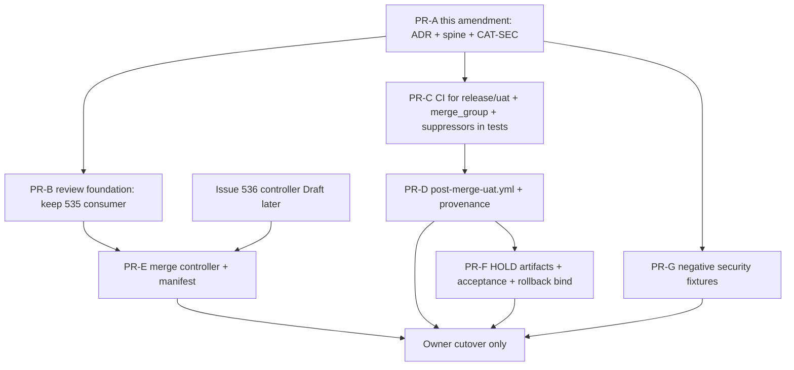

# Option B — dependency-ordered migration plan

**Authority:** Issue #538. **Not live cutover.**  
**Date:** 2026-11-02, Asia/Singapore  
**Base evidence:** PR #537 audit of `main` `22ffe635` and Deploy UAT #451.

Do not merge existing PRs. Do not set `UAT_DEPLOY_GATE_ACTIVE=true`. Do not create an unprotected deploy path. Do not change live protections or secrets from this agent.

## Dependency graph



PR-C may start in parallel with PR-B. PR-E must not start until AD-15/AD-16 reviews accept a token split. Issue #536 stays a separate Draft and must land before or with PR-E only as a *non-merging* producer.

## Draft PR boundaries

### PR-A — this amendment (PR #537 follow-up commit)

| | |
| --- | --- |
| Purpose | Record Issue #538, Option B spine, CAT-SEC addendum, this plan |
| Exclusive | `_bmad-output/planning-artifacts/architecture/architecture-option-b-release-uat-2026-11-02/**` plus a pointer on the historical audit |
| Must not | Change `.github/workflows/**`, `deploy/**`, secrets, #535, #536, #505 |

### PR-B — authentic review consumer alignment

| | |
| --- | --- |
| Purpose | Keep #535 as consumer. Retarget readiness evaluation to PRs against `release/uat` once that branch exists. No producer. |
| Exclusive | #535 files only (`uat-readiness.yml`, `deploy/lib/uat-readiness.py`, tests, docs) |
| Must not | Merge authority, `environment: uat`, `DROPLET_*`, #536 |
| Depends on | Owner Apps (later). Can draft path allowlists now. |

### PR-C — CI + first-merge suppression contracts

| | |
| --- | --- |
| Purpose | Add `release/uat` and `merge_group` to `ci.yml`. Add `UAT_MAIN_DEPLOY_SUPPRESSED` HOLD path in predeploy **without** retargeting `workflow_run.branches` yet. GG API scan on push to `release/uat`. |
| Exclusive | `ci.yml` (triggers + GG `if`), `deploy/validate-uat-predeploy-gate.sh`, `deploy/lib/uat-predeploy-gate.py`, `deploy/validate-deploy-uat-workflow.sh`, tests |
| Must not | Change `workflow_run.branches` away from `main`. Must not set gate true. Must not add `environment: uat` to CI. |
| Hazard control | `main` still triggers Deploy UAT; gate stays false so SSH cannot run. Suppression var is implemented but owner-unset, so behavior matches #451 until owner sets it. |

### PR-D — post-merge tests + deploy retarget (second code wave)

| | |
| --- | --- |
| Purpose | `post-merge-uat.yml` on `release/uat`. Bind predeploy to check-run `Post-merge UAT validation`. Retarget tip-pin to `origin/release/uat` **only after** AD-14 suppression is live. |
| Exclusive | new `post-merge-uat.yml`, `deploy.yml` retarget, `ORIGIN_UAT_REF=origin/release/uat` in predeploy/fetch scripts, provenance writer |
| Must not | Merge while `UAT_MAIN_DEPLOY_SUPPRESSED` is not `true` in production vars. Must not listen to both `main` and `release/uat`. |
| Gate | Owner sets suppression and drains (AD-21) before this PR is merged to `main`. |

### PR-E — scoped automatic merge

| | |
| --- | --- |
| Purpose | `cohestra-uat-merge` consumer + manifest path check. No UAT secrets. |
| Exclusive | new `uat-merge.yml`, `deploy/lib/uat-merge.py`, tests |
| Must not | `contents: write` on `main`. No Environment `uat`. No #536 files. No auto-merge of `.github/**` or `deploy/**`. |
| Depends on | Owner App install. Branch protection required checks. #536 must not share the App. |

### PR-F — HOLD artifacts, acceptance, rollback bind

| | |
| --- | --- |
| Purpose | Parent AD-8 conditional downloads. `accepted-uat-release.json`. Bind #532 rollback to `release/uat` SHA without claiming automatic rollback. |
| Exclusive | `deploy.yml` delivery-outcome, `uat-final-outcome.sh`, acceptance writer, #532 follow-up if needed |
| Must not | Combine with #535/#536. Must not enable automatic rollback. |

### PR-G — deterministic security tests

| | |
| --- | --- |
| Purpose | N1–N24 mocked. Including delayed `main` `workflow_run`, PR-modified workflow, merge-controller deny, skipped post-merge. |
| Exclusive | `deploy/*.test.sh` fixtures, `ci.yml` isolation contract additions |
| Must not | Live Deploy UAT dispatch. Live SSH. |

### PR-H — owner cutover (not a git PR)

See checklist below. GitHub UI only.

### Existing PRs — do not absorb

| PR / issue | Action |
| --- | --- |
| #537 | Amend with this folder. Keep Draft. |
| #535 | Consumer only. Keep Draft. |
| #536 | Separate controller Draft later. No merge token. |
| #532 | Rollback. Rebind SHA source in a follow-up, do not merge into C/D. |
| #533 | Acceptance. Keep separate. |
| #505 | Do not modify. |

## First-merge / queued-run hazard

Live today (`deploy.yml` on `main`):

```
on.workflow_run.branches: [main]
TARGET_SHA = workflow_run.head_sha or dispatch github.sha
tip-pin origin/main
UAT_DEPLOY_GATE_ACTIVE != true → HOLD, no Environment uat
```

Run #451 proved that HOLD path. The hazard is **not** today's false gate. The hazard is an unordered cutover:

1. Someone sets the gate `true` while `workflow_run` still listens to `main`.
2. `deploy.yml` is changed to listen to both branches.
3. A queued `main` run starts after the owner thinks cutover is done.
4. `release/uat` exists unprotected and Environment `uat` still allows every ref.

**Safe order (mandatory):**

1. Keep `UAT_DEPLOY_GATE_ACTIVE` unset/false.
2. Merge PR-C (suppression *code* exists; var still unset → same as #451).
3. Owner creates **protected** `release/uat` from agreed SHA (Q2: `22ffe635` unless `main` moved).
4. Owner sets Environment `uat` branch policy to `release/uat` only and `can_admins_bypass=false`.
5. Owner sets `UAT_MAIN_DEPLOY_SUPPRESSED=true`.
6. Owner lists Deploy UAT runs with status `queued|in_progress|waiting|requested` and waits until each is `completed` with artifacts `eligible=false` / `ssh_executed=false`.
7. Merge PR-D (retarget `workflow_run.branches` to `[release/uat]`, tip-pin `origin/release/uat`, refuse `main`).
8. Confirm a `main` push does **not** start Deploy UAT, and a delayed `main` `workflow_run` HOLDs.
9. Only then, after PR-G negatives and owner attestation, the owner may set `UAT_DEPLOY_GATE_ACTIVE=true`.

Do not cancel in-flight Deploy UAT jobs to “speed” the drain (`cancel-in-progress: false` is load-bearing). Wait for HOLD.

## Staged owner cutover checklist

Print as names only. This agent must not execute the checked GitHub admin steps.

- [ ] `UAT_DEPLOY_GATE_ACTIVE` is not `true`
- [ ] PR-A reviews: no unresolved BLOCKER/MAJOR
- [ ] PR-C merged; suppression unit tests green
- [ ] `release/uat` exists and is protected (required checks, no admin bypass)
- [ ] Environment `uat` allows only `release/uat`; `can_admins_bypass=false`
- [ ] `DROPLET_*` names present in Environment `uat` (values not in chat)
- [ ] `GITGUARDIAN_API_KEY` still repo scan-only
- [ ] Apps `cohestra-bmad`, `cohestra-cat-sec` installed (merge App later for PR-E)
- [ ] `UAT_MAIN_DEPLOY_SUPPRESSED=true`
- [ ] Zero in-flight Deploy UAT runs; last runs `ssh_executed=false`
- [ ] PR-D merged to `main` and fast-forwarded or merged into `release/uat`
- [ ] `main` CI completion does not start Deploy UAT
- [ ] Delayed `main` `workflow_run` HOLD evidence
- [ ] Post-merge required jobs cannot skip
- [ ] PR-G negatives `SIMULATED_PASS`
- [ ] Owner sets `UAT_DEPLOY_GATE_ACTIVE=true`
- [ ] First live deploy recorded as `LIVE_UAT_DEPLOY_VERIFIED` or HOLD with honest artifacts
- [ ] Production still dispatch-only; no `release/uat` → `main` automation

## Outstanding owner-only setup

1. Create and protect `release/uat`.
2. Restrict Environment `uat`.
3. Confirm secret **names**.
4. Install review Apps (and later merge App).
5. Set `UAT_READINESS_*` vars.
6. Set `UAT_MAIN_DEPLOY_SUPPRESSED` at the drain step only.
7. Audit `main` and `release/uat` required checks (API 403 here).
8. Never authorize SSH from this planning run.

## Evidence classes (never collapse)

| Class | Meaning |
| --- | --- |
| `SIMULATED_PASS` | Mocked N-tests green |
| `LIVE_READ_ONLY_VERIFIED` | Live HOLD / skip observed, no SSH |
| `LIVE_UAT_DEPLOY_VERIFIED` | Live SSH + acceptance on an approved SHA |
| `NOT_RUN` | Missing |

#451 is `LIVE_READ_ONLY_VERIFIED` for the **main** + gate-false path only.
