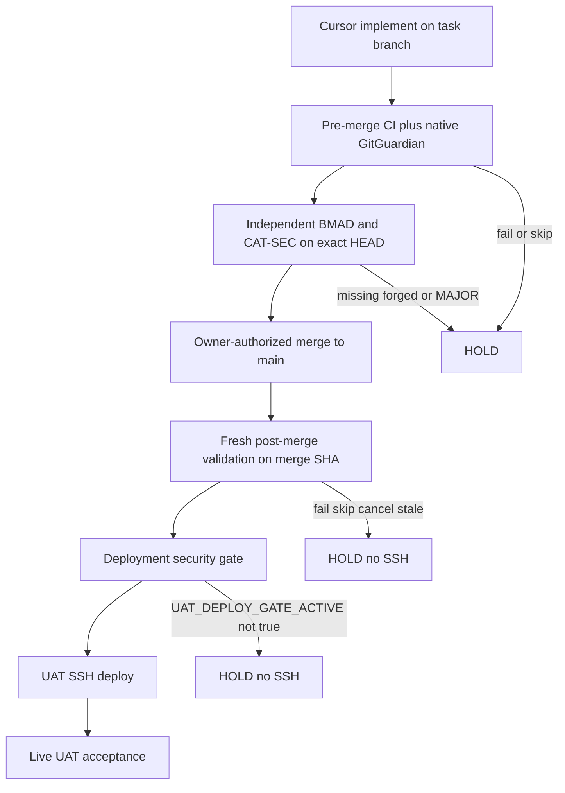
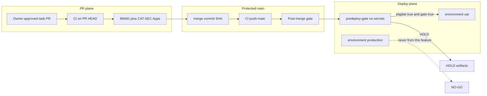

# Architecture Spine — Cohestra UAT Automation Readiness

Issue #538 accepted Option B as the target topology. This spine remains the 2026-11-01 audit contract. AD-1 stays live until cutover. Do not treat this file as the post-cutover deploy source. The Option B spine is `architecture-option-b-release-uat-2026-11-02/ARCHITECTURE-SPINE.md`.

## Design Paradigm

**Fail-closed gated pipeline.** Every promotion step is a separate plane with its own identity, evidence, and refusal path. Missing, skipped, stale, or forged evidence is HOLD or REFUSE. A previous PR HEAD is never sufficient for UAT SSH. Production is a different pipeline with different secrets and an owner dispatch.



## Inherited Invariants

| Inherited | From parent | Binds here |
| --- | --- | --- |
| Cursor is not an SSH client | Epic 45 AD-1 | Agents read Actions artifacts. No droplet key in Cursor. |
| Environment `uat` owns UAT deploy secrets; concurrency `deploy-uat`; Production workflow forbidden on this path | Epic 45 AD-2 | `DROPLET_*` stay Environment `uat`. Only Deploy UAT uses group `deploy-uat`. |
| Missing required secret names fail closed as `MISSING_SECRET=<NAME>` | Epic 45 AD-3 | Check names after `eligible=true` and before SSH. Never print values. |
| Evidence contains no secrets | Epic 45 AD-4 | Scrub artifacts. No `.env` dumps. |
| CI-on-main + `workflow_run.head_sha` + `remote-deploy.sh` is the on-host entrypoint | Epic 45 AD-5 | New post-merge gate is additional, not a replacement entrypoint. |
| UAT story close needs `acceptance-summary.json`; missing post-deploy evidence is FAIL | Epic 45 AD-8 | HOLD-before-SSH may omit that file; after SSH it is mandatory. |
| Shared-host UAT isolation | Epic 45 inherited | Compose project `cohestra-uat`; no CRM port or volume takeover. |
| Production cutover is owner-only | Epic 45 / Epic 46 | This feature never automates Production. |
| First-merge suppressor | `uat-gated-promotion.md` | `vars.UAT_DEPLOY_GATE_ACTIVE` must equal exact `true` or SSH is forbidden. |
| Reporter is not the controller | Issue #534 / #536 | PR #535 evaluates. Issue #536 executes corrections. |

## Invariants & Rules

### AD-1 — Main remains the only UAT deployable SHA

- **Binds:** Deploy UAT, post-merge gate, rollback
- **Prevents:** A dedicated integration branch silently becoming the deploy source while main-based gates still assume `origin/main` tip
- **Rule:** Until a separately accepted topology decision is merged, `candidate_sha` must be a commit, an ancestor of `origin/main`, and equal to the current `origin/main` tip. Do not create, retarget, or auto-merge a `uat` integration branch in this feature.

### AD-2 — First-merge suppressor is exact-string and HOLD-first

- **Binds:** `deploy.yml` predeploy and pre-SSH revalidation
- **Prevents:** Partial activation, truthy-but-not-`true` values, or git fetch before the suppressor is proven
- **Rule:** If `vars.UAT_DEPLOY_GATE_ACTIVE != "true"`, write HOLD evidence, set `eligible=false`, skip Environment `uat`, and do not fetch `origin/main` for tip-pin. Keep the variable false until the owner attests the owner-only residuals (Environment `uat` policy, secret names present, Apps installed). Unverified API 403 is not a PASS and is not a reason to flip the variable.

### AD-3 — Dual-review trust is identity-bound, not comment-bound

- **Binds:** PR #535 consumer, Issue #536 producer, merge readiness
- **Prevents:** Author self-attestation, `cursor[bot]` PASS, one App impersonating two roles, stale SHA reviews, PASS-with-BLOCKER
- **Rule:** App evidence is two check-runs named exactly `Cohestra BMAD` and `Cohestra CAT-SEC`, `conclusion=success`, `head_sha` equal to the PR HEAD, from two distinct Apps. Default slugs are `cohestra-bmad` and `cohestra-cat-sec`. If owner vars `UAT_READINESS_*_APP_SLUG` and `UAT_READINESS_*_APP_ID` are set, both slug and numeric id must match. Structured check-run output JSON must include `severity` with no `BLOCKER` or `MAJOR`. Human fallback is two GitHub PR reviews `APPROVED` from distinct non-author OWNER/MEMBER/COLLABORATOR accounts. Comments, PR body, labels, and check-run name spoofing are untrusted. Forbidden slugs: exact `github-actions`, `github`, `cursor`, `dependabot`, `gitguardian`, `renovate`, plus any slug starting with `cursor`. One App must not satisfy both roles.

### AD-4 — Reporter and controller stay in separate PRs

- **Binds:** PR #535, Issue #536
- **Prevents:** A read-only evaluator gaining dispatch, write, or privileged credentials
- **Rule:** #535 remains evaluation-only and Draft until owner merge. #536 is a later Draft PR. Do not combine consumer and producer. Do not claim the correction loop is operational without mocked plus separately authorized live evidence.

### AD-5 — Owner gates are not auto-merge

- **Binds:** Issue #536, branch protection, readiness states
- **Prevents:** Protected auto-merge from a READY comment or a controller token
- **Rule:** Terminal happy path is `READY_FOR_OWNER_MERGE_DECISION` then a separately authorized merge. Controller tokens must not have `contents: write` on `main`, must not approve their own PR, and must not change Environments, secrets, or `UAT_DEPLOY_GATE_ACTIVE`.

### AD-6 — Post-merge validation is a separate gate on the merge SHA

- **Binds:** New post-merge workflow, Deploy UAT predeploy
- **Prevents:** Treating pre-merge PR HEAD success as deploy eligibility
- **Rule:** Workflow file `.github/workflows/post-merge-uat.yml`, check-run name `Post-merge UAT validation`. Required job names: `.NET build and test`, `API integration tests`, `Next.js build`, `Frontend unit tests`, `AuthN AuthZ regression`, `Billing entitlement regression`, `Docker stack smoke`, `UAT isolation contract`, `Exact-SHA security scan`, `GitGuardian exact-SHA API scan`, `Deploy artifact provenance`. `deploy/lib/uat-predeploy-gate.py` must require that check-run SUCCESS on the candidate SHA when the suppressor is `true`. Existing `ci.yml` Layer A is not an alternate post-merge gate. Missing, failed, canceled, or skipped required jobs HOLD. No SSH before this gate and the suppressor both pass.

### AD-7 — Deploy artifact SHA must equal the approved merge SHA

- **Binds:** Image build, `remote-deploy.sh`, rollback
- **Prevents:** Stale images, rebuilt-from-later-tip, or host checkout drift
- **Rule:** On-host entrypoint remains `deploy/remote-deploy.sh`. SSH checks out the approved 40-hex SHA and deploys that tree. A later-tip or unpinned branch checkout is REFUSE. Registry digest attestation is out of scope until a new AD replaces this rule; do not ship a digest-only path in the first post-merge PR. Provenance job records `{merge_sha, git_tree, compose_config_hash}` and predeploy refuses a mismatch.

### AD-8 — Conditional artifacts must not lie

- **Binds:** `delivery-outcome` in `deploy.yml`
- **Prevents:** Expected HOLD skips annotated as errors, and missing post-deploy evidence treated as READY
- **Rule:** If eligibility is HOLD and SSH never started, omit downloads of deploy/Playwright/lifecycle/acceptance artifacts or treat them as expected-absent. If deploy or SSH started, those artifacts are mandatory; absence is FAIL. HOLD and FAIL never become READY.

### AD-9 — UAT credentials are environment-scoped and branch-restricted

- **Binds:** GitHub Environment `uat`, Deploy UAT SSH job
- **Prevents:** Fork PR, feature-branch, or unprotected workflow use of `DROPLET_*`
- **Rule:** `DROPLET_HOST`, `DROPLET_USER`, `DROPLET_SSH_KEY`, `DROPLET_DEPLOY_PATH` are Environment `uat` secrets only. Environment `uat` must require a `main` branch policy, `can_admins_bypass=false`, and no empty `protection_rules`. Jobs that reference `environment: uat` run only after `eligible=true`. Production uses `PROD_DROPLET_*` and Environment `production` only.

### AD-10 — Correction loop is manifest-gated and budgeted

- **Binds:** Issue #536 controller
- **Prevents:** Unbounded retries, duplicate agents, untrusted PR code with privileged tokens
- **Rule:** Start only from an owner-approved immutable manifest JSON: `task_id`, `pr_number`, `allowed_path_prefixes`, `base_sha`, `max_attempts` (default 3), `max_minutes` (default 180), `reviewer_app_slugs`. Persist state as a GitHub Actions artifact named `uat-correction-state` plus an issue comment marker that is evidence, not authorization. Lock key is `pr_number+head_sha+manifest_id` in that artifact; a duplicate event with the same key must not start a second agent. After every new HEAD, ignore older check-runs and require new exact-HEAD CI plus AD-3 reviews. Classify `RETRYABLE_SCOPED`, `WAITING_EXTERNAL`, or `HOLD_OWNER_ACTION_REQUIRED`. Exhaustion is `attempts >= max_attempts` or elapsed minutes `>= max_minutes`. Fail closed on 403, spoof, scope drift, budget exhaust, or PR #505. `pull_request_target` is forbidden. Mock contract `SIMULATED_PASS` is required before any live dispatcher.

### AD-11 — Rollback is implemented-or-not, never implied automatic

- **Binds:** PR #532, future rollback workflow
- **Prevents:** Claiming automatic rollback from a dry-run script or an unmerged PR
- **Rule:** Automatic rollback is unavailable until a merged workflow both implements and live-tests it. Current #532 is owner-dispatched, confirmation-phrased, default dry-run, and unmerged. Partial deploy recovery is HOLD plus owner-controlled rollback, not an implicit reverse SSH.

## Consistency Conventions

| Concern | Convention |
| --- | --- |
| Naming | Secret names stay `DROPLET_*` (UAT) and `PROD_DROPLET_*` (Production). Review apps default `cohestra-bmad` / `cohestra-cat-sec`. States are uppercase snake. |
| Evidence | JSON artifacts under `artifacts/`; no secret-like strings; SHA fields are 40-hex lowercase. |
| Verdicts | `PASS` / `HOLD` / `REFUSE` / `FAIL`. Config presence uses `VERIFIED` / `UNVERIFIED` / `FAIL`. Never invent PASS. |
| Triggers | Deploy UAT: `workflow_run` of CI on `main` or `workflow_dispatch`, then predeploy also requires check-run `Post-merge UAT validation`. Production: `workflow_dispatch` from `refs/heads/main` only. |
| Permissions | Read-only default (`contents/actions/checks: read`). Write and Environment access only on the job that already passed eligibility. |
| Isolation | UAT Compose `cohestra-uat`. Production Compose `cohestra-production`. No shared SSH key, host path, or secret name. |
| Concurrency | Only Deploy UAT uses group `deploy-uat` with `cancel-in-progress: false`. Post-merge uses `post-merge-uat-${{ github.sha }}`. Correction uses `uat-correction-${{ pr }}`. Neither may use `deploy-production`. |
| GitGuardian key | `GITGUARDIAN_API_KEY` is a scan-only repository secret, used on `push` to `main` only. Forbidden on Environment `uat`/`production`, reporter, and controller. |

## Stack

| Name | Version |
| --- | --- |
| .NET | 9.0 |
| Next.js | 16.3.6 |
| Node | 22 |
| PostgreSQL | 16 |
| GitHub Actions checkout | 4.4.0 pin `11d5960a326750d5838078e36cf38b85af677262` |
| GitHub Actions upload-artifact | 4.6.2 pin `ea165f8d65b6e75b540449e92b4886f43607fa02` |
| GitHub Actions download-artifact | 4.3.0 pin `d3f86a106a0bac45b974a628896c90dbdf5c8093` |
| appleboy/ssh-action | 1.2.2 pin `2ead5e36573f08b82fbfce1504f1a4b05a647c6f` |
| ggshield | 1.56.1 |

## Structural Seed

```text
.github/workflows/
  ci.yml                      # pre-merge and push-main jobs
  deploy.yml                  # Deploy UAT; SSH only after eligible
  deploy-production.yml       # owner dispatch; PROD_* only
  uat-readiness.yml           # PR #535 only; reporter; not on main
  post-merge-uat.yml          # proposed; not on main
  uat-correction.yml          # proposed Issue #536; not on main
deploy/
  validate-uat-predeploy-gate.sh
  lib/uat-predeploy-gate.py
  lib/uat-readiness.py        # PR #535 only
  uat-final-outcome.sh
```



## Capability → Architecture Map

| Capability / Area | Lives in | Governed by |
| --- | --- | --- |
| First-merge suppressor | `deploy.yml`, `validate-uat-predeploy-gate.sh` | AD-2 |
| Tip-pin and Layer A CI | `uat-predeploy-gate.py`, `production-github-provenance.py` | AD-1, inherited Epic 45 AD-5 |
| Dual-review consumer | PR #535 `uat-readiness.py` | AD-3, AD-4 |
| Dual-review producer / retry | Issue #536, not implemented | AD-3, AD-4, AD-10 |
| Post-merge mandatory tests | proposed `post-merge-uat.yml` | AD-6, AD-7 |
| HOLD artifact honesty | `deploy.yml` `delivery-outcome` | AD-8 |
| UAT SSH | `deploy.yml` job `deploy` | AD-2, AD-9 |
| Production deploy | `deploy-production.yml` | inherited Production owner-only |
| Rollback | PR #532 unmerged | AD-11 |

## Deferred

| Item | Why it can wait |
| --- | --- |
| Dedicated UAT integration branch | Would rewrite AD-1 and every tip-pin script. Separate architecture decision after this spine is accepted. |
| Live SSH connectivity proof | Requires owner authorization. This run must not start SSH. |
| Live Cursor dispatcher | Issue #536 requires mocked `SIMULATED_PASS` then a later `LIVE_SCOPED_LOOP_VERIFIED`. |
| Automatic rollback | Not implemented on main. #532 is owner-dispatched dry-run by default. |
| Production activation | Explicit NO-GO. |
| Secret-value inspection | Forbidden. Owner verifies names only. |
| GitHub branch-protection API details | This integration received 403. Owner residual. |

## Open questions

| ID | Question | Blocks |
| --- | --- | --- |
| Q1 | Are `DROPLET_*` present as Environment `uat` secrets, repo secrets, or both? | AD-9 verification |
| Q2 | What required status checks and review count are configured on `main`? API 403. | AD-5 |
| Q3 | Are `Cohestra BMAD` and `Cohestra CAT-SEC` Apps installed? No check-runs observed on `22ffe635`. | AD-3 |
| Q4 | After architecture acceptance, is merge authorization still owner-only, or a later ruleset + App approval policy? | AD-5 revision |

## Conflicts with prior decisions

A dedicated UAT integration branch would conflict with Epic 45 tip-pin (`candidate_sha == origin/main` tip). That conflict is Deferred, not overridden. Local ADs tighten inherited Epic 45 AD-2/AD-3/AD-4/AD-5/AD-8; they do not replace them.
