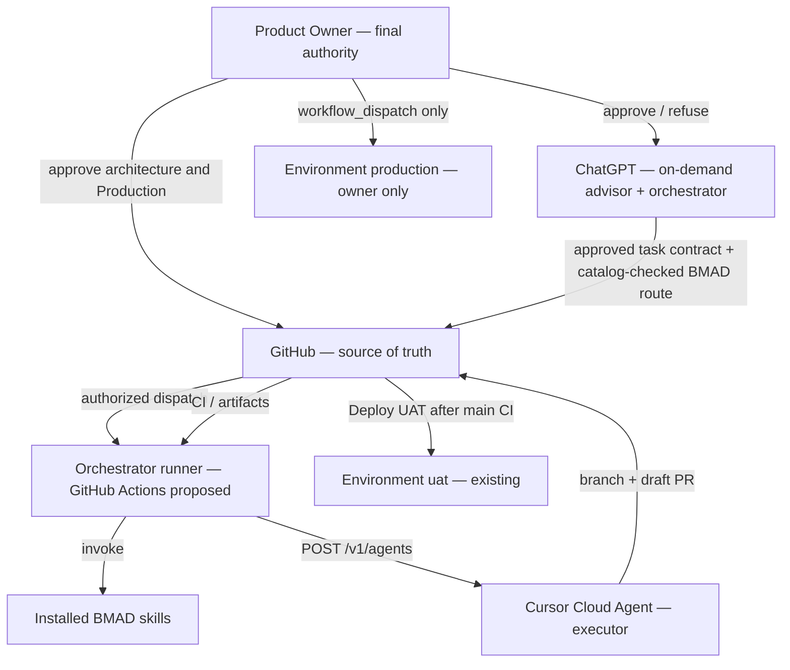

# Governance architecture

## Authority model



## Responsibility matrix

| Domain | Product Owner | ChatGPT | Cursor / BMAD | GitHub Actions |
| --- | --- | --- | --- | --- |
| Product strategy and functionality | **Decide** | Advise | Execute approved stories | Record |
| System / code / infra / security / data architecture | **Decide + ADR** | Propose alternatives + impact assessment | Halt if material; implement after approval | Protected paths **and semantic review**; fail closed |
| Significant technical decisions | **Decide** | Options + risks | No silent adoption | Audit |
| Routine story implementation | Authorize epic/story and boundaries | Author approved GitHub contracts, select catalog-verified BMAD route, coordinate evidence | Execute under Grok 4.6 | CI and durable state |
| Code review (BMAD) | Decides scope changes/critical exceptions | Inspect evidence and report | Cataloged `bmad-code-review` **with security criteria**, new review after every fix | Exact-HEAD CI/GitGuardian checks |
| UAT deploy | Already automated | Observe | No SSH | Existing `deploy.yml` |
| Production authorization | **Only** | Never | Never | `deploy-production.yml` after owner dispatch |
| Secrets creation | **Only** | Never | Never | Consume Environment secrets |
| Merge to main (UAT/non-prod) | Policy already approved | Advise | Allowed only if 14-point policy holds | N/A |
| Merge / deploy Production | **Only** | Never | Never | Dispatch-only |

## What is “material architecture”

Treat as material (halt) if the change would let two future stories diverge, or if it touches any of:

- `_bmad-output/planning-artifacts/architecture/**`
- this program folder `_bmad-output/planning-artifacts/autonomous-development-control-program-2026-10-25/**`
- `_bmad-output/planning-artifacts/autonomous-merge-policy.md`
- `_bmad-output/planning-artifacts/autonomous-delivery-loop.md`
- `_bmad/custom/**`
- `docker-compose.production.yml`, `docker-compose.uat.yml`
- `deploy/production-*.sh`, `deploy/validate-production-*.sh`, `deploy/validate-uat-*.sh`, `deploy/remote-deploy.sh`, `deploy/uat-*.sh`
- `.github/workflows/**` (including `ci.yml`, `deploy.yml`, `deploy-production.yml`, and any future ADCP dispatcher)
- provenance scripts and `ProductionSecurityValidator`, tenant filters, recaptcha/CORS/JWT/Paddle guards
- GitHub Environment names, required reviewers, or secret classes
- New external vendors, new always-on services, new public ports

Halt is evaluated at **dispatch** (story/changed-path preview) **and again on the exact PR HEAD diff** before milestone completion or merge consideration. **File paths are only the minimum safeguard.** A semantic impact review must also detect material changes to API contracts, tenancy, auth, database schemas, billing, privileges, infrastructure, observability data exposure, and software/system design anywhere in the tree. If the detector or reviewer is unavailable, uncertain, or disagrees with the approved story contract, stop at OWNER_GATE. An executor that adds Production or workflow files after launch still stops.

Routine story UI/API work inside an approved contract is **not** material unless it expands privilege or weakens a gate.

## Required path for material decisions

1. ChatGPT (or the executing agent) writes an impact assessment (template in milestone reports).
2. Product Owner participates (comment, review, or recorded decision).
3. Explicit approval: `OWNER_APPROVE ADR-<id>` (or equivalent recorded phrase).
4. ADR appended to the program spine or a dated ADR file. Status `[ADOPTED]` only after that phrase exists.
5. Implementation may resume on a new HEAD. Prior review is invalid.

## ChatGPT role limits

Inherited Epic 45 AD-12 remains binding: **Grok 4.6 owns architecture, security, CI/CD, and BMAD review signoff.** ChatGPT does not replace that.

**Proposed owner-approved role clarification:** ChatGPT may author task instructions directly in GitHub, choose **catalog-verified** BMAD workflows for already-approved stories, assess PR/CI/security evidence, post technical reviews, coordinate follow-ups when actively invoked and prepare architecture alternatives and risk assessments for the Product Owner. It is **not** the mandatory Grok 4.6 reviewer and may not amend Epic 45 AD-12 without an owner-approved ADR. A standing OpenAI API adviser is a **separate, not-yet-approved design**.

Forbidden: adopting ADRs; claiming Production GO; inventing BMAD skills; storing secrets; instructing Cursor to bypass review; representing ChatGPT feedback as Grok 4.6 review signoff; acting as a continuously running daemon; autonomously deploying Production; approving material design decisions. Existing specific UAT merge policy remains separate; this program grants no new blanket merge authority.

## Cursor / BMAD role limits

Allowed: `bmad-dev-story` / `bmad-quick-dev` inside an approved story; tests; draft PRs; BMAD code review; UAT-path merge when policy holds.

Forbidden: Production dispatch; creating Environments or secrets; editing GitHub protection; weakening fail-closed validators; closing source PRs the owner asked to keep open.

## Audit trail

Minimum record for each dispatched run:

- GitHub issue or PR number that authorized the run
- `github.actor` of the human who labeled, commented, or dispatched
- Orchestrator workflow run URL
- Cursor agent id and run id
- Cursor model ID explicitly requested and availability evidence (Grok 4.6 / `GET /v1/models`); actual runtime usage independently attested or marked unknown
- Immutable task/dispatch idempotency key and retry/cost budget
- Branch and HEAD SHA produced
- CI check-run conclusions (including GitGuardian)
- Follow-ups, steers, and cancels
- Owner decision id if any gate fired

Dispatch is refused unless `github.actor` is on an owner-maintained allowlist. Agents and bots cannot authorize a new run by labeling or commenting. The dispatcher workflow must ignore events it created.

## Least-privilege dispatch job (proposed, D3=A)

Quoted by `07-implementation-proposal.md` and ADCP-P2. Modeled on `deploy-production.yml` workflow-level default-deny.

```yaml
permissions: {}   # workflow default-deny
# job may grant only:
#   contents: read
#   issues: write
#   pull-requests: write
#   actions: read
# forbidden: id-token:write, actions:write, contents:write on main,
#            environment: production, environment: uat
```

Secret **name** allowlist the job may reference: `CURSOR_API_KEY` and optional ChatGPT key. YAML may name those secrets; it must never contain values.

Creating Environment `adcp` without required reviewers is privilege expansion (D4 + D12). Before **any** key-backed live dispatcher, protect `main` and policy/workflow-sensitive changes (D10) and inventory repo/org secret scopes. A same-repo `pull_request` workflow that adds `environment: adcp` after a key exists is in the blast radius; `ci.yml` must not request that Environment. GitHub's optional **prevent-self-review** can prohibit the sole owner from releasing a job they themselves initiated; The **single-owner** model has no second reviewer, so D4 proposes the Product Owner as the sole required `adcp` reviewer with **prevent-self-review disabled for `adcp` only**, subject to explicit owner signoff. This is an owner confirmation gate **not an independent human review**; keep `production` settings untouched and document the weaker separation-of-duties boundary.

## Execution and privileged-operation policy (PROPOSED)

- `workflow_dispatch` by a GitHub allowlisted human is the **only** pilot trigger. Issue/PR comments and bot events are NOT launch authorization until D11 authorizes and tests their ACL.
- Agent work stays on an isolated draft branch; model ID must be explicitly pinned after authenticated inventory; avoid any fallback, including child/review agents.
- The credential-bearing dispatcher must not use unreviewed PR code, expose Cursor credentials to agents through environment or MCP configuration, or consume `production`/`uat` Environments.
- New privilege scopes, control workflows, secrets, branch/ruleset settings, service accounts, OpenAI API data egress, and semantic architecture changes require owner approval.
- Repo main remains unprotected at the 2026-10-25 baseline; this is a **blocking prerequisite for live credential-backed dispatch**, not deferred pilot debt.
- Existing UAT auto-deploy on main is a potential side effect of merging; the **first pilot cannot merge**. A merge is never Production authorization.

## Permanent single-owner operating model (PROPOSED, 2026-10-25)

The Product Owner has confirmed there are **no human collaborators and none are planned**. No Cohestra workflow may depend on a second human GitHub identity, team, code owner, approval or administrator. Independent **engineering** validation can come from separate Grok 4.6 BMAD review agents and externally generated CI/security checks, but must not be misrepresented as independent human review or a hard credential security boundary.

### Pull requests / main

- Protect `main` with required pull requests, exact-HEAD CI/security check policies, blocked forced pushes/deletions and controlled changes to privileged paths. Preserve any Production two-parent merge-history requirement; do not enable linear-only/squash-only enforcement that invalidates it.
- **Do not require a human GitHub PR approving review** when only one person can author/approve. GitHub authors cannot approve their own PRs. Record separate BMAD Grok 4.6 review **evidence**, code tests, CI checks and Product Owner risk acceptance where material. For an agent-authored PR the owner may review manually, but absence of another human must not deadlock the entire workflow.
- Protect `.github/workflows/**`, security policy/architecture and secrets-affecting changes through mandatory owner design gates and reviewable diffs, not by silently changing the branch strategy. This requires owner signoff on actual ruleset/branch-protection settings.
- **Identity caveat:** GitHub comments written by ChatGPT using the owner's connected token may appear to be authored by the owner. Such comments are **not** evidence of explicit human owner approval. A privileged/architecture gate must require a verified owner action or separately documented owner-attested decision in the actual conversation, not arbitrary GitHub comment text.

### ADCP Environment / pilot

- Proposed `adcp` Environment: Product Owner as the *only* required deployment reviewer; **Prevent self-review = OFF only for `adcp`** so the person who initiates the pilot can approve it. Approval is an explicit confirmation, not a two-person review. Do not modify Environment `production` or claim equal separation of duties.
- A required reviewer must approve each Environment-gated job. Therefore this `adcp` configuration supports the **owner-started pilot** but **not unattended execution of every routine task**.
- Credential-backed pilot is prohibited until `main`/workflow boundary is hardened, sole-reviewer mechanics are tested, the exact Grok 4.6 model ID is authenticated, secret scopes are inventoried, and the owner approves D4/D5/D10/D12.
- The later unattended P5 must separately design an **owner-approved non-interactive, least-privilege execution boundary** with no routine per-job human approval (for example, an isolated execution Environment or short-lived brokered credentials). It may dispatch **only pre-approved low-risk tasks**. Architecture, access/permission expansion, secret changes, deployment and Production continue to require explicit owner confirmation.
- Remaining risks of a permanently single-owner team: no independent human audit or recovery authority, compromised owner account, same-person deployment approval, automated reviewer blind spots. Mitigate with phishing-resistant MFA/passkeys or hardware keys where available, scoped app identities, complete audit logs, independently checked CI/GitGuardian, protected critical GitHub workflows, rotation/revocation, offsite credential recovery, and explicit NO-GO on unknown risks. No claim of zero possible risk.

## CAT-SEC: mandatory iterative code and security review (methodology approved 2026-10-25)

- **Only the installed `bmad-code-review` workflow** performs the mandatory Grok 4.6 code-review/security review, using the explicit checklists in `14-code-review-security-loop.md`. Do not claim an absent `bmad-security-review` skill exists, and do not substitute a model-unverified Cursor helper's `security-review` for approved Grok.
- For an authorized story, repeat `IMPLEMENT → TEST → bmad-code-review (security lens) → inspect findings → FIX → TEST → RE-REVIEW`. Every change invalidates prior review/CI evidence for the new HEAD. A review reporting BLOCKER/MAJOR, missing tests, failed security check or unverified actual model usage is **not** PASS.
- Each run has an explicit maximum of **three fix/review iterations**; after that, escalate with evidence, not blanket failure acceptance or endless retries. Owner may approve a new limited budget after seeing exact remaining findings.
- Reviewer/executor must remain Grok 4.6 in fact, not merely prompt request; existing D17 model-provenance hard blocker remains. No CODE/BMAD runtime review in D18-A was performed.
- Material API/data/tenancy/security/infrastructure/privilege/billing/Production decisions discovered during a fix are **immediate owner gates**, not grounds for an agent to change architecture autonomously.
- Completion/merge may be considered only under the separate approved Epic 45 14-point non-production merge policy; this CAT-SEC methodology grants **no** new merge authority.
