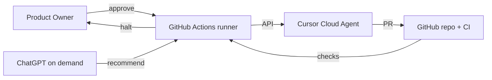
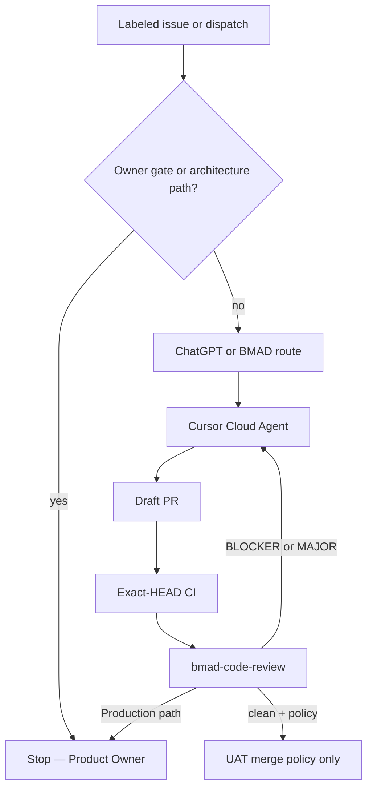

# Architecture Spine — Autonomous Development Control Program

## Design Paradigm

**Four-role control plane.** Product Owner decides. ChatGPT advises. Cursor Cloud Agents execute in git worktrees. GitHub is the only source of truth and the only approved runner for the pilot.



## Inherited Invariants

| Inherited | From parent | Binds here |
| --- | --- | --- |
| Cursor is not an SSH client | Epic 45 AD-1 | Dispatch never needs a droplet key in Cursor |
| Environment-scoped secrets | Epic 45 AD-2 | Control-plane keys must not share `uat` or `production` |
| Fail closed on missing secret names | Epic 45 AD-3 | Orchestrator prints `MISSING_SECRET=<NAME>` only |
| Evidence never contains secrets | Epic 45 AD-4 | Milestone reports are names/SHAs/URLs |
| Stop only at real owner gates | Epic 45 AD-9 | Timeouts and test failures are not owner gates |
| Grok 4.6 owns control-plane decisions | Epic 45 AD-12 | Composer 2.5 remains light-only; Auto disabled |
| Autonomous merge is UAT/non-prod | merge policy 2026-10-15 | Production merge/dispatch stays owner-only |
| Two-parent Production provenance | Epic 46 AD-7 | This program must not squash Production-bound history |
| Dedicated Production plane | Epic 46 | Orchestrator must not compose-up or write Production `.env` |

## Invariants & Rules

### AD-1 — Product Owner is the only architecture and Production authority [PROPOSED]

- **Binds:** FR-1, FR-4, all material ADRs
- **Prevents:** ChatGPT or Cursor adopting architecture by merge
- **Rule:** `[ADOPTED]` on an ADCP ADR requires a recorded Product Owner approval. Production `workflow_dispatch` remains a human action on `main`.

### AD-2 — ChatGPT is on-demand and non-authoritative [PROPOSED]

- **Binds:** FR-2, FR-13
- **Prevents:** Treating a ChatGPT session as a 24/7 control plane, as Production GO, or as a substitute for Grok 4.6 review
- **Rule (proposed clarification subject to owner AD-12 reconciliation):** ChatGPT runs only when invoked by a human or an expressly approved API worker. During human-invoked sessions it may create approved GitHub task contracts, **select catalog-validated BMAD workflows**, review PR/CI evidence and coordinate feedback. It is not the mandatory Grok 4.6 engineering reviewer, cannot silently adopt an ADR, and is not an always-on service. Any future OpenAI API advisor is a separate owner-gated credential/data-processing decision.

### AD-3 — Cursor Cloud Agents are executors, not the orchestrator [PROPOSED]

- **Binds:** FR-12
- **Prevents:** Agents launching unbounded child agents without a budget
- **Rule:** One executor per task in the pilot; task IDs and branch occupancy are idempotent and fail closed on duplicate run. No `workOnCurrentBranch` on `main`. Grok 4.6 exact model ID must be verified through authenticated `GET /v1/models` then explicitly pinned for every engineering run, including review agents; unsupported/default/Auto => REFUSE. Follow-up/steer model inheritance and child-agent/helper model behavior must be authenticated or those paths disabled; the v1 steer API cannot accept an explicit `model` field. **Confirmed capability risk:** Cursor's Cloud Agents release notes say coordinators can switch worker models, and staff acknowledge helpers may use nonselected models. Pinning `POST /v1/agents.model.id` therefore does **not** attest Grok 4.6-only execution. Require provider-verifiable per-run model provenance or demonstrable prohibition of all non-Grok helper paths; if unavailable, fail closed and do not claim compliance. Executors open draft PRs; no pilot merge/Production dispatch. The API client must never forward its own or host credentials in `envVars`, prompts, MCP headers/env or agent secrets, and must pin `repos[]` to `fad16papa/Cohestra`.

### AD-4 — GitHub-native orchestration is the pilot runner [PROPOSED]

- **Binds:** FR-9, NFR-4
- **Prevents:** An unapproved always-on orchestrator host
- **Rule:** Option A (GitHub Actions + Cursor Cloud Agents API) is the **owner-selected pilot direction**, not yet an adopted ADR or deployed workflow. Only implement it after the amended ADCP architecture is explicitly adopted; dedicated orchestrator and event-driven advisor API are separately owner-gated.

### AD-5 — Control-plane secrets are a new Environment class [PROPOSED]

- **Binds:** FR-16, FR-19
- **Prevents:** Mixing Cursor/ChatGPT keys with UAT deploy keys or Production host secrets
- **Rule:** Proposed Environment name `adcp`, isolated from `production` and `uat`. Before creating any key-backed runner, owner must approve main/workflow protection, inventory repo/org secret scopes, approve the Environment name/branch restrictions and required reviewer identities (including a self-review deadlock test), and authorize a dedicated Cursor service-account key. No personal owner, UAT or Production credentials are forwarded. This planning PR creates nothing privileged.

### AD-6 — Architecture-path changes halt [PROPOSED]

- **Binds:** FR-4, FR-15
- **Prevents:** Silent edits to spines, Production compose, provenance, security validators, UAT deploy, or the dispatcher itself
- **Rule:** The path set in `04-governance.md` is a minimum enforced at dispatch and on the final PR HEAD. Mandatory **semantic review** compares actual API/data/tenancy/auth/security/billing/service-boundary and software-design changes with the owner-approved story contract even outside protected paths. Material or uncertain changes halt with `OWNER_GATE=architecture` until impact assessment and owner-approved ADR.

### AD-7 — Loops terminate [PROPOSED]

- **Binds:** FR-14
- **Prevents:** Infinite review-fix or self-dispatch
- **Rule:** Each task has a documented retry budget and wall-clock timeout covering agent runtime **and** waiting for CI. On expiry the runner cancels the Cursor run, does not treat timed-out CI as SUCCESS, leaves the draft PR, and escalates. Workflow events created by the dispatcher cannot start a new dispatch. Only allowlisted human actors may authorize a run.

### AD-8 — Evidence is check-runs and artifacts, not chat [PROPOSED]

- **Binds:** FR-11, FR-20, FR-21
- **Prevents:** Milestone complete on agent-reported PASS
- **Rule:** CI, GitGuardian, and contract scripts are evidence only when a URL or logged conclusion is attached. Agent prose without that is a claim.

### AD-9 — BMAD skill names are closed-set [PROPOSED]

- **Binds:** FR-5
- **Prevents:** Invented workflow names
- **Rule:** Routing may only name skills listed in `_bmad/_config/bmad-help.csv` **union** `_bmad/custom/*.toml`. Names present only under `.agents/skills/` and absent from that union are refused.

### AD-10 — This program must not mutate Epic 46 [PROPOSED]

- **Binds:** FR-8
- **Prevents:** Control-plane work rewriting Production launch stories
- **Rule:** Implementation stories for this program use a new epic number the owner assigns. They must not edit `46-*` story files or the Epic 46 spine except by a later owner-approved correct-course.



## Consistency Conventions

| Concern | Convention |
| --- | --- |
| Branches | `cursor/<slug>-<id>` |
| PRs | Draft until the task's milestone report exists |
| Reports | Ten-section template; Evidence vs Claim labels |
| Secret output | Names only; `MISSING_SECRET=<NAME>` |
| Models | Grok 4.6 REQUIRED for planning, execution, testing, security, CI/CD and review; Cursor API `model.id` must be verified and explicitly pinned, no fallback |
| Dates | ISO date; times in Asia/Singapore when reporting to the owner |

## Stack

| Name | Version |
| --- | --- |
| Cursor Cloud Agents API | v1 public beta (docs 2026-10-25) |
| GitHub Actions | existing `actions/checkout@v4` pin style in repo |
| BMAD Method catalog | 6.9.0 (`_bmad/bmm/config.yaml`) |
| .NET / Next runtime | unchanged (.NET 9 / Next 16) — out of this spine |

## Structural Seed

```text
.github/workflows/          # later: adcp-dispatch.yml only after owner approval
_bmad/custom/               # existing methodology overrides — do not bypass
_bmad-output/planning-artifacts/autonomous-development-control-program-2026-10-25/
  architecture/ARCHITECTURE-SPINE.md
deploy/                     # no Production compose changes in this program
```

## Capability → Architecture Map

| Capability | Lives in | Governed by |
| --- | --- | --- |
| Authority lock | governance + ADRs | AD-1, AD-6 |
| BMAD routing | orchestrator + installed skills | AD-9 |
| Dispatch | GitHub Actions + Cloud Agents API | AD-3, AD-4, AD-7 |
| Secrets | proposed Environment `adcp` | AD-5 |
| Milestone evidence | issue/PR comments + Actions logs | AD-8 |
| Isolation from Production launch | separate epic | AD-10 |

## Deferred

- Dedicated orchestrator service (Option B) until Actions limits or ChatGPT-state require it
- Cursor API v1 webhooks until generally available and owner-approved
- ChatGPT vendor/account selection (OpenAI API vs human session)
- Exact Environment name and required reviewers for `adcp` (D4)
- Epic number assignment (proposed 47; D2)
- Authenticated availability and exact Cursor Cloud Agent `model.id` for Grok 4.6 (model policy itself already required; availability unverified)
- Exact `main` ruleset / required reviewer implementation (now a blocking safeguard for credential-backed ADCP runner; requires owner approval and UAT/Production compatibility review)

## Amendment proposal relationship

As of 2026-10-25, **AD-1..AD-10 remain [PROPOSED]**. Owner selected detailed planning of Option A but did not adopt these ADRs. The companion `../10-architecture-amendment-proposal.md` and `../09-owner-decision-register.md` are required reading before any adoption, implementation, credential use or dispatch. A successful owner-started pilot and a fully event-driven ChatGPT-guided engineering loop are distinct milestones.

## Review-start circular dependency (PROPOSED)

Independent current-HEAD Grok review is required before owner ADCP architecture adoption. A secure fully automated Grok reviewer would itself require an owner-approved ADCP runner, protected main, secrets and provider model integrity verification. This cannot be satisfied by simply posting `@cursor` in GitHub or by assuming a selected Cloud Agent parent model governs helpers. A one-time **owner-initiated review-only bootstrap** is a separate option that uses the prewritten GitHub review task without authorizing merge, Production, GitHub settings or credentials. Even this option must **fail closed** if Grok-only child/helper model evidence is unavailable. Details: `../13-review-bootstrap-model-integrity.md`.
