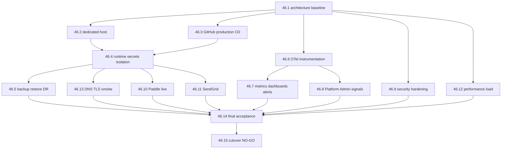

# Story dependency graph

## Hard arrows

| From | To | Why |
| --- | --- | --- |
| 46.1 | 46.2 | Host follows the compose/network contract |
| 46.1 | 46.3 | CD references compose names and SHA contract |
| 46.1 | 46.6 | Instrumentation targets known process boundaries |
| 46.2 + 46.3 | 46.4 | Host + environment needed to isolate runtime config |
| 46.4 | 46.5 | Cannot backup a database that is not specified |
| 46.6 | 46.7 / 46.8 | Dashboards and Platform Admin need signals |
| 46.4 | 46.10 / 46.11 | Live providers need Production config home |
| 46.13 | 46.14 | Edge smoke is an acceptance input |
| 46.14 | 46.15 | Cutover is forbidden before the matrix |

## Soft arrows

46.9 can proceed in repo (headers, tests, recaptcha verifier assertions) in parallel with 46.2; host-specific SSH/firewall evidence waits on 46.2.

46.10 webhook URL for live Paddle prefers 46.13 DNS but can use a dark-host URL for configuration rehearsal without charges.

46.12 load tests can use local Production-like compose after 46.1; they must not hit customer DNS.

## Owner gates on the graph

- 46.2: droplet purchase
- 46.3: populate production secrets (workflow code itself is not a gate)
- 46.5: OPTION B purchase if selected
- 46.7: paid observability if selected
- 46.10: live Paddle credentials and any real charge
- 46.11: Production email DNS records if externally controlled
- 46.13: Production DNS/TLS when public
- 46.15: `PRODUCTION CUTOVER: AUTHORIZED`
